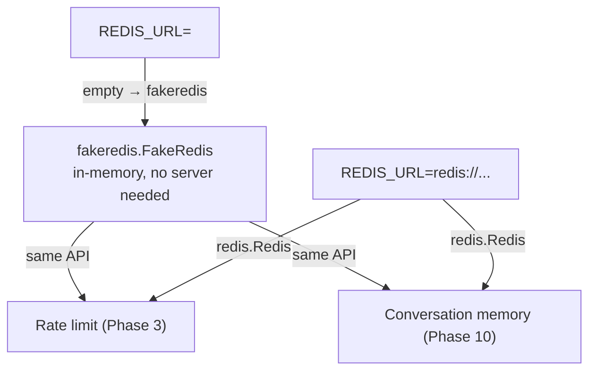
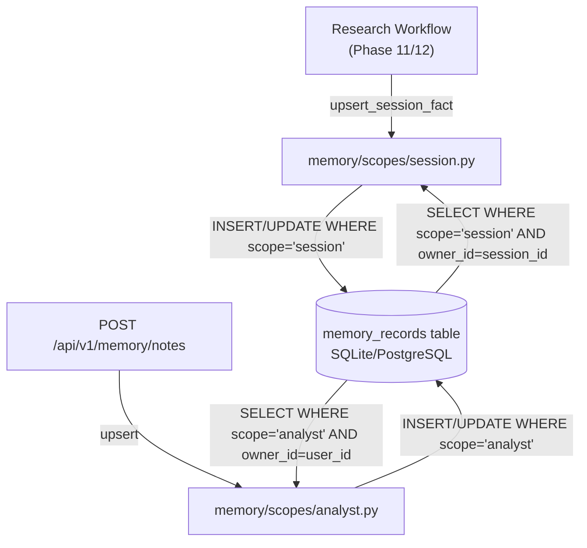
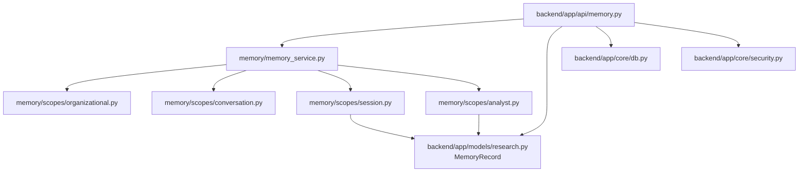
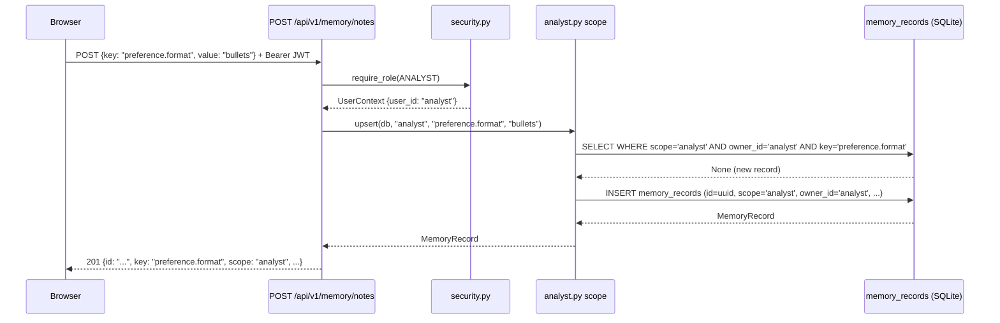
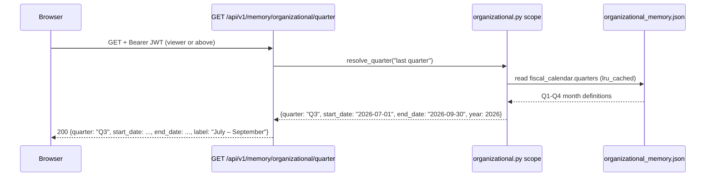

# Phase 10 — Memory: Infrastructure and Component Wiring

## Overview

Phase 10 adds the memory layer. From an infrastructure perspective, it introduces two new types of data flow:

1. **Redis** (or `fakeredis`) is now used not just for rate limiting (Phase 3) but also for **conversation memory**.
2. The **`memory_records` table** in SQLite/PostgreSQL (which was created in Phase 2 but unused) is now actively read and written by the memory service.

No new services are added. The memory layer wires into existing components.

---

## Component map after Phase 10

```mermaid
graph TD
    subgraph Client
        Browser["Browser<br/>Next.js :3001<br/>(Phase 13)"]
    end

    subgraph Backend [FastAPI :8001]
        Main["main.py<br/>+ memory_router"]
        MemAPI["api/memory.py<br/>GET /organizational<br/>GET /organizational/quarter<br/>GET/POST/DELETE /notes"]
        MemService["memory/memory_service.py"]
        OrgScope["memory/scopes/organizational.py"]
        ConvScope["memory/scopes/conversation.py"]
        SessScope["memory/scopes/session.py"]
        AnaScope["memory/scopes/analyst.py"]
    end

    subgraph Storage
        OrgFile["sample_data/<br/>organizational_memory.json<br/>(read-only)"]
        Redis[(Redis / fakeredis<br/>conv:{session_id} lists)]
        SQLite[(SQLite / PostgreSQL<br/>memory_records table)]
    end

    Browser -->|JWT| Main
    Main --> MemAPI
    MemAPI --> MemService
    MemService --> OrgScope --> OrgFile
    MemService --> ConvScope --> Redis
    MemService --> SessScope --> SQLite
    MemService --> AnaScope --> SQLite
```

---

## Redis wiring for conversation memory

Redis was introduced in Phase 3 for rate limiting. Phase 10 reuses the same `get_redis_client()` function for conversation memory, adding a second usage pattern.

```mermaid
graph LR
    App["FastAPI backend"] -->|get_redis_client()| RedisClient["redis.Redis or<br/>fakeredis.FakeRedis"]

    RedisClient -->|RPUSH conv:sess-X turn| ConvList["Redis list<br/>key: conv:{session_id}"]
    RedisClient -->|LRANGE conv:sess-X 0 -1| ConvList
    RedisClient -->|EXPIRE conv:sess-X 86400| ConvList

    RedisClient -->|INCR + EXPIRE| RateLimit["rate_limit:{ip}<br/>(Phase 3)"]

    style ConvList fill:#ef9a9a
    style RateLimit fill:#ef9a9a
```

**Key naming**:
- Rate limit: `rate_limit:{client_ip}` — integer counter, TTL 60s
- Conversation: `conv:{session_id}` — JSON list, TTL 86400s (24h)

There is no collision between these key namespaces.

---

## Fakeredis for offline development

When `REDIS_URL` is empty (the default in `.env.example`), both rate limiting and conversation memory fall back to `fakeredis.FakeRedis`:



This means `make test` and `make demo` require **zero external services** — a core constraint of the project (N1).

---

## Database wiring for session and analyst memory

The `memory_records` table was defined in Phase 2 as part of `MemoryRecord` (in `backend/app/models/research.py`). Phase 10 is the first phase to actually write to it.



The `scope` and `owner_id` columns act as the namespace. A single `SELECT` query with these filters is all that's needed to isolate one analyst's notes from another's.

---

## Import and dependency wiring

The memory package lives in `memory/` at the repo root (the same level as `backend/`, `rag/`, `agents/`). It follows the same PYTHONPATH convention: `PYTHONPATH=backend;.`



The `memory/` package imports from `app.models` (via PYTHONPATH) but **never from `app.api` or `app.services`** — keeping the layering rule: memory is a leaf layer alongside `rag/` and `agents/`.

---

## Request flow: analyst adds a personal note



---

## Request flow: organizational quarter resolution



The JSON is loaded once at first call and cached for the lifetime of the process — no disk reads after startup.

---

## Production infrastructure note

| Component | Dev / test (default) | Production option |
|---|---|---|
| Conversation memory | `fakeredis` in-process | Redis or Redis Cluster |
| Session + analyst memory | SQLite `memory_records` | PostgreSQL `memory_records` |
| Organizational memory | JSON file on disk | Same (it's static config) |

No environment variable changes are needed to switch — `REDIS_URL` and `DATABASE_URL` already control the backing stores from Phase 2 and Phase 3.
