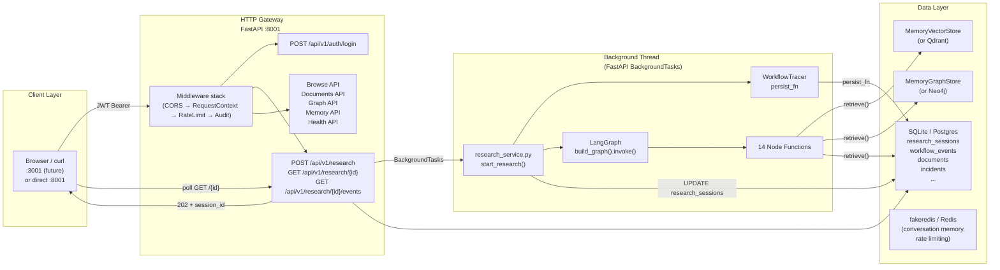
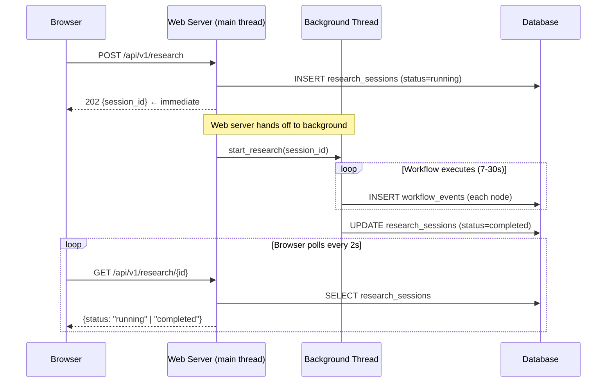
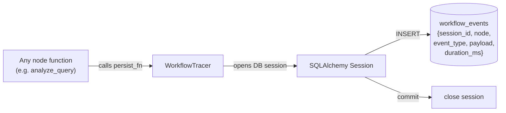
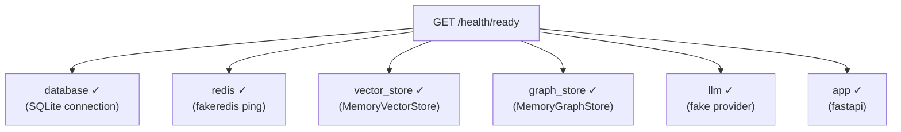
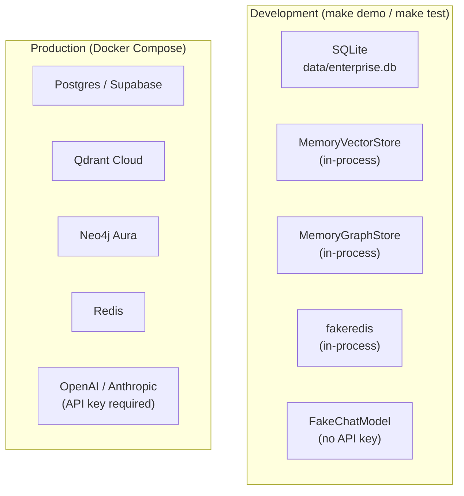
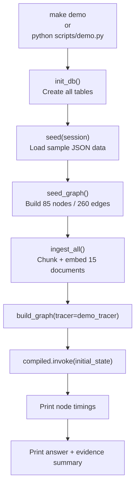

# Phase 12 — Infrastructure and Component Wiring Design Evolution

## Overview

Phase 12 is the first phase where the entire system becomes a runnable application. All components built in earlier phases are now wired together and exposed over HTTP.

---

## Component Map After Phase 12

---

## Request Threading Model

One of Phase 12's most important design decisions is **how long work is handled without blocking the web server**.

**Why this matters for infrastructure:** The web server thread is never blocked waiting for AI. This means:
- One web server process can handle many concurrent research requests
- Each research run uses a separate background thread
- In production, this would be replaced with a proper worker queue (Celery, Redis Queue, or LangGraph's checkpoint-postgres)

---

## Database Write Pattern After Phase 12

Each node in the workflow writes to the database via the tracer:

**One session per event** — the tracer opens and closes a database session for each node. This avoids holding a long-lived session across the entire workflow run, which would cause locking issues under SQLite.

---

## Health Check Coverage After Phase 12

All five store types are checked on startup. If any store is `degraded` (e.g., Neo4j is down), the system still starts but reports `degraded` on the health endpoint. The workflow continues — a failed store records an error on the sub-question instead of crashing.

---

## Development vs Production Wiring

The same application code runs in both environments. Only environment variables change (`DATABASE_URL`, `VECTOR_STORE`, `GRAPH_STORE`, `LLM_PROVIDER`). The interfaces (protocols) ensure no code changes are needed to switch from development to production stores.

---

## make demo Flow

This replicates the full startup sequence that `main.py` lifespan runs in production — confirming the entire system works offline in under 10 seconds.
