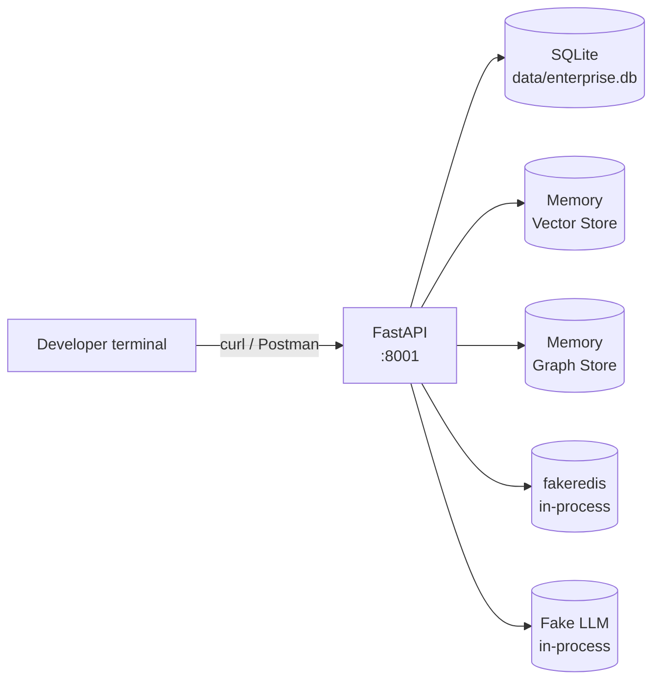
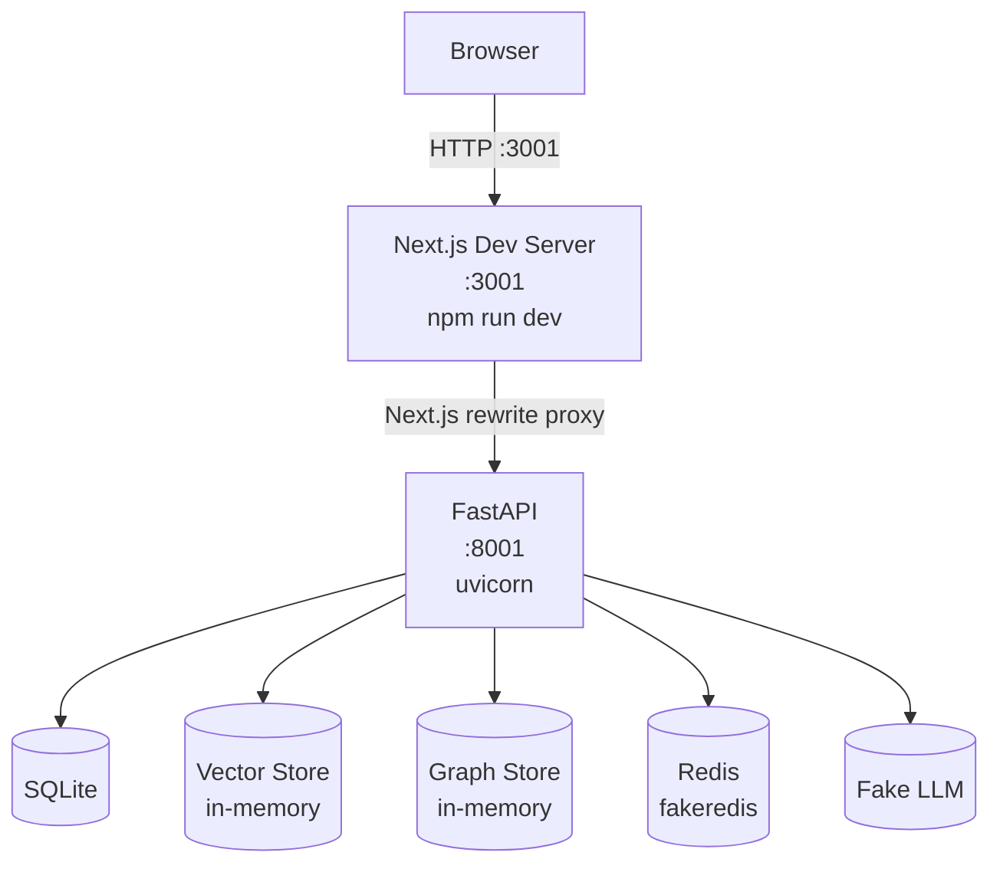
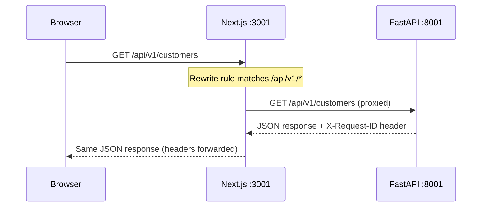
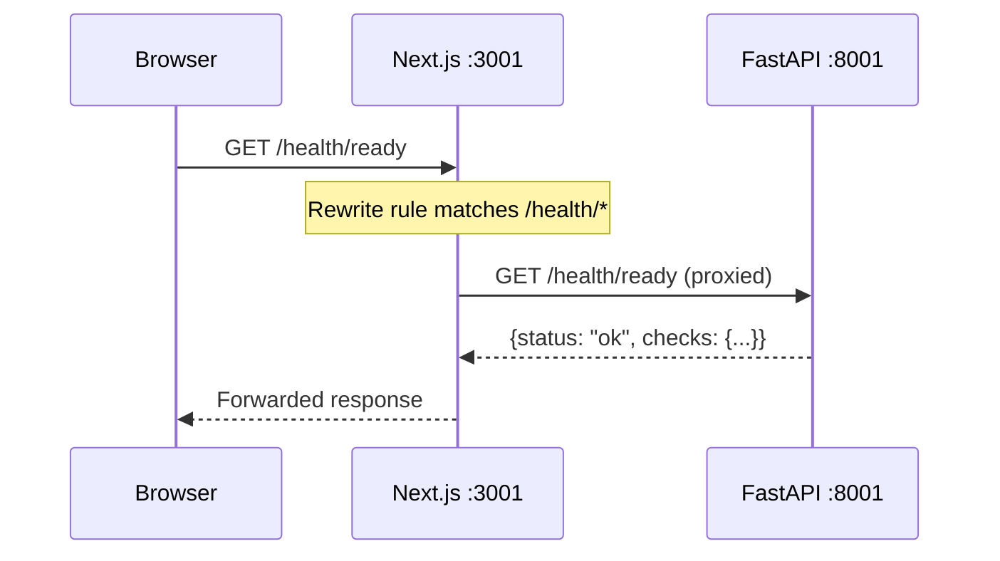
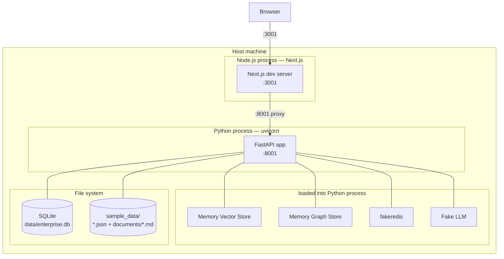
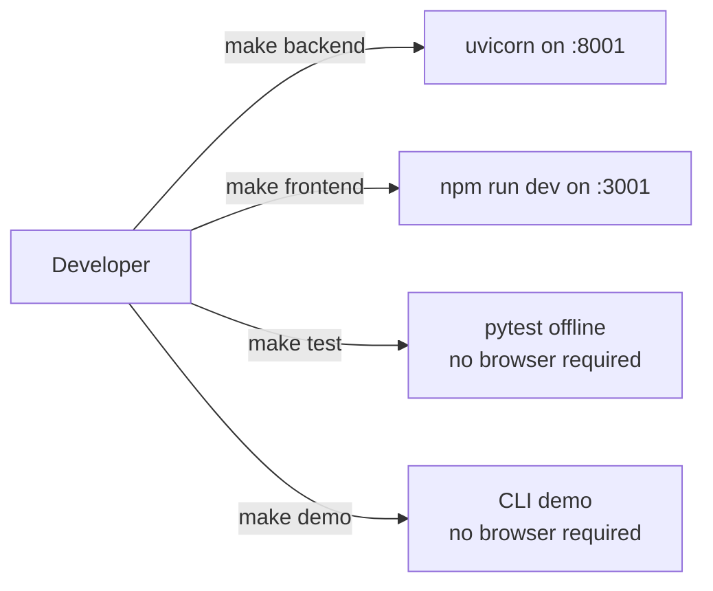
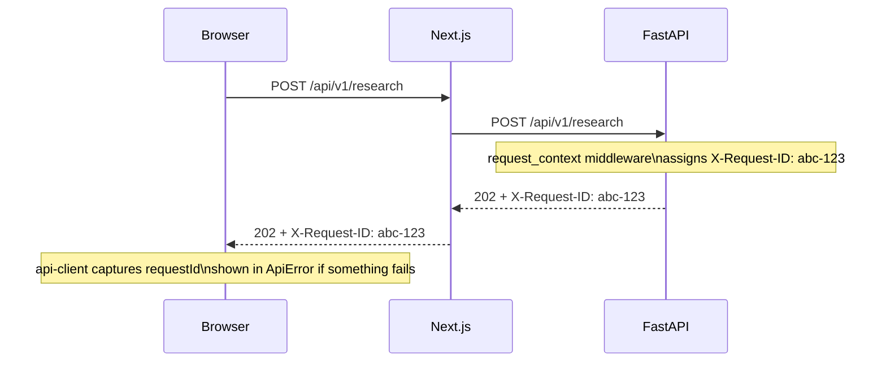
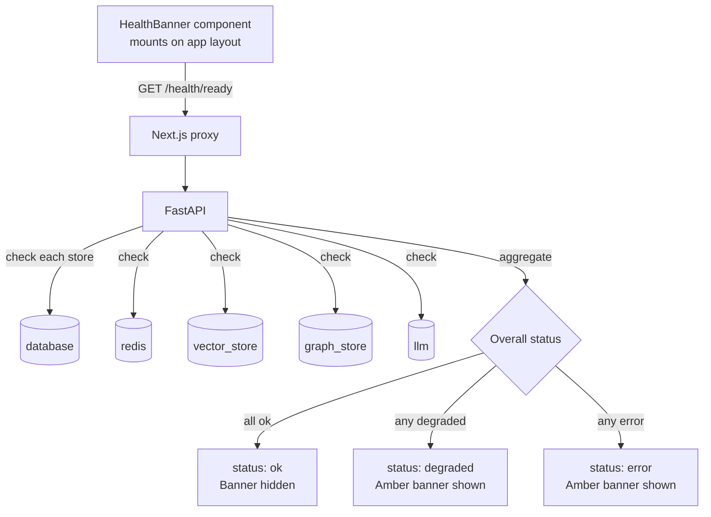
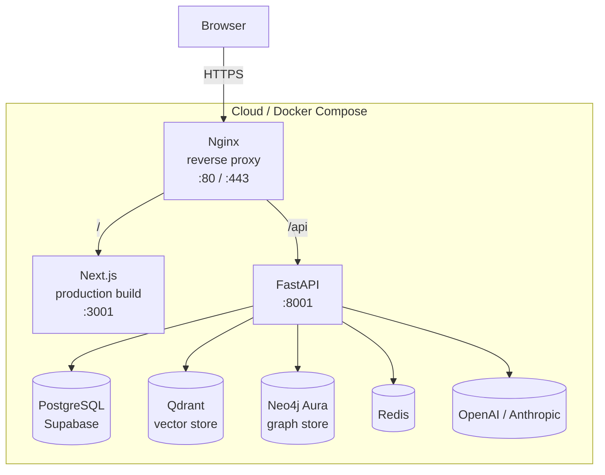

# Phase 13 — Infrastructure and Component Wiring Design Evolution

## Overview

Phase 13 introduces the first user-facing component: a Next.js 15 web application running on port 3001. This document explains how the new frontend process wires into the existing backend infrastructure, how traffic flows between components, and how the development setup is structured.

---

## Infrastructure before Phase 13

Before Phase 13, the entire system ran as a single Python process. There was no browser component.



All infrastructure was in-process or file-based. Zero external services required. This was the N1 requirement (run with no API key and no external service).

---

## What Phase 13 adds: a second process

Phase 13 introduces a **second process** — the Next.js development server — running on port 3001. The two processes are independent: each can be started, stopped, and restarted without affecting the other.



**Key insight:** The browser never talks directly to port 8001. All API calls go to the Next.js server first, which proxies them to FastAPI via Next.js rewrites. From the browser's perspective, there is only one server.

---

## Next.js rewrites — how the proxy works

The `next.config.ts` file defines URL rewrite rules:





**Why this matters:**
- No CORS headers needed on the FastAPI side during development.
- The browser bundle never contains the backend's internal address.
- In production, a real reverse proxy (Nginx, Caddy, or a cloud load balancer) would replace the Next.js rewrites.

---

## Port assignment and process map



---

## Make targets for the two-process setup



The two servers must run in **separate terminal windows** simultaneously during full-stack development. The test suite (`make test`) does not require the frontend process — it tests the backend directly.

---

## Browser session management

```mermaid
graph TD
    Login[/login page] -->|POST /api/v1/auth/login| Token[Receive JWT]
    Token -->|sessionStorage.setItem| SS[Browser sessionStorage\ntoken + role]
    SS -->|read on each request| Client[api-client.ts\nAdds Authorization header]
    Client -->|Bearer token| FastAPI

    TabClose[User closes tab] -->|sessionStorage cleared| Logout[Auto logout]
    SignOut[Sign out button] -->|clearToken| SS2[sessionStorage cleared]
    SS2 -->|router.push /login| Login
```

**Why sessionStorage and not localStorage?**
- `sessionStorage` is cleared when the browser tab is closed. The JWT cannot accidentally persist to a shared computer.
- `localStorage` persists across browser restarts — suitable for user preferences, not authentication tokens.

---

## Request tracing across the two layers

Every response from FastAPI includes an `X-Request-ID` header (from Phase 1's middleware). The frontend's API client captures this ID and includes it in `ApiError` objects so it can be shown in the UI alongside error messages.



---

## Rate limit handling at the client layer

```mermaid
graph TD
    Call[api-client makes a request] -->|check| RLCheck{Date.now &lt;\n_rateLimitUntil?}
    RLCheck -->|Yes — blocked| Throw[throw ApiError 429\n"Retry in Ns"]
    RLCheck -->|No| Fetch[fetch to backend]
    Fetch -->|status 429| SetRL[_rateLimitUntil = now + 60s]
    SetRL --> Throw
    Fetch -->|status ok| Return[Return parsed JSON]
```

The client-side rate limit guard prevents the browser from hammering the backend with retry loops after a 429. This is a client-side courtesy to the backend — the backend still enforces its own Redis token-bucket limit from Phase 3.

---

## Health check wiring



The health banner runs once on mount and does not poll. It is a startup indicator, not a live monitor. Polling the health endpoint on every page would create unnecessary load.

---

## Development environment summary

| Component | Technology | Port | Restart trigger |
|-----------|-----------|------|----------------|
| FastAPI backend | Python / uvicorn | 8001 | Python file change (--reload) |
| Next.js frontend | Node.js / Next.js 15 | 3001 | TypeScript file change (HMR) |
| Vector store | Python in-memory | — | Restart backend |
| Graph store | Python in-memory | — | Restart backend |
| Redis | fakeredis in-process | — | Restart backend |
| Database | SQLite file | — | Persists across restarts |

**Hot reload:** both servers support hot reload in development. The FastAPI uvicorn process reloads on Python file changes. The Next.js dev server uses Hot Module Replacement (HMR) for instant TypeScript/CSS updates in the browser.

---

## Production topology (Phase 15 preview)

Phase 15 will introduce Docker Compose with real external services. The topology will grow:



The separation of the two processes that Phase 13 establishes is exactly what makes this future topology straightforward — each process just points to a different backend URL.
