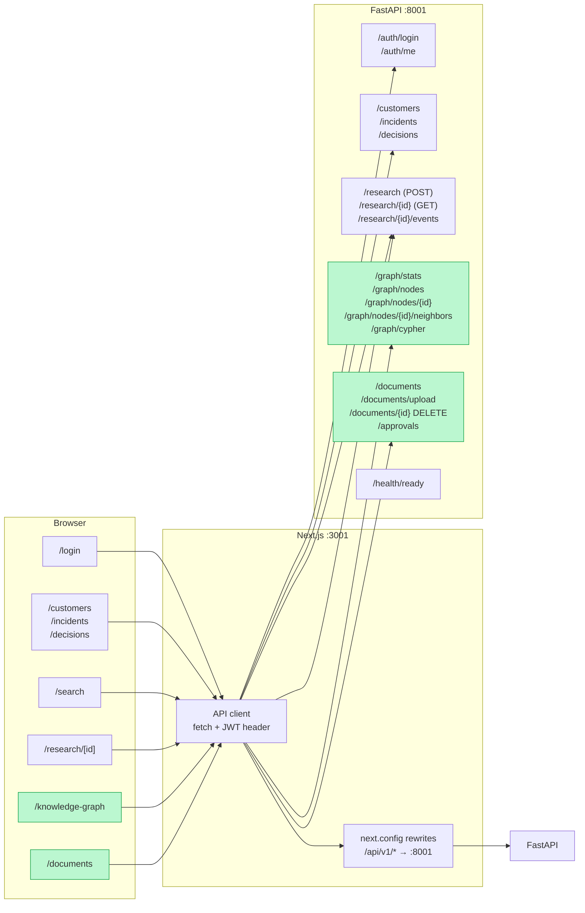
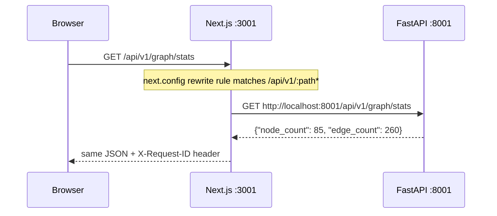
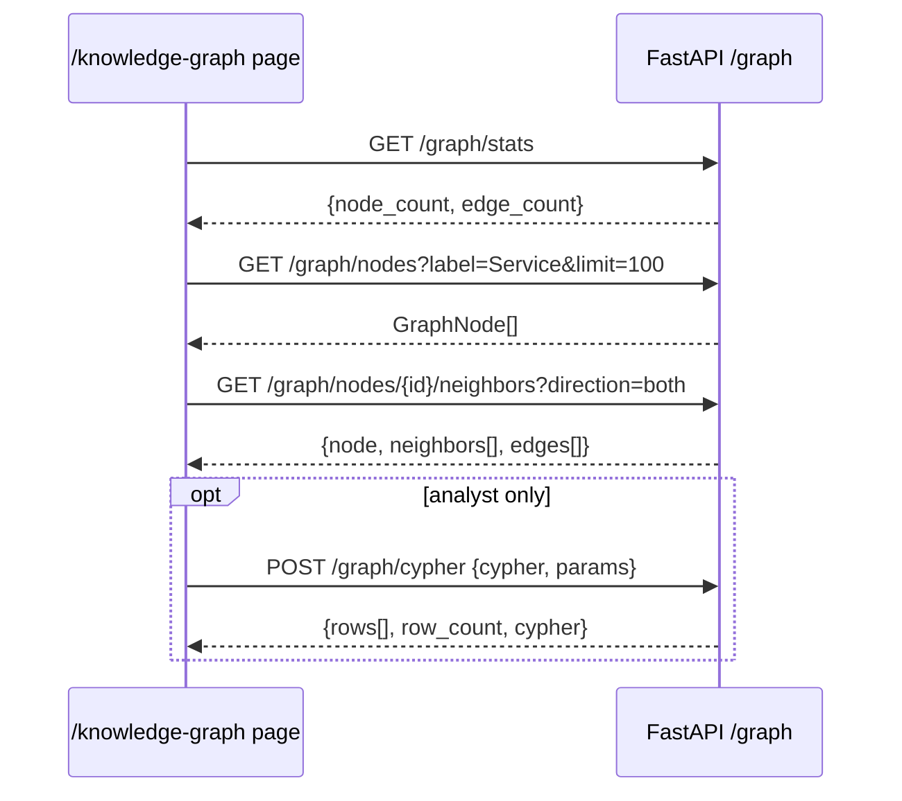
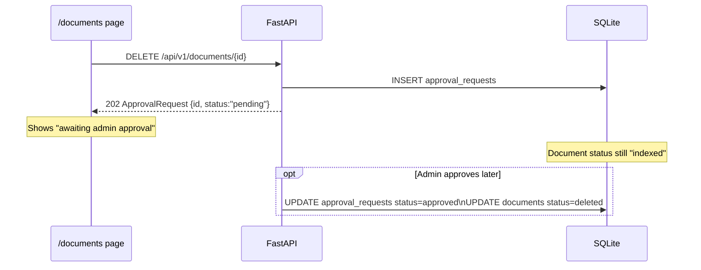
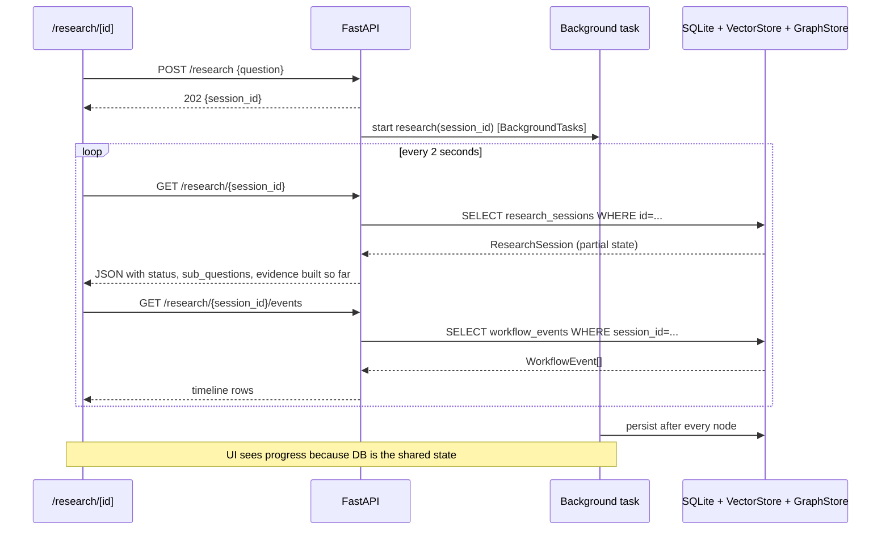
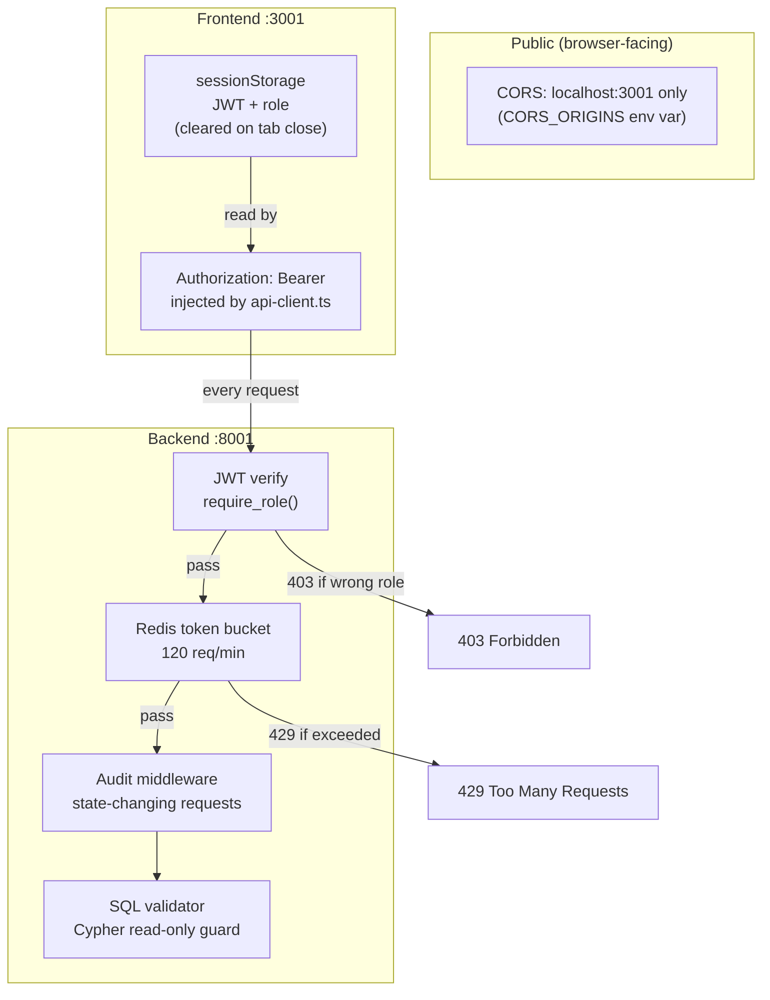
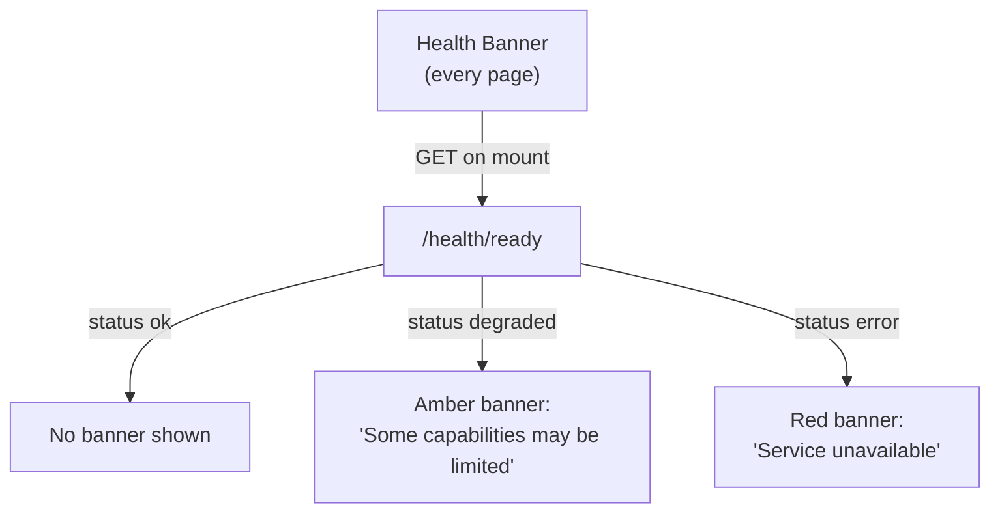

# Phase 14 — Infrastructure and Component Wiring Evolution

## Overview

Phase 14 adds no new infrastructure components. The same five services that Phase 13 wired remain:

| Service | Port | Technology |
|---------|------|-----------|
| Next.js frontend | 3001 | Node.js / React |
| FastAPI backend | 8001 | Python / uvicorn |
| SQLite (or Postgres) | — | File / TCP |
| Memory vector store (or Qdrant) | — | In-process |
| Memory graph store (or Neo4j) | — | In-process |

What Phase 14 adds is **wire coverage** — more paths between the frontend and backend are now actively used. This section shows those paths.

---

## Component wiring map — Phase 13 vs Phase 14



Green nodes = new paths activated in Phase 14.

---

## Request routing detail

### How the browser reaches the backend

The Next.js config rewrites proxy rules so the browser only ever speaks to `:3001`. The backend lives on `:3001/api/v1/*` as far as the browser is concerned.



This proxy means:
- No CORS headers needed on the backend for the browser
- The browser cannot directly address `:8001` — all traffic goes through Next.js
- In production, Next.js is replaced by a reverse proxy (nginx / Vercel edge) with the same rewrite

---

## New API surfaces activated in Phase 14

### Knowledge graph endpoints



### Document upload endpoint (multipart)

The upload path is special: it must NOT send `Content-Type: application/json` because the browser needs to set a multipart boundary automatically. The API client handles this:

```mermaid
sequenceDiagram
    participant UI as /documents page
    participant Client as api-client.ts
    participant API as FastAPI /documents/upload

    UI->>Client: documentsApi.upload(file)
    Note over Client: Creates FormData\nSets Authorization header\nDoes NOT set Content-Type
    Client->>API: POST /api/v1/documents/upload\n  Authorization: Bearer <jwt>\n  Content-Type: multipart/form-data; boundary=...
    API-->>Client: 201 DocumentUploadResponse
    Client-->>UI: {doc_id, chunk_count, flagged}
```

### Delete request → approval flow



---

## Runtime data flow — full research session



---

## Network isolation and security wiring



---

## Health degradation display

The `/health/ready` endpoint is polled once on page load by the health banner component. Phase 14 screens use this to show partial-availability warnings.



---

## Infrastructure summary: Phase 14

No new services, containers, or ports were added. The changes are entirely in routing paths and wire coverage:

| New wire | Endpoint | From page |
|----------|----------|-----------|
| Graph stats | GET /graph/stats | /knowledge-graph |
| Node list | GET /graph/nodes | /knowledge-graph |
| Node expansion | GET /graph/nodes/{id}/neighbors | /knowledge-graph |
| Cypher query | POST /graph/cypher | /knowledge-graph |
| Document upload | POST /documents/upload | /documents |
| Delete request | DELETE /documents/{id} | /documents |

All backend endpoints existed since Phases 9 and 10; Phase 14 is what actually calls them from the browser.
