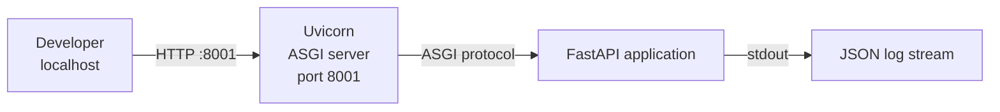
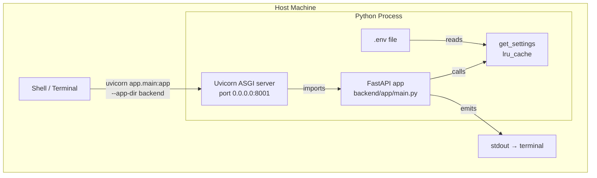
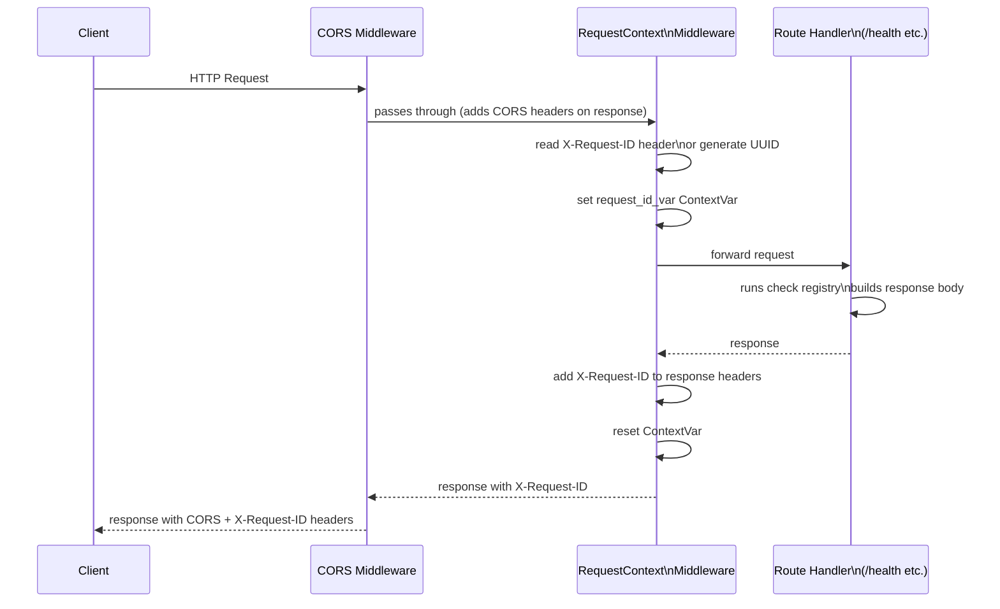
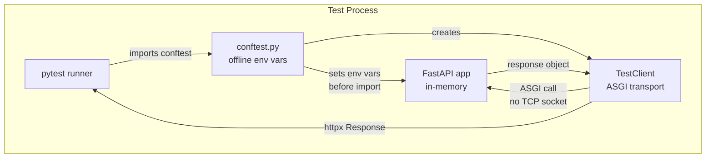
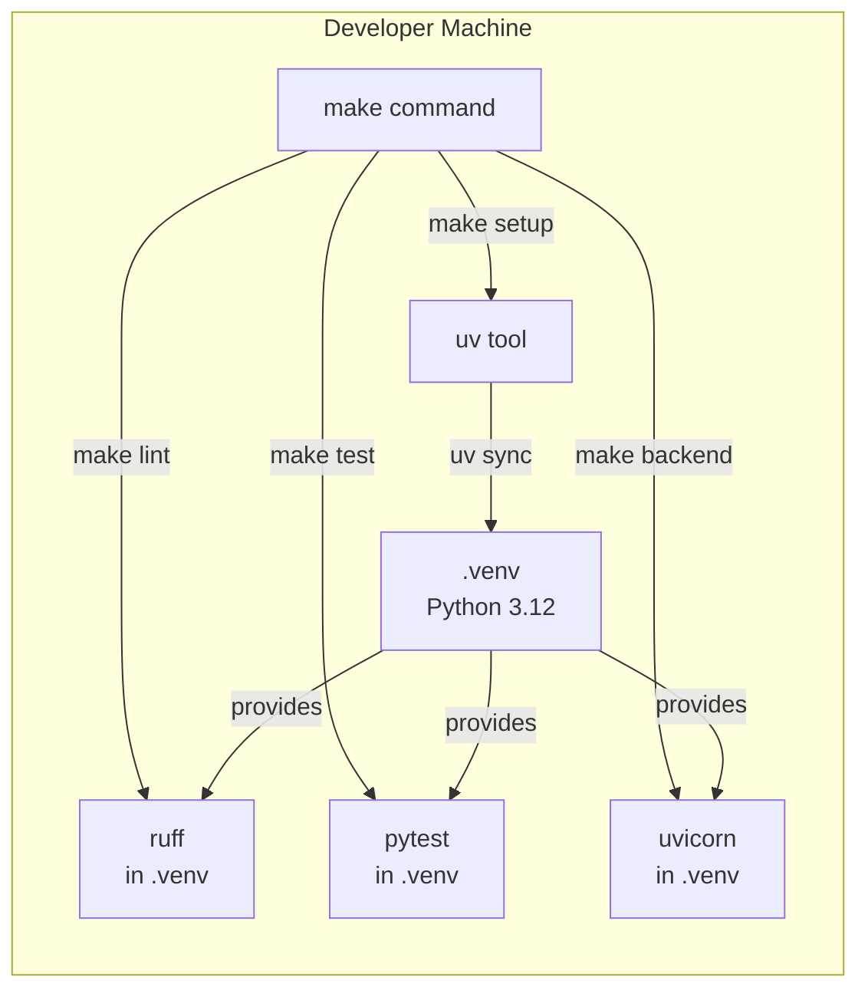
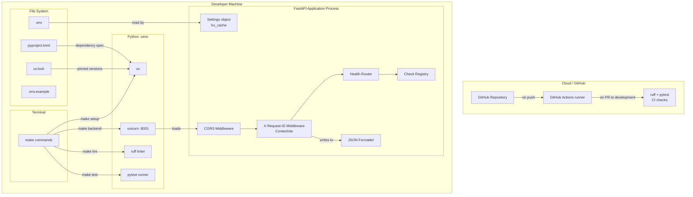

# Phase 1 — Infrastructure Design Evolution

> This document explains the infrastructure wiring, component routing, and networking used in Phase 1.
> No Docker or cloud services are needed in Phase 1 — the entire infrastructure runs as a single local process.

---

## Overview

Phase 1 is a **single-process setup**. Everything runs on one machine, one Python process, one port. There are no containers, no cloud services, no databases yet.



This simplicity is intentional. The infrastructure will grow in later phases; starting minimal means less to debug.

---

## P1-1 — Python Process and Package Layout

The Python process is started by **uvicorn**, which is an ASGI (Asynchronous Server Gateway Interface) server. It loads the FastAPI app object from `backend/app/main.py`.



**Package routing — why `PYTHONPATH=backend`:**

Python needs to know where to find the `app` package. By adding `backend` to `PYTHONPATH`, the import `from app.core.config import get_settings` resolves correctly regardless of the current working directory.

```
PYTHONPATH=backend uvicorn app.main:app
                             ↑
                    Python looks for `app` in `backend/`
                    finds `backend/app/main.py`  ✅
```

---

## P1-2 — Request Routing and Middleware Wiring

When a request arrives at port 8001, it passes through a **middleware stack** before reaching the route handler. Middleware runs in reverse declaration order (outermost wraps innermost).



**Declaration order in `main.py` → execution order:**

```python
app.add_middleware(CORSMiddleware)       # added first → executes last (outermost)
app.add_middleware(RequestContextMiddleware)  # added second → executes first (innermost)
```

Starlette (FastAPI's underlying framework) reverses the declaration order. The middleware added last is the outermost wrapper.

---

## P1-3 — Test Infrastructure Routing

The test suite uses `starlette.testclient.TestClient`, which speaks directly to the ASGI app object without opening a real TCP socket. This means no port conflict and no network overhead.



**Why no real socket:**
- `TestClient` wraps the app in an in-process transport layer
- Tests run at ~300 tests/second instead of network-limited ~50/second
- No port conflicts when running tests in parallel

---

## P1-4 — Developer Workflow Infrastructure



**`uv` replaces pip + virtualenv:**
- `uv sync` reads `pyproject.toml` and installs exact versions from `uv.lock`
- Reproducible: every developer and every CI run installs exactly the same versions
- Fast: `uv` is 10–100× faster than pip for large dependency trees

---

## P1-5 — CI/CD Pipeline Infrastructure

```mermaid
graph TD
    DEV[Developer pushes to GitHub] -->|triggers| GHA[GitHub Actions runner\nubuntu-latest]

    subgraph GitHub Actions runner
        CHECKOUT[actions/checkout@v4\nclone repo]
        PY[actions/setup-python@v5\nPython 3.12]
        UV_SETUP[astral-sh/setup-uv@v4\ninstall uv]
        SYNC[uv sync --all-groups\ninstall deps]
        RUFF_CHECK[ruff check .\nlint]
        RUFF_FMT[ruff format --check .\nformat]
        PYTEST_RUN[pytest tests/ -v\noffline env vars]
    end

    CHECKOUT --> PY --> UV_SETUP --> SYNC
    SYNC --> RUFF_CHECK --> RUFF_FMT --> PYTEST_RUN

    PYTEST_RUN -->|all pass| GREEN[✅ PR mergeable]
    PYTEST_RUN -->|any fail| RED[❌ PR blocked]
    RUFF_CHECK -->|fail| RED
    RUFF_FMT -->|fail| RED
```

---

## Complete Phase 1 Infrastructure Picture



---

## Ports and addresses

| Component | Host | Port | Protocol |
|-----------|------|------|----------|
| FastAPI / uvicorn | 0.0.0.0 | 8001 | HTTP |
| Test client | in-process | — | ASGI (no socket) |
| CI runner | GitHub cloud | — | HTTPS to GitHub API |

No other ports, services, or containers are used in Phase 1.

---

## What infrastructure is NOT here yet

| Component | Added in phase |
|-----------|---------------|
| PostgreSQL / SQLite (data) | Phase 2 |
| Redis / fakeredis | Phase 3 |
| Qdrant (vector store) | Phase 6 |
| Neo4j (graph store) | Phase 7 |
| Docker Compose stack | Phase 15 |
| Frontend Next.js :3001 | Phase 13 |

---

## Summary

Phase 1 infrastructure is intentionally minimal:

- **One process** (uvicorn + FastAPI)
- **One port** (8001)
- **No external services** (fake everything for tests)
- **One CI pipeline** (GitHub Actions, runs on every PR)

The middleware stack is wired in a specific order that all future middleware must respect:
`CORS → RequestContext → (rate-limit P3) → (audit P3) → route handler`

The check registry is global and extensible — later phases register their own readiness checks without touching the health router.
