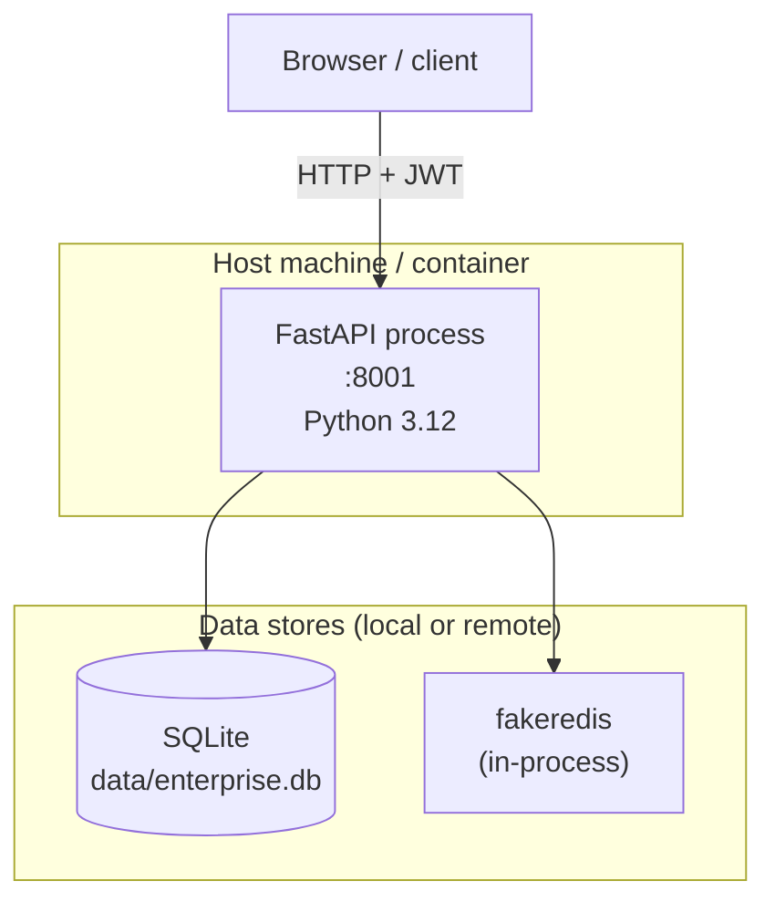
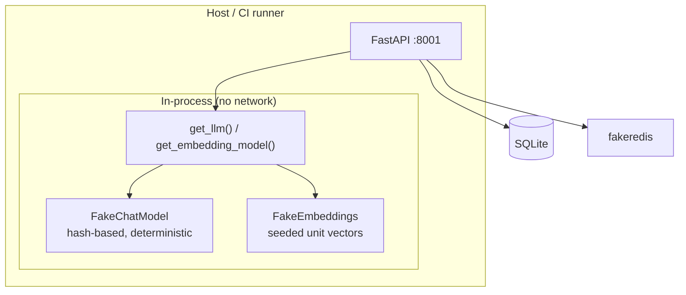
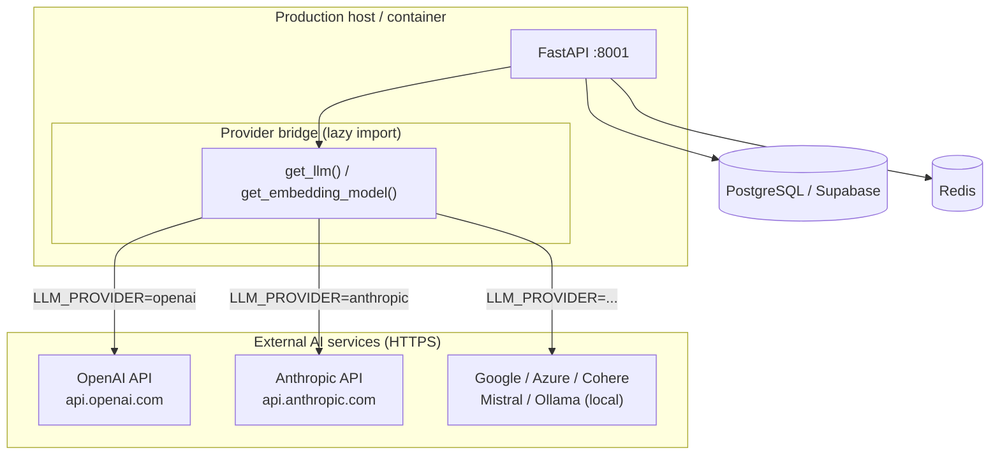
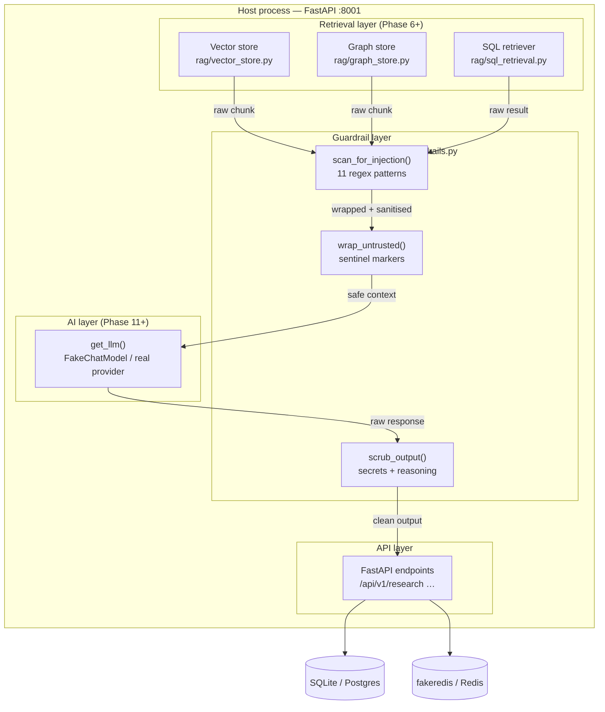
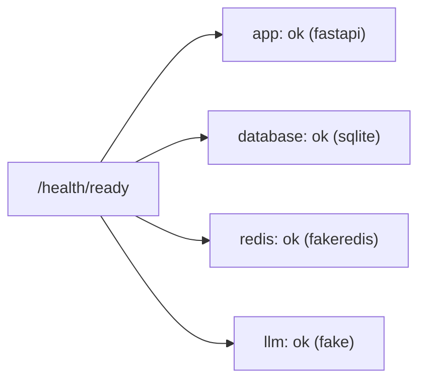
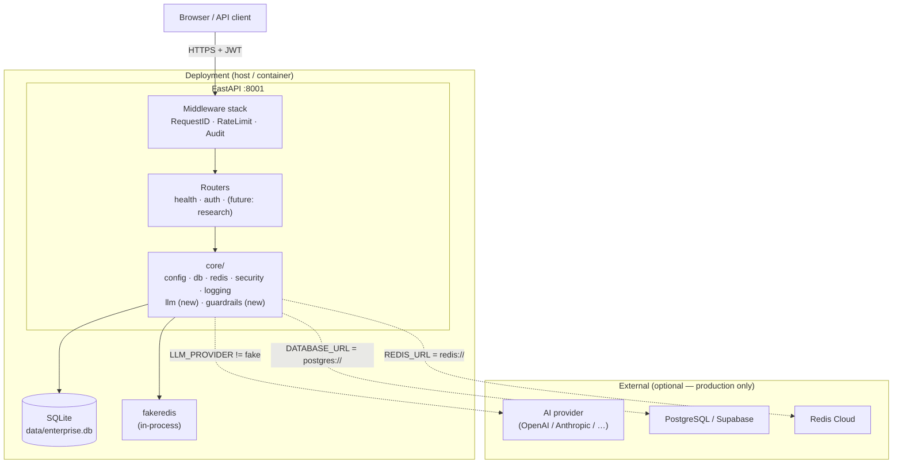

# Phase 4 — Infrastructure Design Evolution

> Component wiring, routing, and deployment considerations for Phase 4: AI Providers and Guardrails.

---

## Overview

Phase 4 adds no new network components. There are no new containers, no new ports, and no new services. What changes is **how the backend process wires itself to external AI services** — and how those wires are guarded by in-process filters.

The key infrastructure addition is the **AI provider bridge**: a lazy, configurable connection to whichever LLM and embedding service the deployment chooses.

---

## Infrastructure state at start of Phase 4

At the end of Phase 3, the deployment looked like this:



No AI provider, no external embedding service.

---

## Infrastructure change — P4-1 and P4-2: AI provider bridge

The `llm.py` module adds a **lazy bridge** to AI services. The bridge is not a container or a network hop — it is code inside the Python process that, when called for the first time, opens a connection to the configured provider.

### Offline (default, testing)



**Network calls:** zero. Everything is in-process.

### Production (with real provider)



**Configuration:** `LLM_PROVIDER` and `LLM_API_KEY` in `.env`. The factory opens the connection when first called; subsequent calls reuse the same client object.

### Environment variable routing table

| Variable | Default | Effect |
|----------|---------|--------|
| `LLM_PROVIDER` | `fake` | Which AI provider to use |
| `LLM_API_KEY` | _(empty)_ | API key for the chosen provider |
| `LLM_MODEL` | _(empty)_ | Model name override (e.g. `gpt-4o`) |
| `EMBEDDING_PROVIDER` | `fake` | Embedding provider |
| `EMBEDDING_MODEL` | _(empty)_ | Embedding model name override |

---

## Infrastructure change — P4-3 and P4-4: Guardrail layer (in-process)

The guardrails are purely in-process filters. They add no containers, no ports, and no external calls. Architecturally, they are a **middleware layer inside the Python process** that sits between the data layer (retrieval) and the AI layer (LLM calls).

### Component wiring for guardrails



**Data flow rule:** No raw document chunk ever reaches the LLM without passing through the guardrail. No AI response ever reaches the API layer without passing through the scrubber.

---

## Health check wiring at end of Phase 4

The `/health/ready` endpoint now checks four components:



The LLM check calls `get_llm()` to verify the configured provider is reachable. With `LLM_PROVIDER=fake`, this always succeeds offline. With a real provider, it validates the key and connection.

**Sample response:**

```json
{
  "status": "ok",
  "checks": {
    "app":      { "status": "ok", "detail": "fastapi" },
    "database": { "status": "ok", "detail": "sqlite" },
    "redis":    { "status": "ok", "detail": "fakeredis" },
    "llm":      { "status": "ok", "detail": "fake" }
  }
}
```

---

## Dependency installation

Phase 4 adds two new Python packages declared in `pyproject.toml`:

| Package | Version | Purpose |
|---------|---------|---------|
| `langchain-core` | ≥ 1.8 | Base abstractions (`AIMessage`, etc.) used by FakeChatModel |
| `langgraph` | ≥ 1.2 | Workflow engine used in Phase 11; added now to avoid a mid-phase upgrade |

Real provider packages (`langchain-openai`, `langchain-anthropic`, etc.) are **not** in `pyproject.toml` — they are optional and installed only when the operator chooses a real provider. The `llm.py` module handles the import lazily with a helpful install hint.

```
# No extra install needed for the default offline mode:
make setup    ← uv sync installs langchain-core + langgraph
make test     ← 114 tests pass, LLM_PROVIDER=fake
```

---

## Full infrastructure picture at end of Phase 4



Dashed arrows are production paths; solid arrows are always active including in the offline test environment.

---

## Security posture after Phase 4

| Threat | Mitigation |
|--------|-----------|
| Prompt injection via document content | `process_chunk()` scans, sanitises, and wraps every chunk |
| API key leak in logs or responses | `scrub_output()` redacts key patterns before any string is logged or returned |
| Secrets in environment | `.env` is git-ignored; `.env.example` lists variables with empty placeholders |
| Provider misconfiguration | Fail-late validation: key check happens at call time, not startup |
| Unbounded AI calls in tests | `LLM_PROVIDER=fake` returns in microseconds with no network calls |
