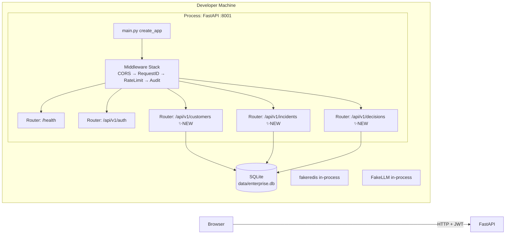
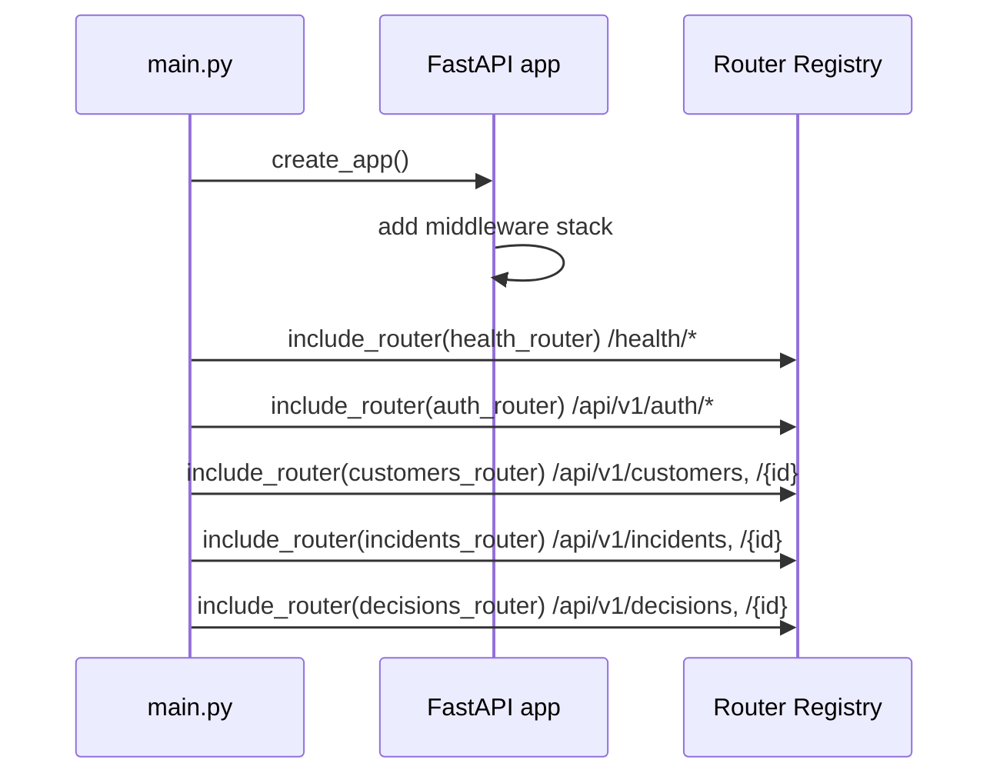
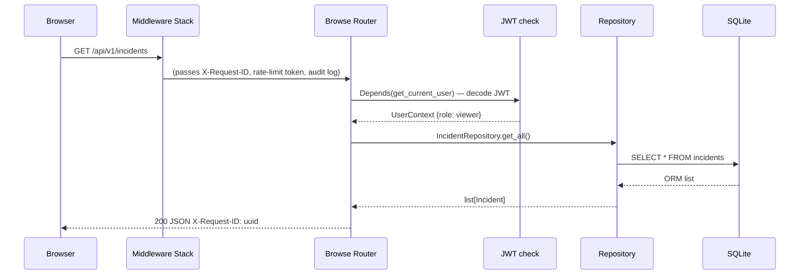
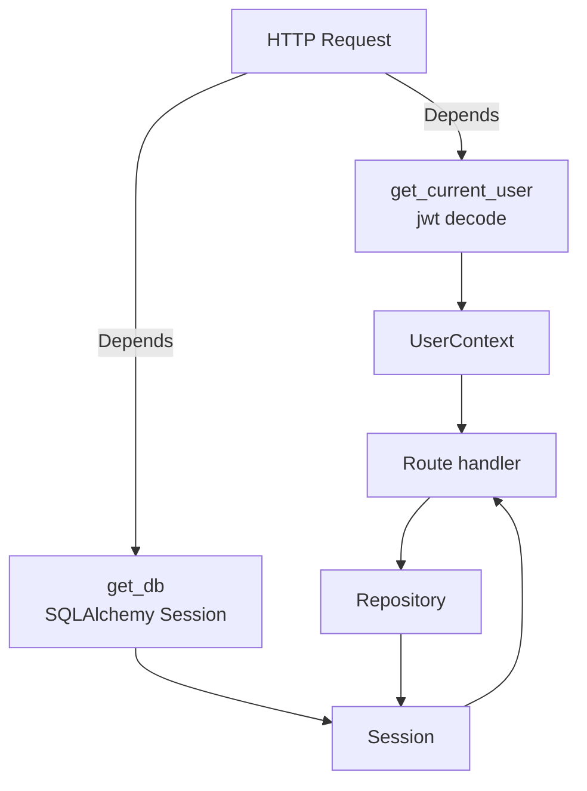
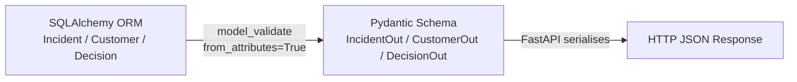

# Phase 5 — Infrastructure Design Evolution: API Contract and Browse API

---

## Overview

Phase 5 is primarily a **contract and routing** phase — no new infrastructure components are
introduced. What changes is the routing table inside the FastAPI process and the addition of two
documentation files on disk. The external topology (SQLite, fakeredis, FakeLLM) is unchanged.

---

## Component Wiring

---

## Router Registration Sequence

---

## Request Lifecycle — Browse Endpoint

**Short-circuit paths:**
- No token → middleware passes, `get_current_user` raises 401 before any DB work
- Rate limit hit → `RateLimitMiddleware` returns 429 before the router is reached

---

## Dependency Injection Graph

The session commits on success and rolls back on error inside `get_db`'s `finally` block.

---

## Pydantic Schema Bridge

---

## What Has Not Changed

| Component | Status |
|-----------|--------|
| SQLite database | Unchanged — no schema changes |
| fakeredis | Unchanged |
| FakeLLM / FakeEmbeddings | Unchanged — no AI calls in browse endpoints |
| Middleware stack | Unchanged — browse requests flow through it |
| Health check registry | Unchanged — no new checks registered |
