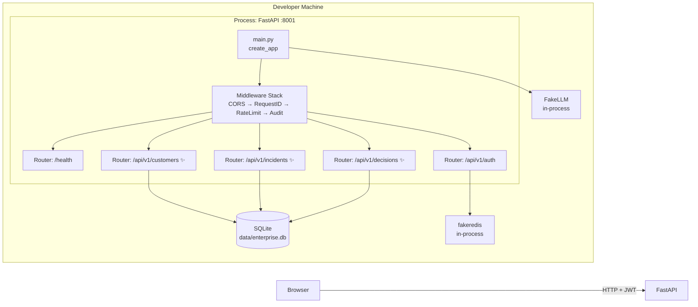
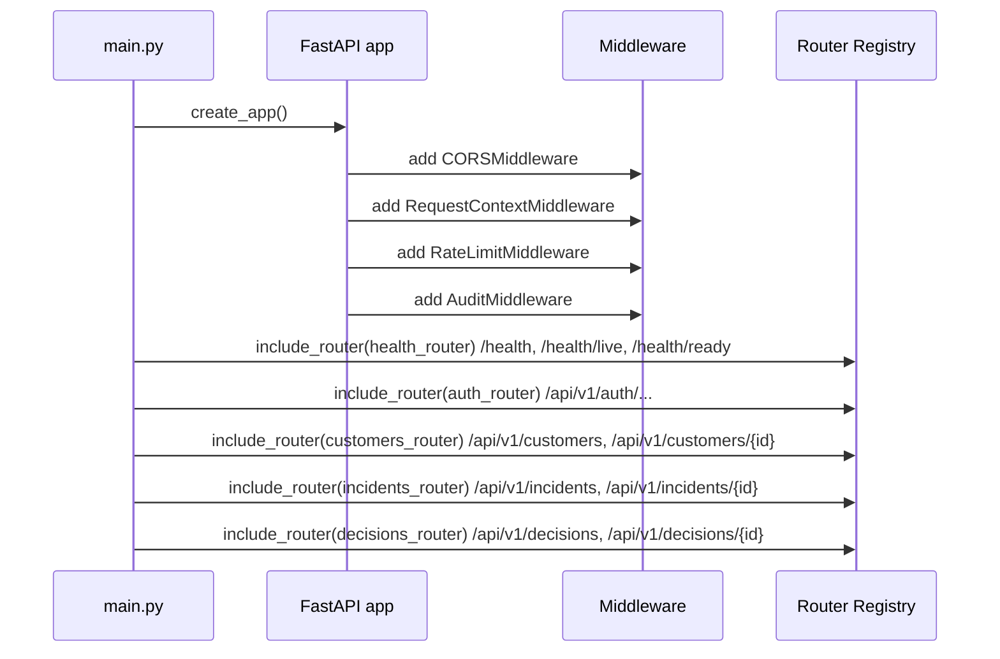
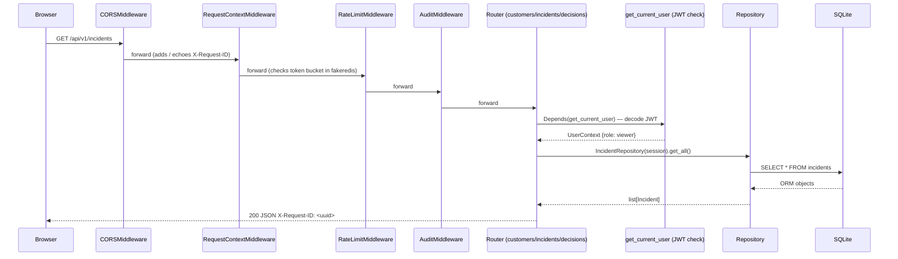
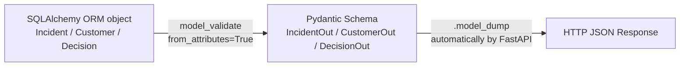
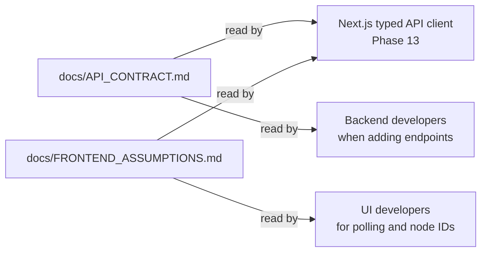

# Phase 5 — Infrastructure Design Evolution: API Contract and Browse API

---

## Overview

Phase 5 is primarily a **contract and routing** phase — no new infrastructure components are
introduced. What changes is the routing table inside the FastAPI process and the addition of
two documentation files that sit on disk. The infrastructure diagram is the same as Phase 4,
but the FastAPI router tree grows.

---

## Component Wiring (unchanged from Phase 4)



✨ = new in Phase 5

---

## Router Registration Flow

When `create_app()` runs, FastAPI builds its routing table in a single pass. The order of
`include_router()` calls determines URL priority (earlier = higher priority for conflicting paths).



---

## Request Lifecycle — Browse Endpoint

Every browse request passes through all middleware layers before reaching the router.



**Rate limit path (429):** RateLimitMiddleware returns before reaching the router — the JWT
check and the repository query never run.

**No token (401):** `get_current_user` raises `HTTPException(401)` before any database work.

---

## Dependency Injection Graph (Browse Endpoints)

FastAPI's DI system wires three dependencies automatically for each request:

```mermaid
flowchart TD
    REQ[HTTP Request] --> |Depends| GCU[get_current_user\njwt decode]
    REQ --> |Depends| GDB[get_db\nSQLAlchemy Session]
    GCU --> UC[UserContext]
    GDB --> SESSION[Session]
    UC & SESSION --> HANDLER[Route handler\nlist_incidents / get_incident / ...]
    HANDLER --> REPO[Repository\n.get_all() / .get_by_id()]
    REPO --> SESSION
```

The session is committed (or rolled back on error) in `get_db`'s `finally` block. The router
never touches the session lifecycle directly.

---

## Pydantic Schema Layer



`model_config = {"from_attributes": True}` on each schema tells Pydantic to read ORM object
attributes as if they were dict fields. This avoids manual field mapping and means the ORM
model is the single source of field names.

---

## Documentation Files on Disk



These are static Markdown files — no runtime component. They are enforced by the test
`test_graph_shape_matches_frontend_assumptions` (Phase 12) which will verify the node IDs
in `FRONTEND_ASSUMPTIONS.md` against the actual `GRAPH_NODES` list.

---

## What Has Not Changed

| Component | Status |
|-----------|--------|
| SQLite database | Same — no schema changes |
| fakeredis | Same — rate limit and audit unchanged |
| FakeLLM / FakeEmbeddings | Same — no AI calls in browse endpoints |
| Middleware stack | Same — browse requests flow through it like any other |
| Health check registry | Same — no new checks registered |

The only infrastructure change is **inside the FastAPI process**: three new routers registered
and two new files written to disk.
