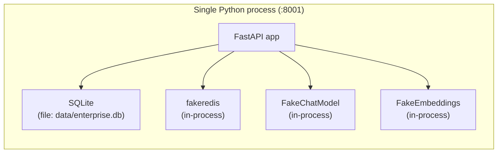
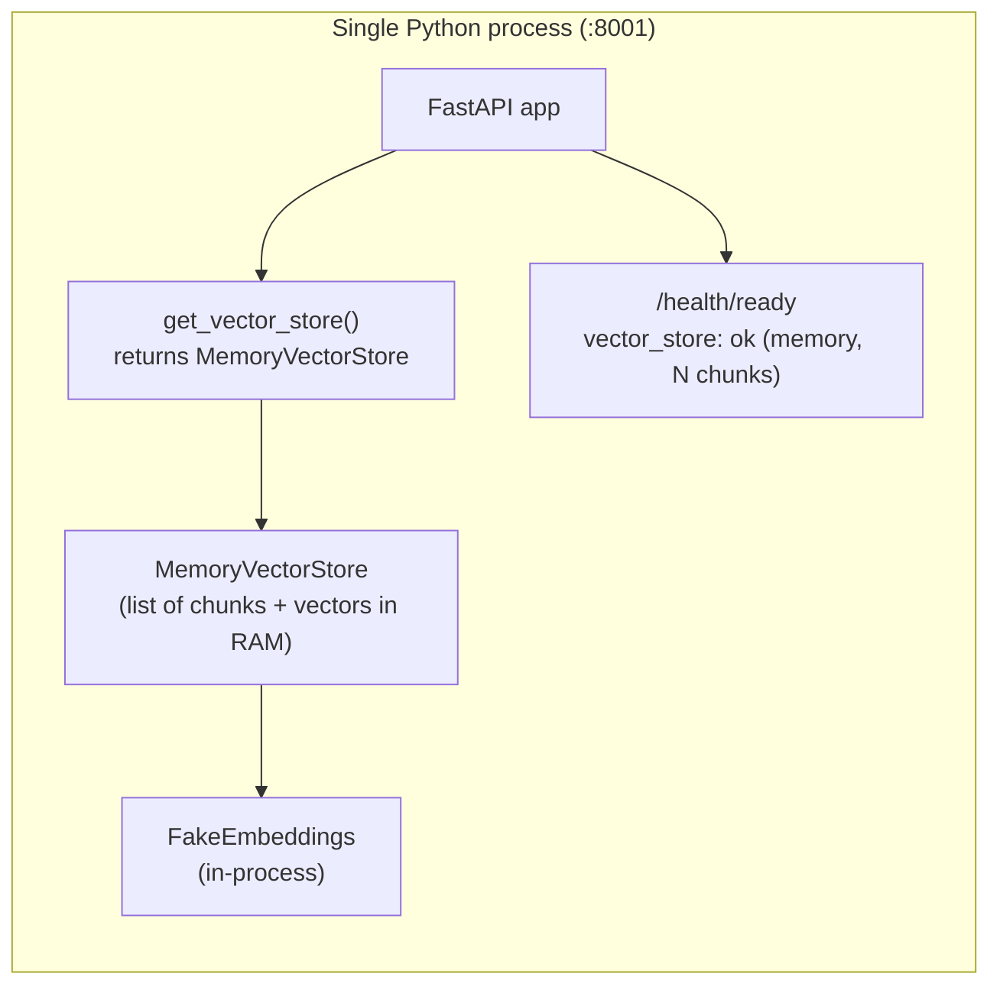
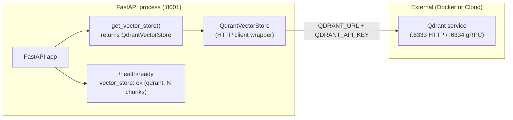
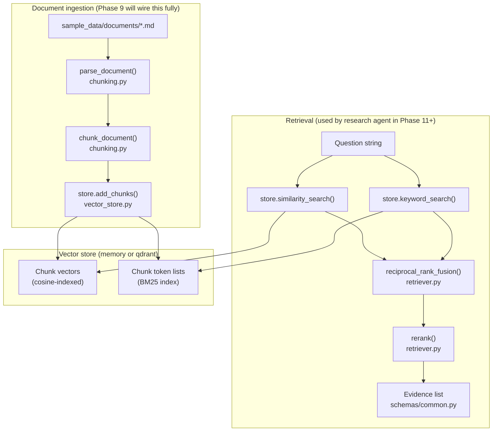
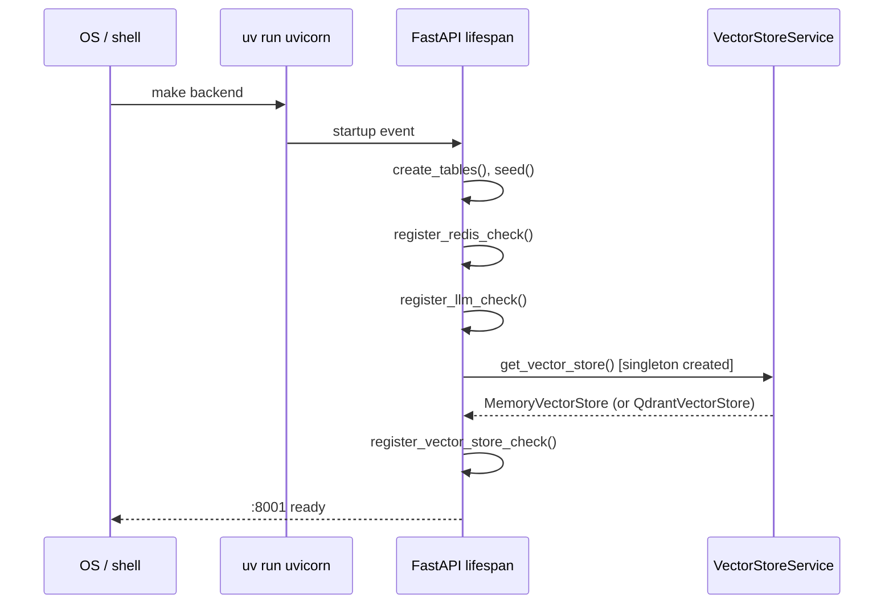
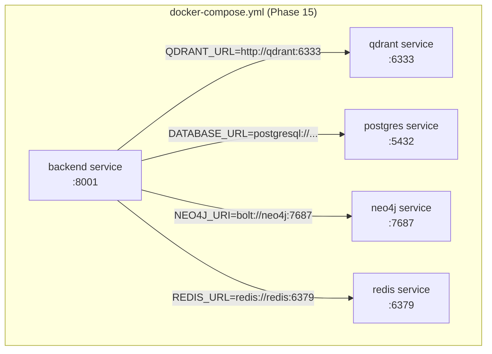

# Phase 6 — Infrastructure Design Evolution: Vector RAG

> This document explains the component wiring, networking, and infrastructure choices introduced in Phase 6.

---

## Infrastructure state entering Phase 6

The backend ran as a single FastAPI process. It connected to:
- **SQLite** (file-based database, no network)
- **fakeredis** (in-process Redis emulator)
- **FakeChatModel** (in-process LLM stub)

No external vector search service existed. The `rag/` module did not exist.



---

## What Phase 6 adds: the vector store layer

Phase 6 introduces a **pluggable vector store** that the app selects via the `VECTOR_STORE` environment variable.

### Offline / test / demo path (`VECTOR_STORE=memory`)



No new network socket. No new process. No new container.
Everything lives in the same Python process, in RAM.

### Production path (`VECTOR_STORE=qdrant`)



The Qdrant adapter uses the official `qdrant_client` library over HTTP/gRPC. Credentials come from `.env`:
```
VECTOR_STORE=qdrant
QDRANT_URL=http://localhost:6333
QDRANT_API_KEY=              # empty for local Docker, set for Qdrant Cloud
```

---

## Component wiring: how data flows through Phase 6



---

## Startup sequence (updated for Phase 6)



The vector store is created lazily on first access; the check is registered at startup. No documents are loaded at startup yet — that happens in Phase 9 (`make ingest`).

---

## Health check output after Phase 6

```json
GET /health/ready

{
  "status": "ok",
  "checks": {
    "app":          { "status": "ok",    "detail": "fastapi" },
    "database":     { "status": "ok",    "detail": "sqlite" },
    "redis":        { "status": "ok",    "detail": "fakeredis" },
    "llm":          { "status": "ok",    "detail": "fake" },
    "vector_store": { "status": "ok",    "detail": "memory (0 chunks)" }
  }
}
```

After `make ingest` (Phase 9) the detail will show `memory (70 chunks)`.

---

## Docker Compose (Phase 15 — not yet active)

When Docker Compose is introduced in Phase 15, Qdrant will be a sidecar container:



For now all stores run in-process. No `docker-compose.yml` file exists yet.

---

## Summary of infrastructure changes in Phase 6

| Component | Before Phase 6 | After Phase 6 |
|-----------|---------------|---------------|
| Vector search | Not present | In-process (memory) or Qdrant (production) |
| New env vars | — | `VECTOR_STORE`, `QDRANT_URL`, `QDRANT_API_KEY` (all already in `.env.example` from Phase 1 spec) |
| New packages | — | `pypdf>=4.0.0` (parsing); `qdrant-client` optional (not in pyproject.toml yet — added in Phase 15) |
| Health check | `llm` | `llm` + `vector_store` |
| External services needed offline | None | None |
| External services needed in production | LLM API | LLM API + Qdrant |
