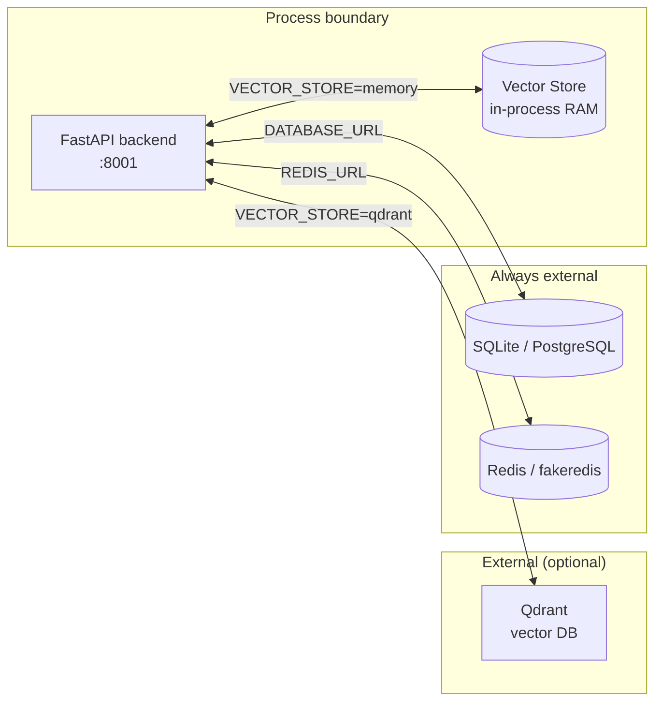
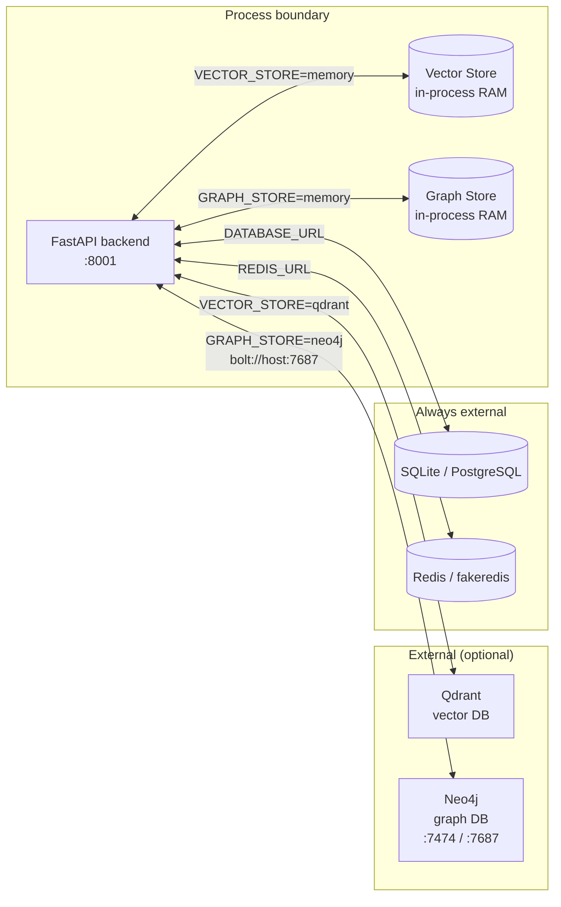
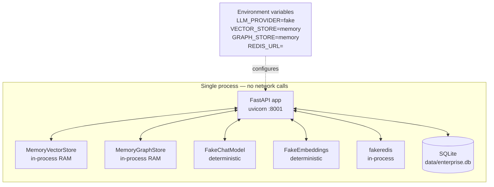
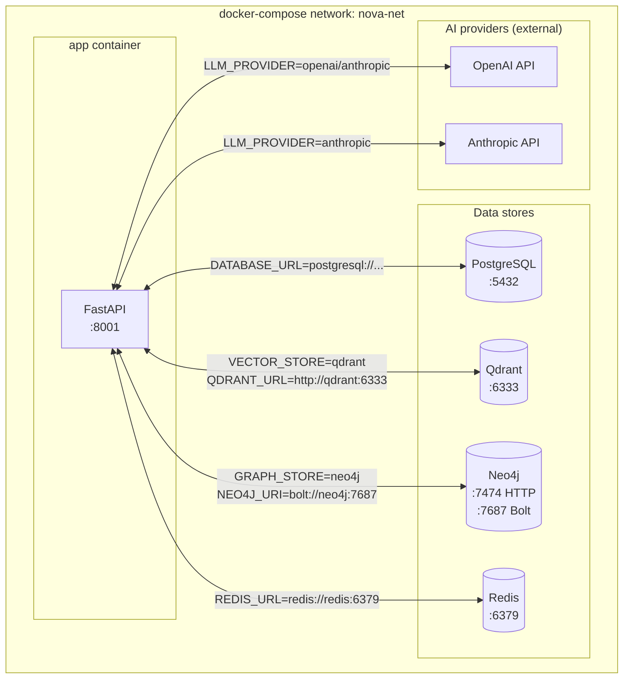
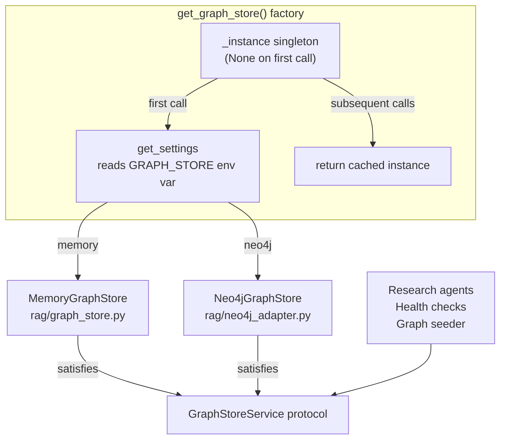
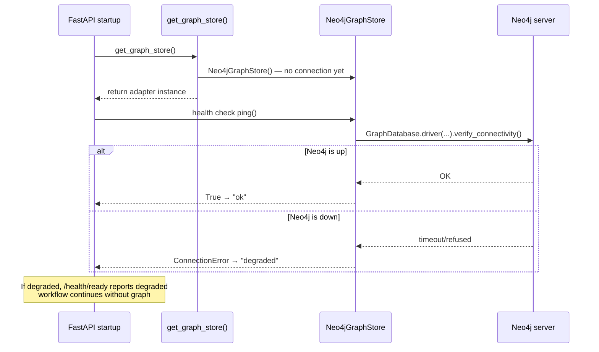
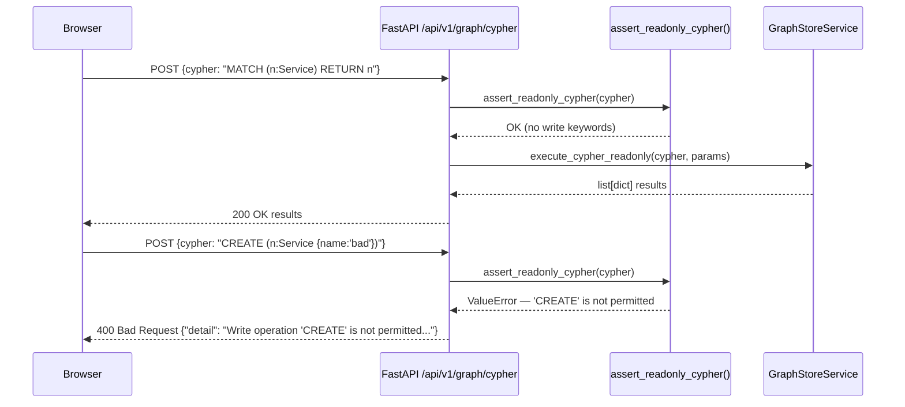
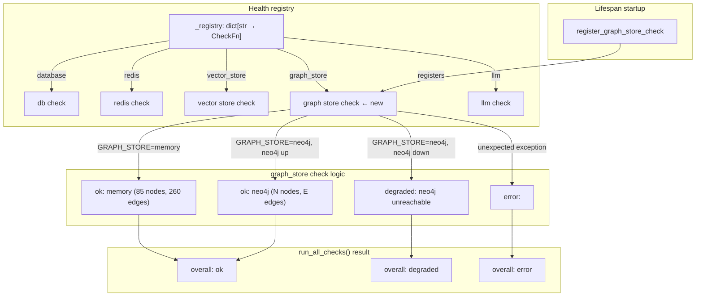
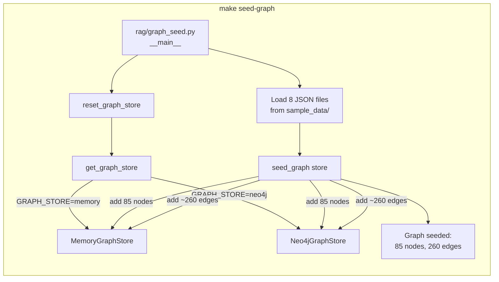

# Phase 7 — Infrastructure Design Evolution: Graph RAG

> This document explains the component wiring, routing, and infrastructure introduced in Phase 7. It shows how the graph store fits into the platform's overall infrastructure, the connection paths used in development vs. production, and how the system behaves when the graph store is unavailable.

---

## Infrastructure Baseline After Phase 6

After Phase 6, the platform used three infrastructure components:



Phase 7 adds the graph store — a fourth persistence layer with its own adapter pattern.

---

## Phase 7 Addition: The Graph Store



**New env vars introduced in Phase 7:**

| Variable | Default | Purpose |
|---|---|---|
| `GRAPH_STORE` | `memory` | Selects the adapter: `memory` or `neo4j` |
| `NEO4J_URI` | _(empty)_ | Bolt connection string, e.g. `bolt://localhost:7687` |
| `NEO4J_USER` | _(empty)_ | Neo4j username |
| `NEO4J_PASSWORD` | _(empty)_ | Neo4j password |

---

## Deployment Mode 1: Fully Offline (Development / CI)

No external services. Everything runs in-process.



**Startup sequence (lifespan):**
1. Create SQLite tables
2. Seed domain data (teams, services, customers, incidents, decisions)
3. Register vector store health check
4. **Register graph store health check** ← new in Phase 7
5. Register LLM health check
6. Build the LangGraph research workflow (Phase 12)

**Health check output (offline):**
```json
{
  "status": "ok",
  "checks": {
    "database": {"status": "ok", "detail": "sqlite"},
    "redis": {"status": "ok", "detail": "fakeredis"},
    "vector_store": {"status": "ok", "detail": "memory (70 chunks)"},
    "graph_store": {"status": "ok", "detail": "memory (85 nodes, 260 edges)"},
    "llm": {"status": "ok", "detail": "fake"}
  }
}
```

---

## Deployment Mode 2: Production Stack (Docker Compose)

Production adds real external services. This is wired in Phase 15, but the adapters are ready now.



**Network routing details for Neo4j:**
- The Neo4j container exposes two ports: `7474` (HTTP browser interface) and `7687` (Bolt binary protocol)
- The backend uses the **Bolt protocol** (`bolt://neo4j:7687`) — this is the high-performance binary wire protocol for the Python driver
- Inside the Docker network, the hostname `neo4j` resolves to the Neo4j container's IP automatically
- Authentication: `NEO4J_USER=neo4j`, `NEO4J_PASSWORD` set in `.env`

---

## Component Wiring: The Adapter Factory Pattern

The selection of which graph store adapter to use happens in one place:



**Key guarantee:** `get_graph_store()` is called once at startup and cached. All subsequent callers share the same instance. `reset_graph_store()` clears the cache — used in tests to get a fresh empty store for each test.

---

## Connection Lifecycle: Neo4j Lazy Connection

The Neo4j adapter uses a **lazy connection** — the driver is not opened at import time, only when the first operation is called:



**Why lazy?** Connecting at import time would cause the backend to fail to start if Neo4j is not ready yet. With a lazy connection, the backend starts, reports "degraded" on the health check, and the graph store becomes available as soon as Neo4j is reachable — without restarting the backend.

---

## Read-Only Cypher Request Flow

When an analyst submits a custom Cypher query:



**Where the guard lives:** `rag/graph_store.py::assert_readonly_cypher()` — a pure function that both adapters import. This ensures the same enforcement regardless of which backend is active.

---

## Health Check Integration

The graph store registers its own readiness check during the lifespan startup:



**Status semantics:**
- `"ok"` — store is fully functional
- `"degraded"` — store is unavailable but the platform can still answer questions from documents and SQL; this is the expected Neo4j-down state
- `"error"` — unexpected failure; should be investigated

---

## make seed-graph: The Seeder Command



**Usage:**
```bash
make seed-graph          # seeds using GRAPH_STORE from .env (default: memory)
GRAPH_STORE=neo4j make seed-graph  # seeds a running Neo4j instance
```

The seeder is **idempotent** for Neo4j (uses MERGE internally), and for the in-memory adapter it replaces existing nodes via upsert.

---

## Summary: What Phase 7 Adds to Infrastructure

| Concern | Before Phase 7 | After Phase 7 |
|---|---|---|
| Graph store | None | `MemoryGraphStore` (default) or `Neo4jGraphStore` |
| Graph connection | — | Lazy, with degraded fallback |
| Health endpoint | 4 checks | 5 checks (adds `graph_store`) |
| Read-only guard | SQL validator | SQL validator + Cypher guard |
| Seed command | — | `make seed-graph` (85 nodes, ~260 edges) |
| Env vars | 10 | 14 (adds `GRAPH_STORE`, `NEO4J_URI`, `NEO4J_USER`, `NEO4J_PASSWORD`) |
