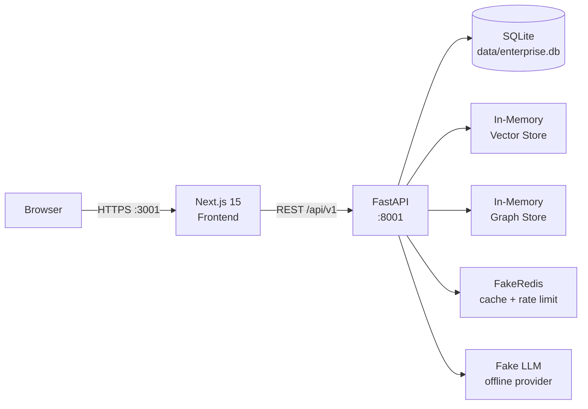
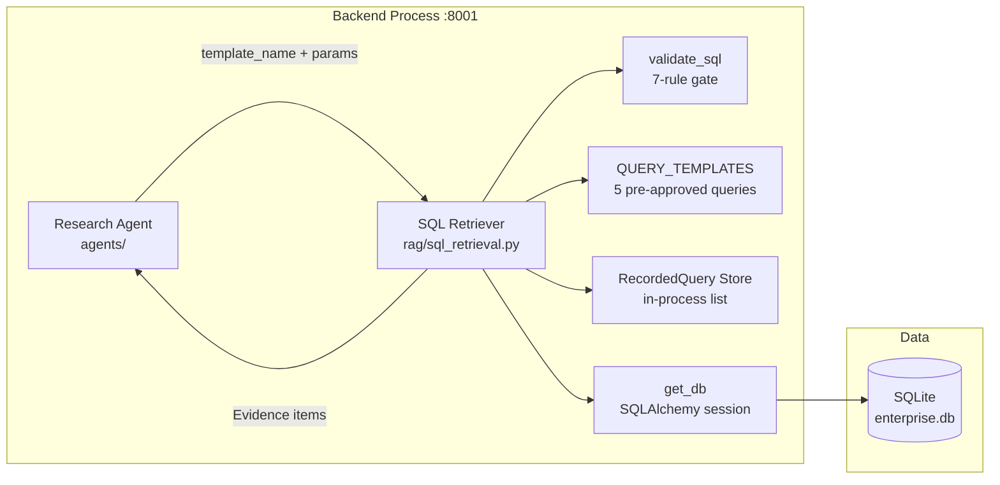
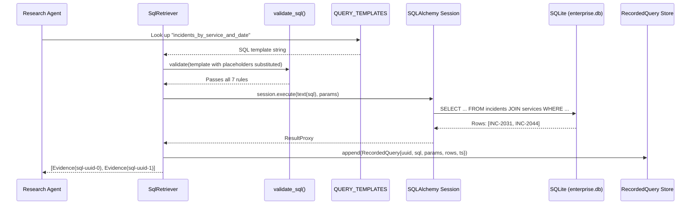
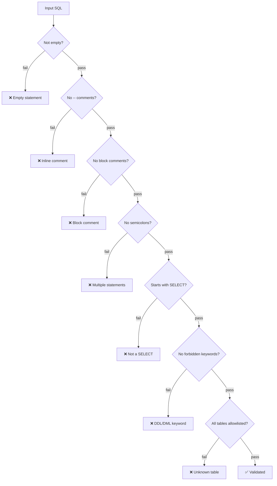
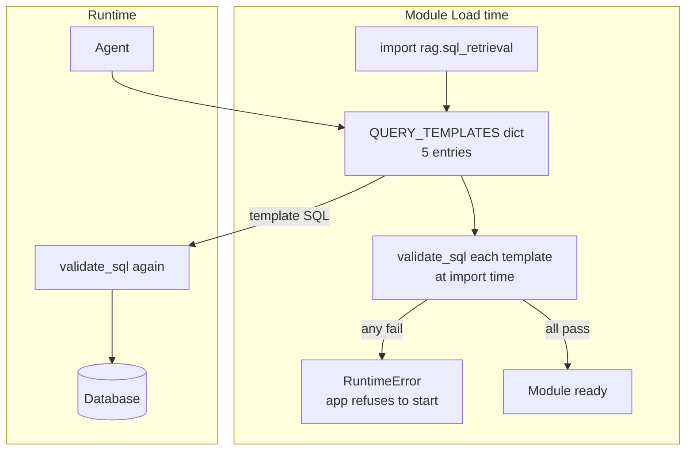
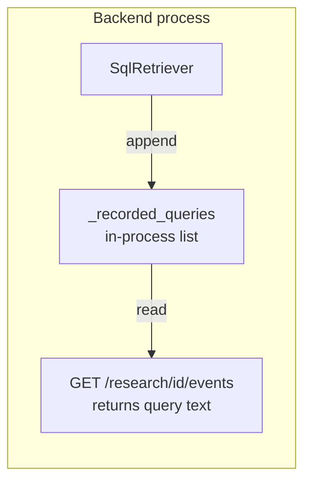
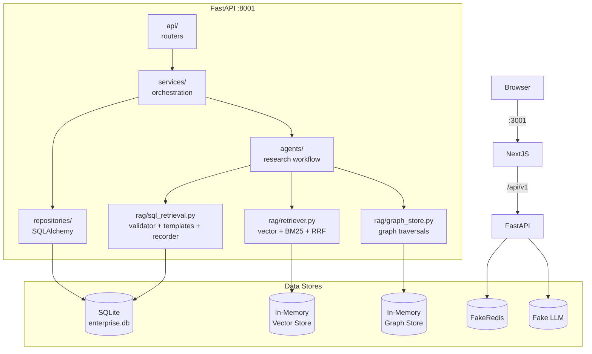

# Phase 8 — Infrastructure Design Evolution: SQL Retrieval

> Component wiring, data flow, and infrastructure topology for the SQL retrieval layer.
> Each section explains what was added, how it connects to existing components, and why.

---

## Infrastructure state entering Phase 8

By the end of Phase 7, the running system had these components:



SQLite was already present — it stores teams, services, incidents, customers, decisions, and all entity data. Phase 8 does not add a new data store; it adds a **new access path** to the existing SQLite (or PostgreSQL in production).

---

## What Phase 8 adds to the infrastructure

Phase 8 adds the SQL retrieval module as a new code-layer component. At the infrastructure level, this means:

- A new Python module (`rag/sql_retrieval.py`) that **reads** from the relational database.
- It uses the existing `get_db()` SQLAlchemy session factory — no new database connection pool.
- An in-process `RecordedQuery` store (a Python list) that acts as a lightweight audit buffer during a research session.



---

## Component wiring: how data flows through the SQL retrieval path

### Step-by-step for the canonical question sub-question "what incidents occurred?"



---

## Validator as a firewall component

The validator is best understood as an **application-layer firewall** that sits between the AI agent and the database.

```mermaid
graph LR
    Agent[AI Agent\n"write any SQL?"] -->|proposed SQL| Gate{validate_sql\n7 rules}
    Gate -->|PASS| DB[(Database)]
    Gate -->|FAIL| ERR[SqlValidationError\nquery rejected]

    style Gate fill:#f90,color:#000
    style ERR fill:#f33,color:#fff
    style DB fill:#393,color:#fff
```

The validator is stateless — it only inspects the SQL string, with no network calls, no database connection, and no side effects. This means it runs in milliseconds and is easy to unit-test in isolation.

**Rules enforced:**



---

## Template registry as a configuration component

The `QUERY_TEMPLATES` dictionary is a **static registry** loaded at module import time. It is validated once at startup. No runtime configuration is needed.



The double-validation (at import + at runtime) means template SQL is checked **twice**. This is an intentional redundancy: it catches developer mistakes early and defends against hypothetical template mutation at runtime.

---

## RecordedQuery store: in-process vs. persistent

In Phase 8 the recorded query store is a Python list in memory:



**Production evolution (Phase 12+):** When the research service persists agent state to the database after every node, recorded queries will be serialised as part of the session's event log. The in-process list is a stepping stone that keeps Phase 8 fully self-contained.

---

## Database access: same session factory, new consumer

Phase 8 reuses the SQLAlchemy session factory already wired up in `backend/app/core/db.py`. The SQL retriever receives a session as a constructor argument (`SqlRetriever(db_session=session)`), keeping it testable:

- In production: a real `Session` from `get_db()`.
- In tests and the offline demo: `None` → returns empty rows, still records the query.

```mermaid
graph TD
    subgraph Test / Offline
        TA[Test / Offline Agent] --> SR1[SqlRetriever\ndb_session=None]
        SR1 -->|empty rows| EV1[Evidence: "returned no results"]
    end

    subgraph Production
        PA[Production Agent] --> SR2[SqlRetriever\ndb_session=Session]
        SR2 --> SL[(SQLite / PostgreSQL)]
        SL --> EV2[Evidence with real rows]
    end
```

This pattern — inject the session, default to None — is the same approach used by the repositories layer in Phase 2.

---

## Full infrastructure view after Phase 8



The key observation: the SQL retriever and the repository layer both access SQLite, but through different channels:
- **Repositories** are used by the API services layer for CRUD operations (Phase 2).
- **SQL retriever** is used by the agent for research queries — it is read-only and query-validated.

They share the same underlying database but serve different purposes and are kept in separate modules.

---

## Offline / CI infrastructure

No new infrastructure components are required for Phase 8 to run offline:

| Component | Phase 8 state |
|---|---|
| SQLite | Already present from Phase 2 |
| SQLAlchemy | Already a dependency |
| `rag/sql_retrieval.py` | New pure-Python module, no external deps |
| `RecordedQuery` store | In-process Python list |
| Test runner | `pytest` with `PYTHONPATH=backend` |

`make test` and `ruff check` are the only commands needed. No Docker, no network, no API key.
