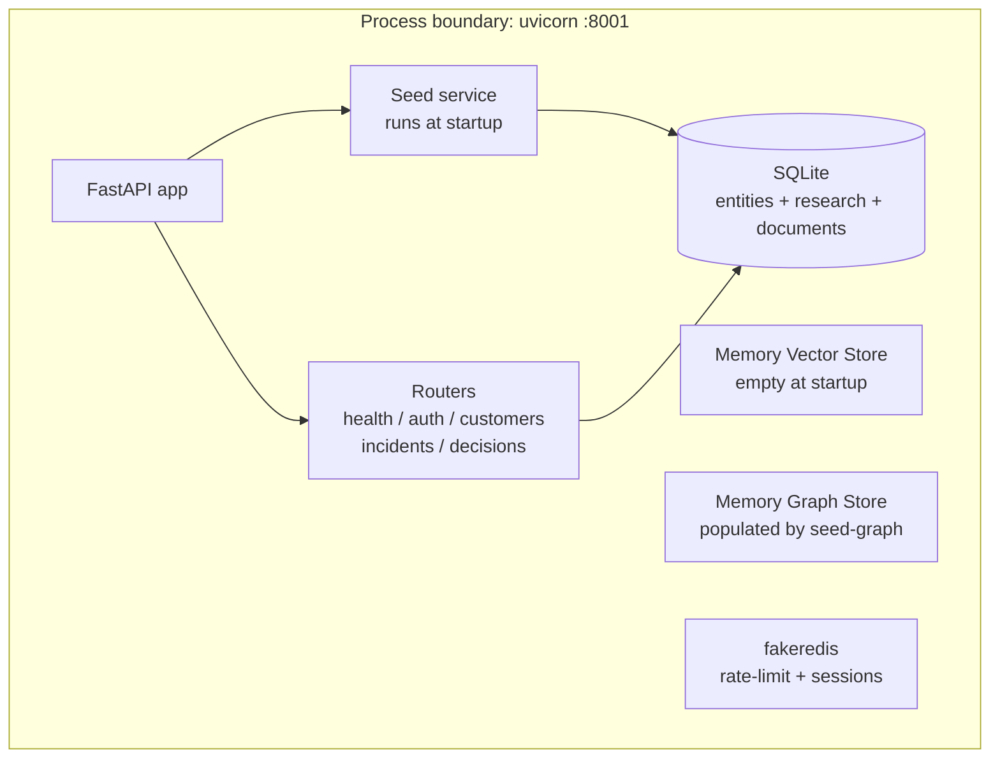
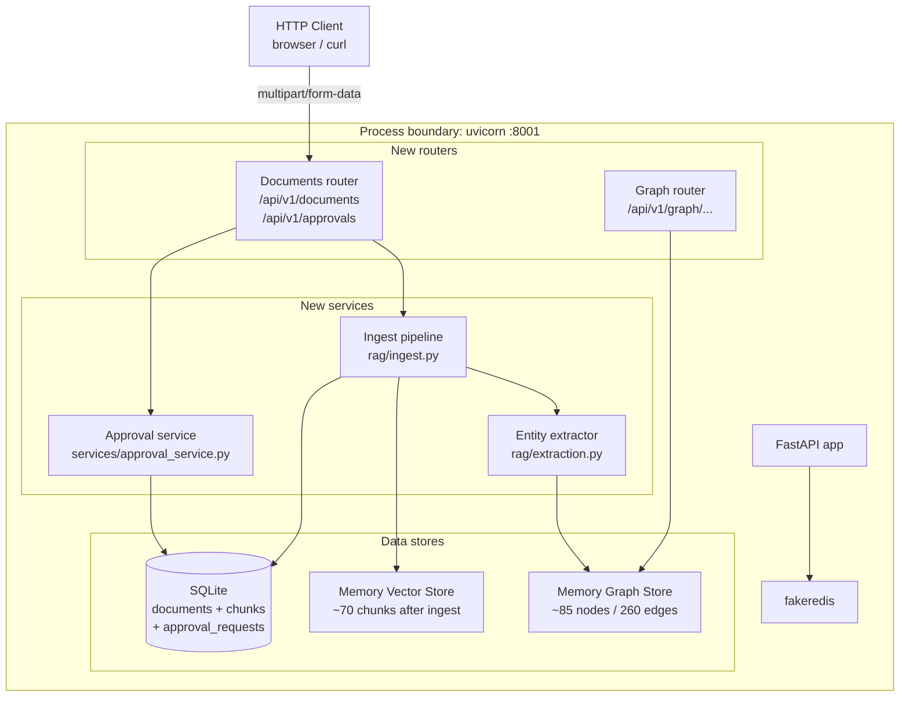
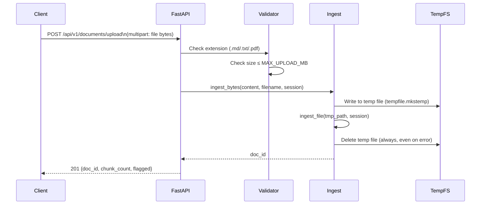
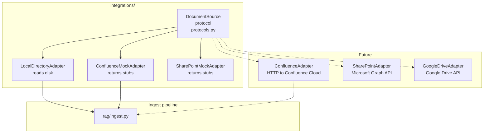
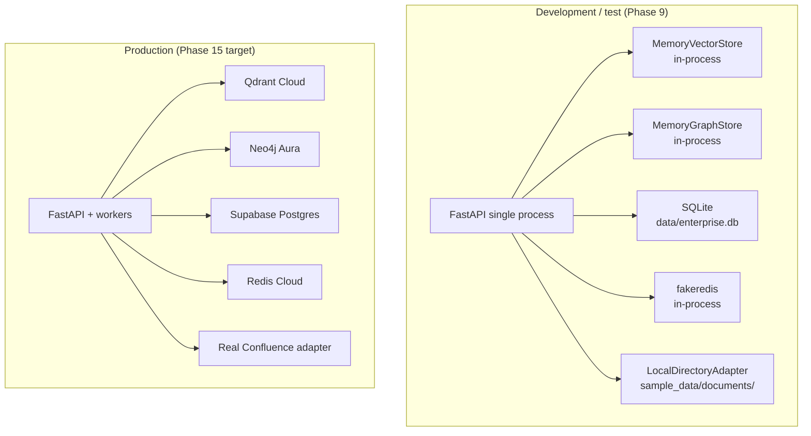

# Phase 9 — Infrastructure Design Evolution: Ingestion and Document Management

## Overview

Phase 9 adds three new infrastructure concerns:
1. **Ingest pipeline** — an internal service that processes files and writes to multiple stores simultaneously
2. **HTTP file upload** — the documents API accepts binary file data from clients
3. **Approval persistence** — a new table records pending/approved/rejected delete requests

No new network components are introduced. Everything still runs in a single process during development.

---

## Component wiring: before Phase 9



The vector store was empty. Graph store was seeded only by running `make seed-graph` manually.

---

## Component wiring: after Phase 9



---

## File upload data flow

File upload uses HTTP multipart/form-data. The `python-multipart` library parses the request body into binary content in memory.



The temp file approach means the ingest pipeline always works with file paths (consistent with the `make ingest` CLI flow) rather than raw bytes streams.

---

## Approval request data flow

```mermaid
graph LR
    subgraph "HTTP layer"
        DEL[DELETE /documents/{id}]
        APPROVE[POST /approvals/{id}/approve]
        REJECT[POST /approvals/{id}/reject]
        LIST[GET /approvals]
    end
    subgraph "Service layer"
        SVC[ApprovalService]
    end
    subgraph "Database"
        AR[(approval_requests table)]
        DOC[(documents table)]
    end

    DEL -->|analyst+| SVC
    SVC -->|INSERT status=pending| AR
    APPROVE -->|admin| SVC
    SVC -->|UPDATE status=approved| AR
    SVC -->|UPDATE doc.status=deleted| DOC
    REJECT -->|admin| SVC
    SVC -->|UPDATE status=rejected| AR
    LIST -->|admin| SVC
    SVC -->|SELECT| AR
```

The document is **never physically deleted** in v1. Setting `status=deleted` hides it from the API. Physical cleanup would be done by a separate job in production.

---

## Knowledge graph API routing

```mermaid
graph TD
    CLIENT[Viewer / Analyst]
    subgraph "Graph API router"
        STATS[GET /graph/stats\nviewer+]
        NODES[GET /graph/nodes\nviewer+ optional ?label=X]
        NODE[GET /graph/nodes/{id}\nviewer+]
        EXPAND[GET /graph/nodes/{id}/neighbors\nviewer+ ?direction=out/in/both]
        CYPHER[POST /graph/cypher\nanalyst+ read-only check]
    end
    subgraph "Graph store (interface)"
        MEMORY[MemoryGraphStore\ndefault in tests + dev]
        NEO4J[Neo4jGraphStore\nwhen GRAPH_STORE=neo4j]
    end

    CLIENT --> STATS
    CLIENT --> NODES
    CLIENT --> NODE
    CLIENT --> EXPAND
    CLIENT --> CYPHER
    STATS --> MEMORY
    NODES --> MEMORY
    NODE --> MEMORY
    EXPAND --> MEMORY
    CYPHER -->|validate_readonly| MEMORY
    MEMORY -.->|swap via config| NEO4J
```

---

## DocumentSource adapter architecture



The `DocumentSource` protocol ensures that any new adapter works with the existing ingest pipeline without changes to `rag/ingest.py`. Adapters are **swappable by configuration**.

---

## Development vs. production topology



The swap from in-memory to production stores requires only config changes (`VECTOR_STORE=qdrant`, `GRAPH_STORE=neo4j`, `DATABASE_URL=postgresql://...`). No code changes.

---

## Network / port summary (Phase 9 — development)

| Component | Port | Protocol | Notes |
|---|---|---|---|
| FastAPI backend | 8001 | HTTP | All requests go here |
| SQLite | n/a | File I/O | `data/enterprise.db` |
| MemoryVectorStore | n/a | In-process | No network call |
| MemoryGraphStore | n/a | In-process | No network call |
| fakeredis | n/a | In-process | No network call |
| Next.js frontend | 3001 | HTTP | Added in Phase 13 |
