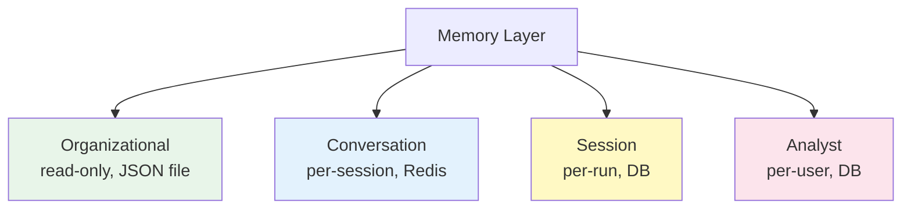
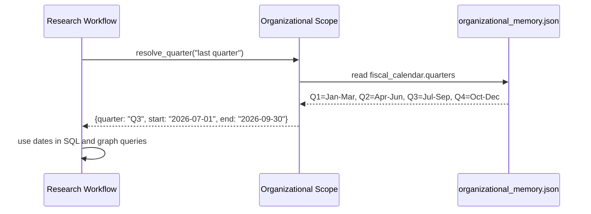
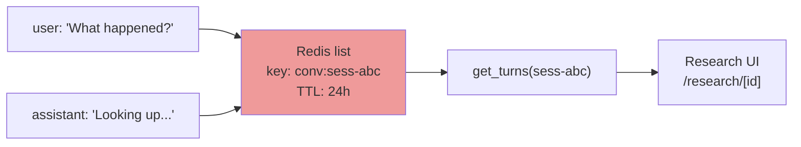
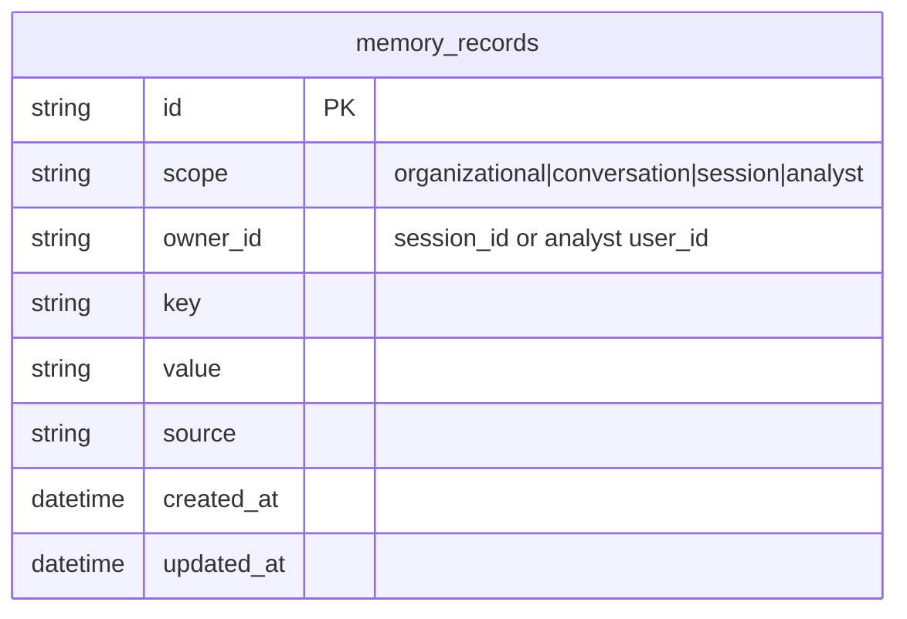
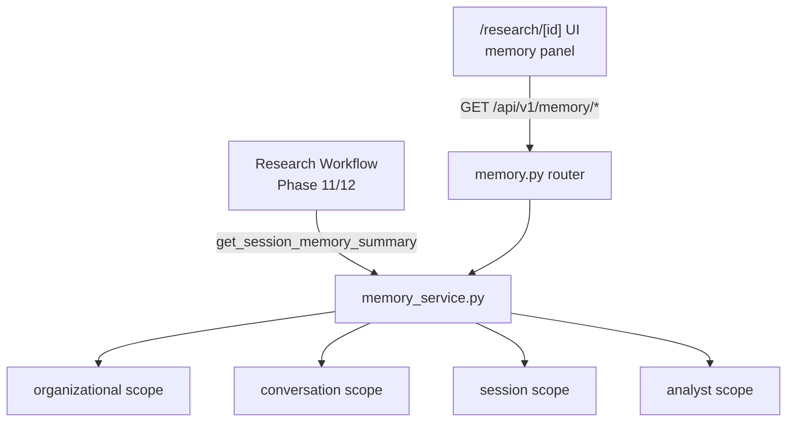
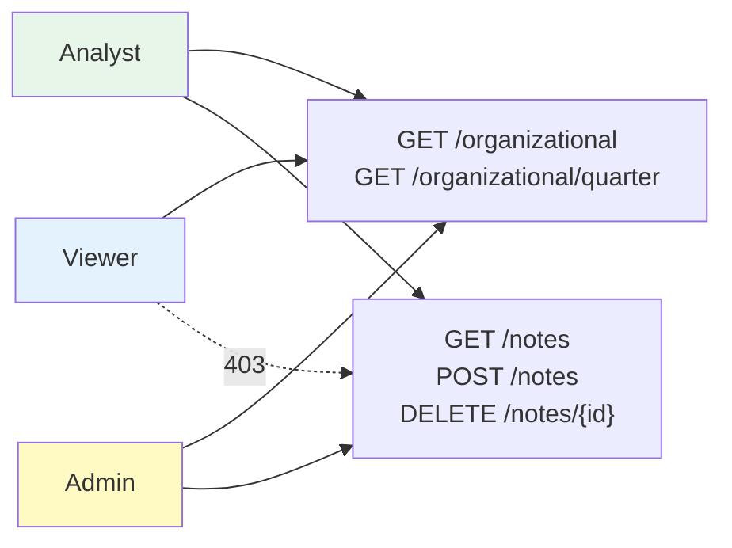
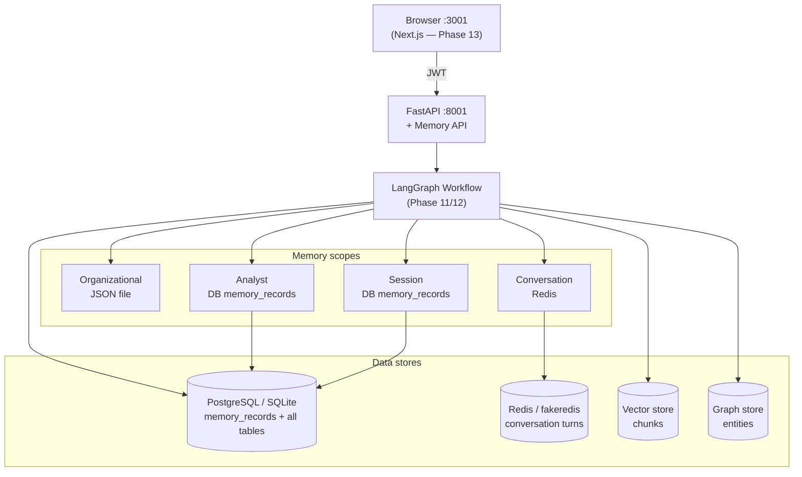

# Phase 10 — Memory: System Design Evolution

## Starting point

After Phase 9, the platform could ingest documents, run SQL and graph queries, and answer questions about incidents, customers, and decisions. But it had no **memory** — every session started from scratch, the assistant couldn't remember what the analyst had previously discussed, and the AI had no way to know that "last quarter" meant July–September 2026.

Phase 10 adds the memory layer that makes the assistant context-aware.

---

## Step 1 — Identifying the four memory scopes

The first design decision was to separate memory into **four distinct scopes**. Each scope has a different lifetime, a different owner, and a different storage backend.

**Why four and not one?** Because the concerns are fundamentally different:
- **Organizational** is shared across the whole company and never changes at runtime.
- **Conversation** is temporary (24 h), lives in a fast in-memory store, and needs no persistence guarantee.
- **Session** is temporary per-run, used by the AI workflow, not by the analyst directly.
- **Analyst** is personal and must be isolated — Alice's notes are never visible to Bob.

---

## Step 2 — Organizational memory and quarter resolution

The organizational scope reads from a fixed JSON file and exposes a `resolve_quarter()` function. This converts natural-language time labels into concrete date ranges.

This is the backbone of the canonical question ("which customers were impacted **last quarter**"). Without it, the SQL query would have no date range to filter on.

---

## Step 3 — Conversation memory in Redis

Each research session has a unique ID. As the user and assistant exchange messages, turns are stored in a Redis list under the key `conv:{session_id}`.

**Fakeredis for offline**: When `REDIS_URL` is empty (the default), the system uses `fakeredis` — a Python in-memory Redis implementation. No real Redis server needed to run tests or the demo.

---

## Step 4 — Session and analyst memory in the database

Both the session and analyst scopes use the same `memory_records` table that was added in Phase 2 (`MemoryRecord` model). The `scope` column distinguishes them.

**Session scope**: `owner_id = research_session_id`. Deleted after the run is complete.

**Analyst scope**: `owner_id = analyst.user_id`. Persisted indefinitely until the analyst deletes it. The API enforces ownership: `get_one()` and `delete()` both filter on `owner_id` before returning or deleting.

---

## Step 5 — Memory service: unified interface

The `memory_service.py` module wraps all four scopes behind a single API. The research workflow (Phase 11/12) will call one function to get everything it needs:

The key function `get_session_memory_summary(db, redis, session_id, analyst_id)` returns all four scopes in a single call — ready for the UI's memory panel.

---

## Step 6 — Memory API and RBAC

Three sets of endpoints were added under `/api/v1/memory/`:

The ownership invariant is enforced at both the service layer (SQL `WHERE owner_id = analyst_id`) and the API layer (the endpoint reads `user.user_id` from the JWT).

---

## Full system design after Phase 10

The memory layer sits alongside the retrieval layer but never feeds into it — memory provides context for reasoning; retrieval provides evidence for citation.

---

## Key design decisions

| Decision | Alternative considered | Why this way |
|---|---|---|
| Four separate scopes | One unified memory | Different lifetimes, owners, and backends make one model unworkable |
| Organizational memory as a JSON file | Seed it into the DB | It's static config, not runtime data; a file is simpler and always available |
| Conversation memory in Redis | In the DB | Redis gives fast ordered lists with TTL; the DB is overkill for ephemeral turns |
| Session + analyst in the same `memory_records` table | Separate tables | The `scope` column is enough to distinguish them; one table is easier to query |
| Ownership enforced in SQL | In Python after fetching | SQL-level filtering prevents accidental leakage if the Python layer has a bug |
| Memory never cited as evidence | Cite memory like documents | Memory is context, not a verifiable source; mixing them would corrupt citations |
