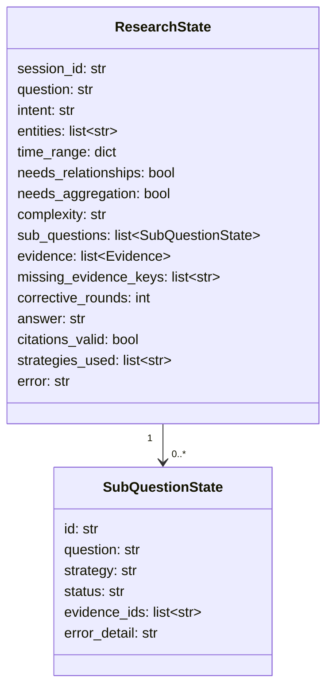
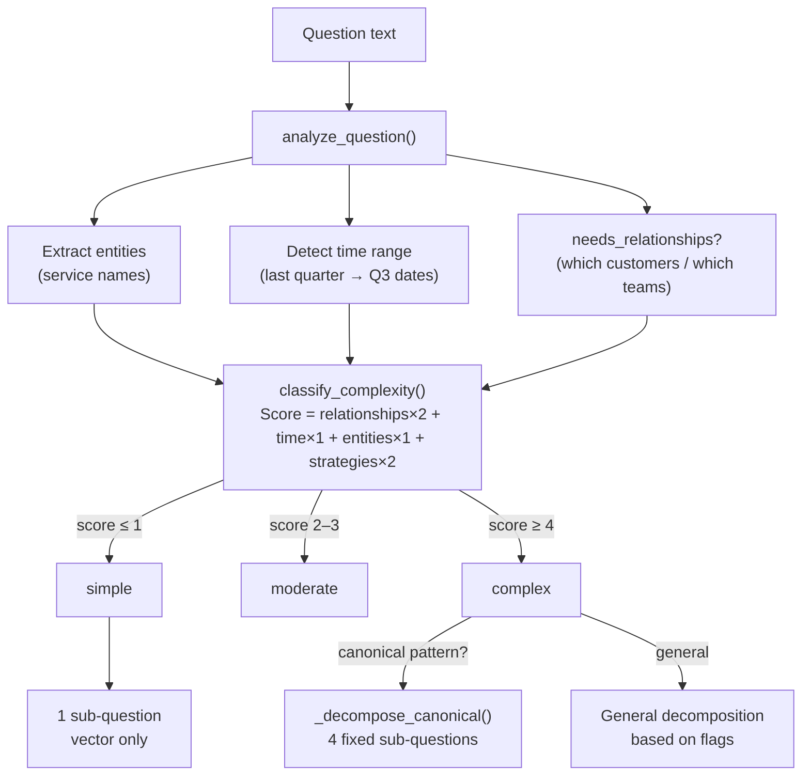
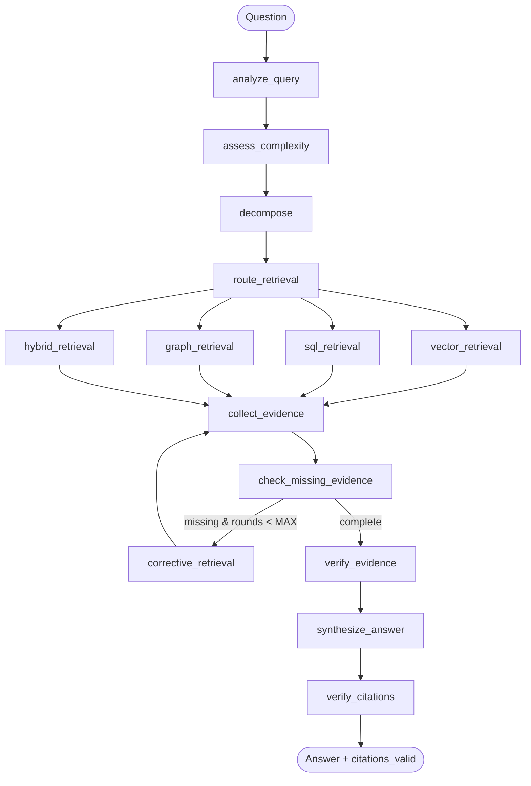
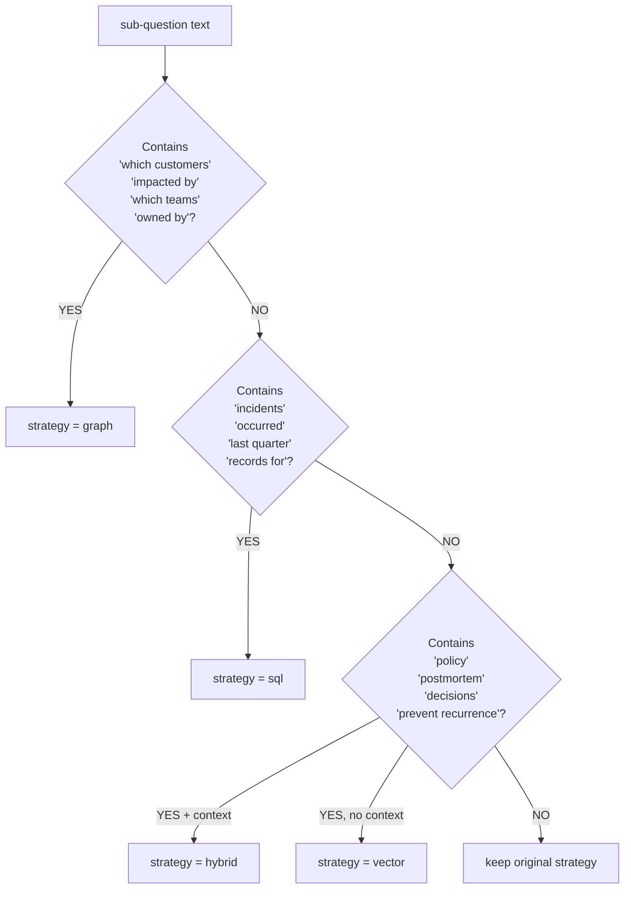
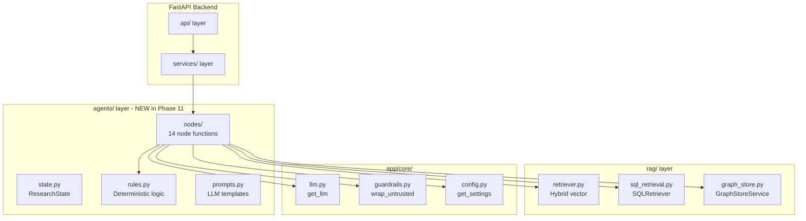

# Phase 11 — Project System Design Evolution

## Starting Point: What Existed Before Phase 11

After Phases 1–10 we had:
- A fully configured FastAPI backend with auth, middleware, and health checks
- Four data stores: SQLite (SQL), MemoryVectorStore (documents), MemoryGraphStore (graph), Redis/fakeredis (memory)
- Complete retrieval tools: hybrid vector search, SQL templates, typed Cypher traversals
- Four memory scopes: organizational, conversation, session, analyst
- Guardrails for injection detection and output scrubbing
- A `ResearchSessionOut` schema waiting for a workflow to fill it

**Missing:** The workflow that actually runs — the agent brain that connects questions to answers.

---

## Design Stage 1: The Research State (TypedDict)

Before writing any node, we needed to define the shared state that flows through every step.



**Design choice:** Use a Python `TypedDict` (not a Pydantic model, not a class) because:
- LangGraph expects dict-compatible state
- TypedDict provides IDE autocomplete and type checking at zero runtime cost
- The same dict can be spread with `{**state, "new_key": value}` to create updated copies

---

## Design Stage 2: Rules Layer — Deterministic Logic

The first file written was `agents/rules.py`. It answers: "What do we always do, regardless of the AI?"



**Key guarantee from CLAUDE.md:** A relationship question is **never** routed vector-only.  
`correct_routing()` is called after decomposition and hard-overrides any strategy that violates this.

---

## Design Stage 3: The 14-Node Workflow

Each node is a pure function: `(ResearchState) → ResearchState`. Nodes don't call HTTP, don't
hold persistent state, and don't know about each other.



---

## Design Stage 4: Routing Decision Logic

The routing node is where the "rules beat AI" guarantee is enforced.



---

## Design Stage 5: Evidence Flow and Citation Model

```mermaid
sequenceDiagram
    participant VR as vector_retrieval
    participant SR as sql_retrieval
    participant GR as graph_retrieval
    participant HR as hybrid_retrieval
    participant CE as collect_evidence
    participant SA as synthesize_answer
    participant VC as verify_citations

    VR ->> CE: Evidence[source_type=document, id=ev-abc]
    SR ->> CE: Evidence[source_type=sql, id=sql-xyz-0]
    GR ->> CE: Evidence[source_type=graph, id=ev-graph-ab]
    HR ->> CE: Evidence[source_type=document, id=ev-def] + Evidence[source_type=graph, id=ev-graph-cd]

    CE ->> CE: deduplicate by id
    CE ->> CE: assign citation_number 1,2,3...
    CE ->> SA: deduped Evidence list

    SA ->> SA: wrap each item with untrusted-data sentinels
    SA ->> SA: prompt LLM with evidence + question
    SA ->> VC: answer = "...customers [1] were impacted [3]..."

    VC ->> VC: extract {1,3} from answer
    VC ->> VC: valid_set = {1,2,3,4,5} (len(evidence))
    VC ->> VC: invalid = {1,3} - {1,2,3,4,5} = {}
    VC -->> END: citations_valid = True
```

---

## Design Stage 6: Corrective Retrieval Loop

```mermaid
flowchart LR
    CE[collect_evidence] --> CME[check_missing_evidence]
    CME --> COND{missing_keys != []\nAND rounds < max?}
    COND --> |YES\nrounds += 1| CR[corrective_retrieval\nbroadened vector search]
    CR --> CE
    COND --> |NO| VE[verify_evidence]
```

**Bounded loop guarantee:** `MAX_CORRECTIVE_ROUNDS=1` (from settings).  
`should_correct()` checks `rounds < settings.max_corrective_rounds` before routing to `corrective_retrieval`.  
No matter what, the loop runs at most `max_corrective_rounds` extra times, then falls through to `verify_evidence`.

---

## Final Architecture After Phase 11



**Layer rules strictly observed:**
- `agents/` imports from `rag/` and `app/core/` — not from `app/api/` or `app/services/`
- `app/core/` never imports `agents/` (would create a cycle)
- Each node is independently testable with fake stores
