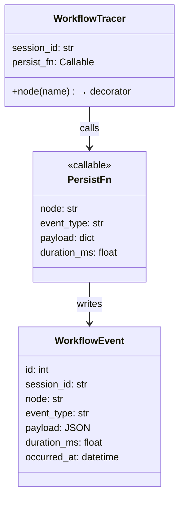
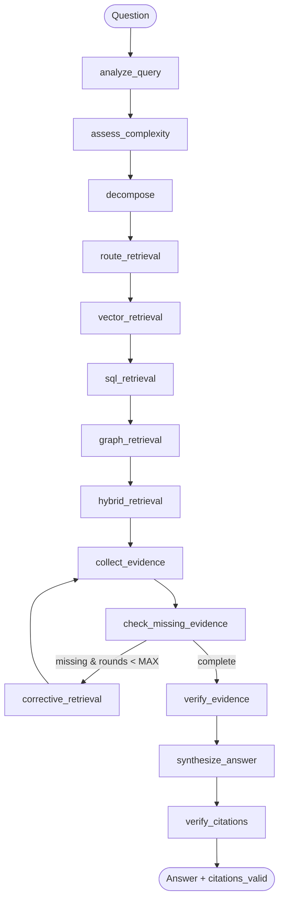
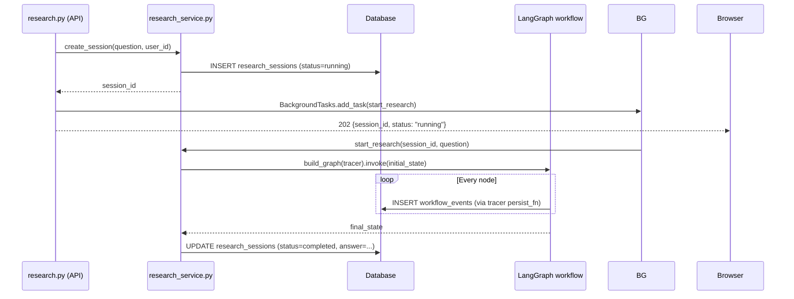
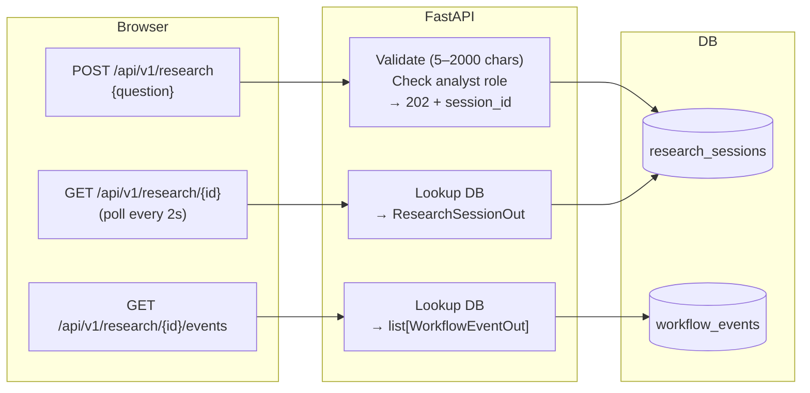
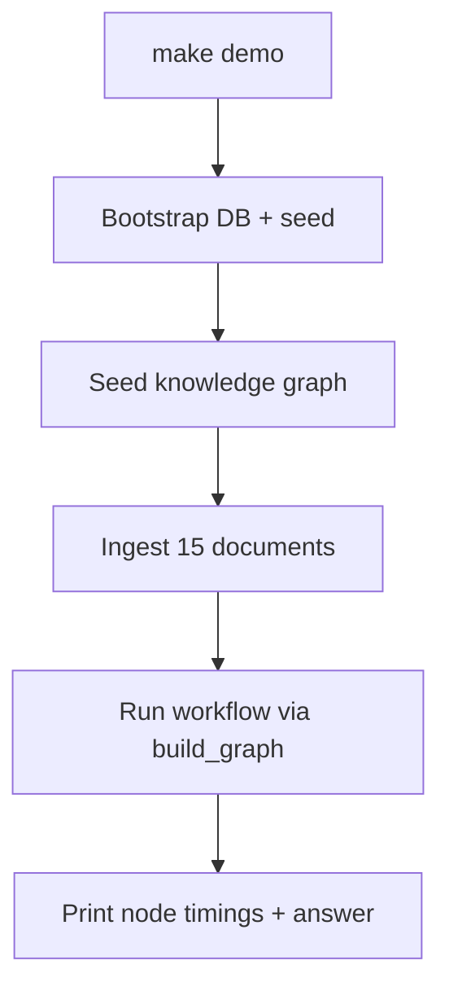
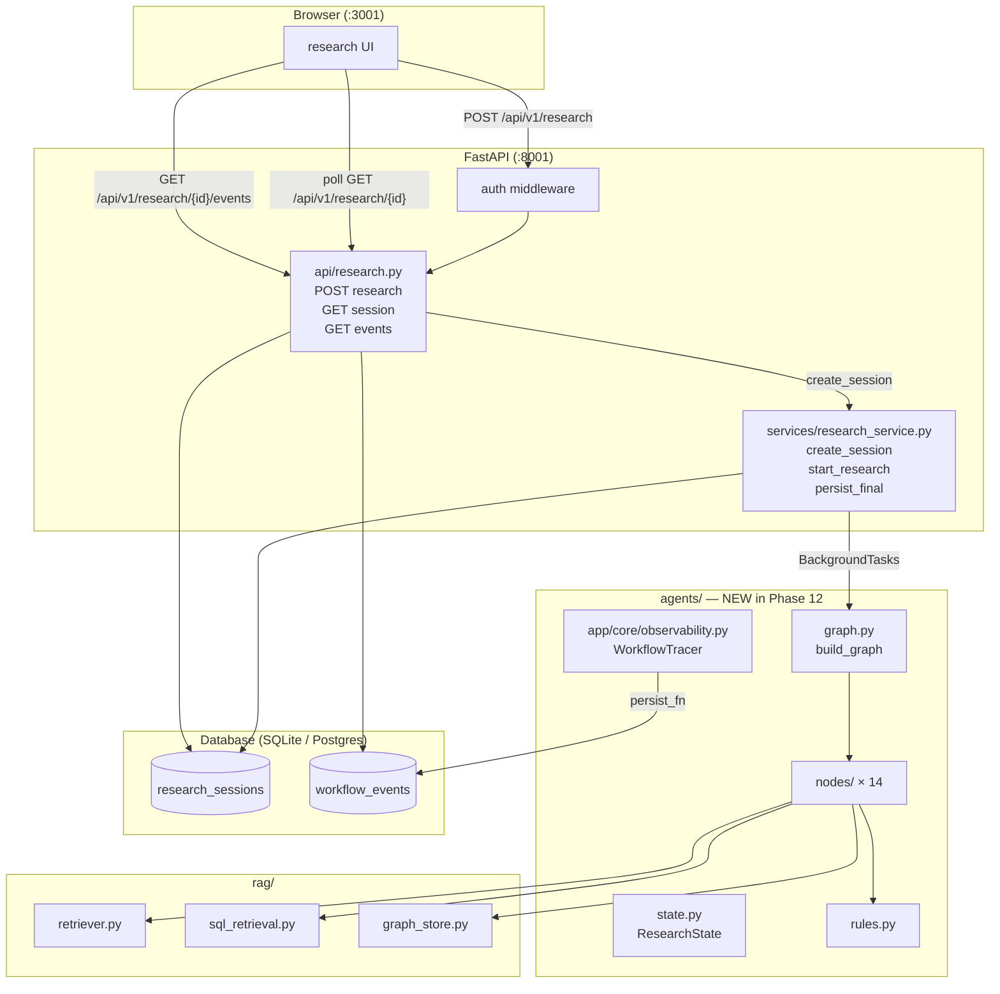

# Phase 12 — Project System Design Evolution

## Starting Point: What Existed Before Phase 12

After Phases 1–11 we had:
- A fully configured FastAPI backend with auth, middleware, health, and all browse APIs
- A complete retrieval layer: vector, SQL, graph, hybrid
- 14 individual node functions that each perform one step of the research workflow
- Deterministic rules for analysis, complexity, decomposition, and routing
- Four memory scopes
- Guardrails, approval service, ingestion pipeline

**Missing:** The completed workflow (connecting nodes together), the research service (running it in the background), and the research API (the HTTP front door).

---

## Design Stage 1: The Workflow Tracer

Before connecting nodes, we needed a way to observe every node transition. The `WorkflowTracer` wraps any node function and records timing data to the database.

**Design choice:** The tracer receives `persist_fn` as a constructor argument (dependency injection). This means:
- The tracer never imports `research_service.py` (no cycle)
- In tests, `persist_fn` can be a no-op or a list collector
- The service layer controls the database session lifetime

---

## Design Stage 2: Graph Wiring

The 14 nodes are connected into a LangGraph `StateGraph`. The assembly is defined in `agents/graph.py`.

**Key design decision:** All four retrieval nodes run sequentially (not in parallel). Each node only processes sub-questions whose `strategy` matches its type — the others pass through unchanged. This means:

- For a simple question: `vector_retrieval` acts, the other three pass through
- For the canonical question: `graph_retrieval` handles sq1 and sq3; `sql_retrieval` handles sq2; `hybrid_retrieval` handles sq4

This is simpler than parallel fan-out for v1 and avoids race conditions on the shared evidence list.

---

## Design Stage 3: Research Service

The `ResearchService` orchestrates the workflow. It is called by the API layer but never imports FastAPI types.

**Why BackgroundTasks?** FastAPI's `BackgroundTasks` runs the workflow after the HTTP response is sent. The workflow takes 7+ seconds with fake providers; without background tasks, the browser would time out.

---

## Design Stage 4: Research API

Three endpoints expose the research workflow over HTTP.

**RBAC enforcement:**
- `POST /api/v1/research` → requires `analyst` role (minimum)
- `GET /api/v1/research/{id}` → requires `viewer` role (everyone logged in)
- `GET /api/v1/research/{id}/events` → requires `viewer` role

---

## Design Stage 5: make demo

The demo script bootstraps the database, seeds data, ingests documents, and runs the workflow end-to-end, printing each node's timing and the final answer.

---

## Final Architecture After Phase 12

**Everything is now connected.** The browser can submit a question, receive an immediate response, and poll for the result while the AI assembly line runs in the background.
