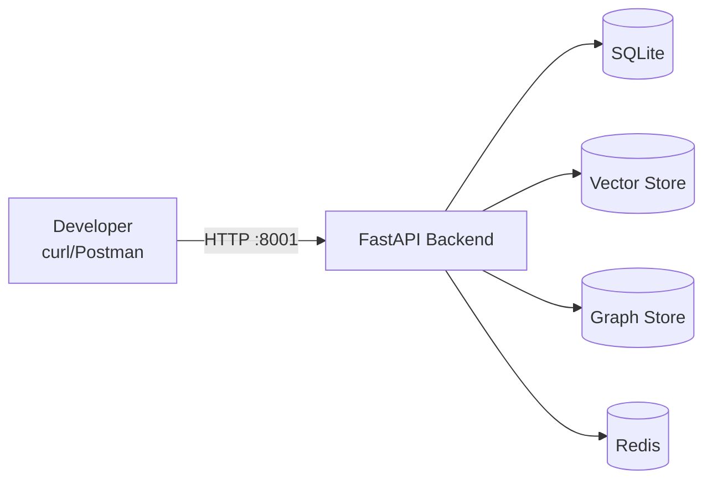
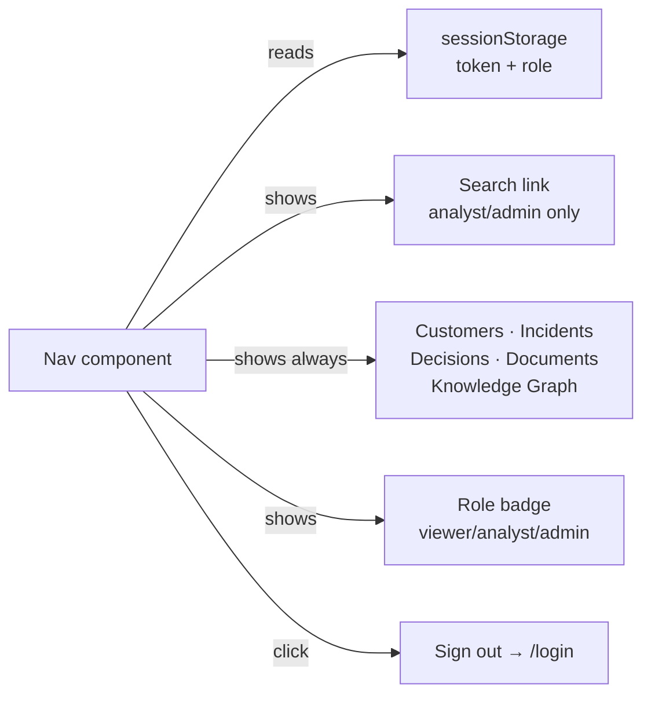
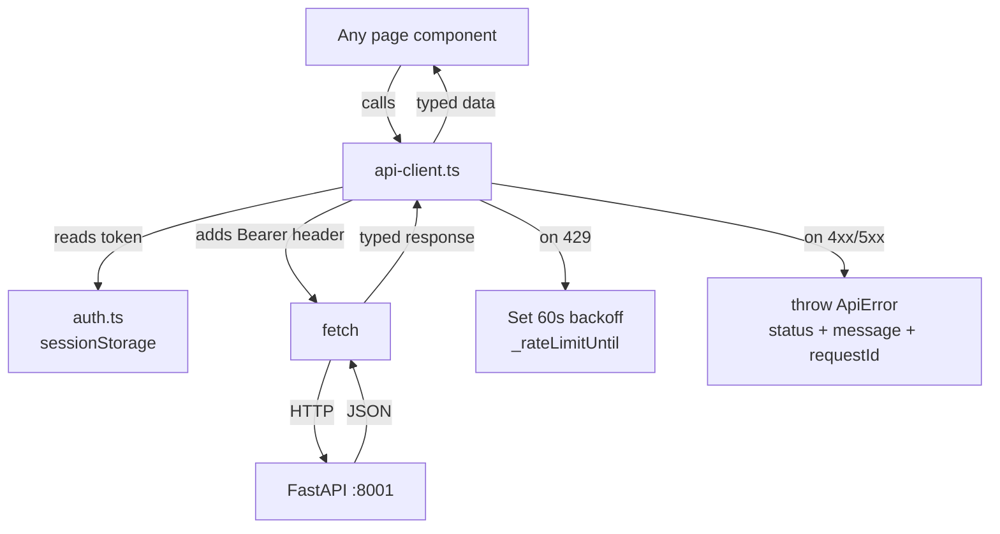
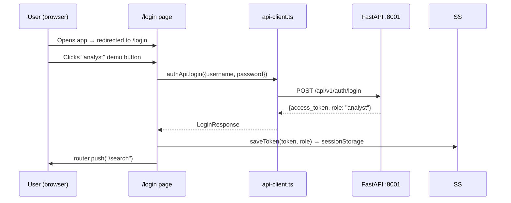
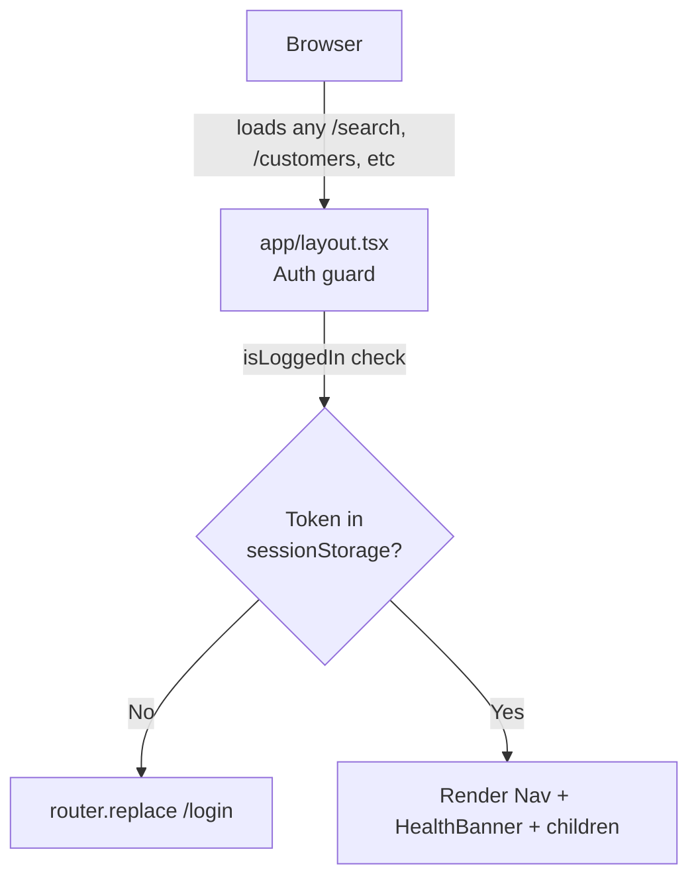
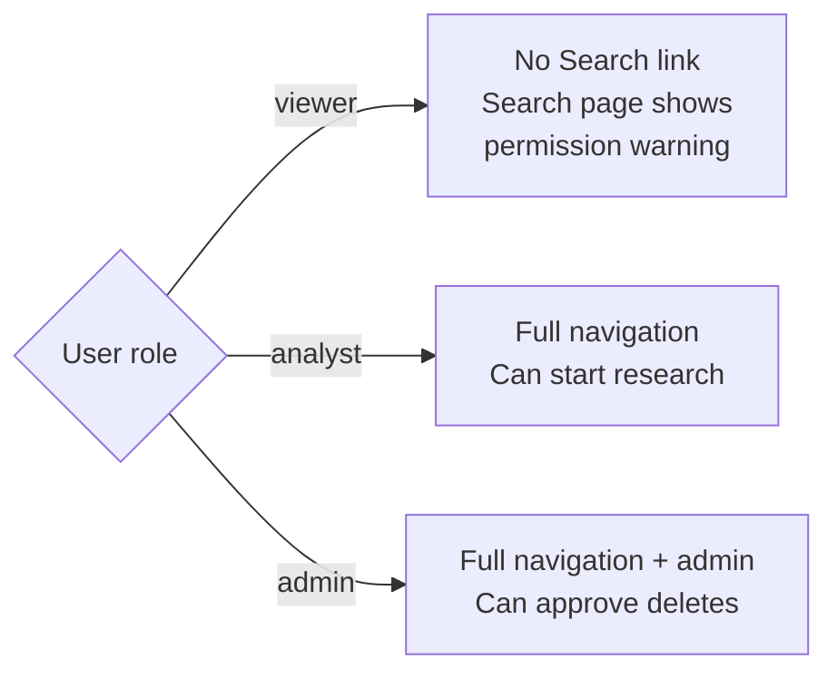
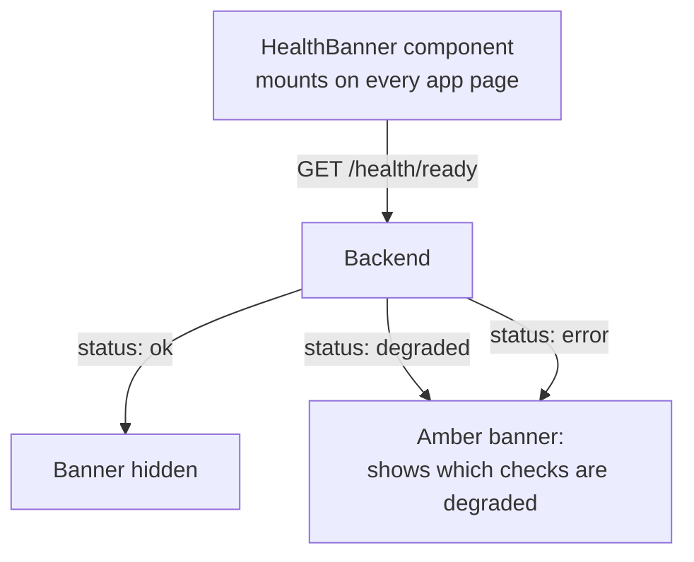
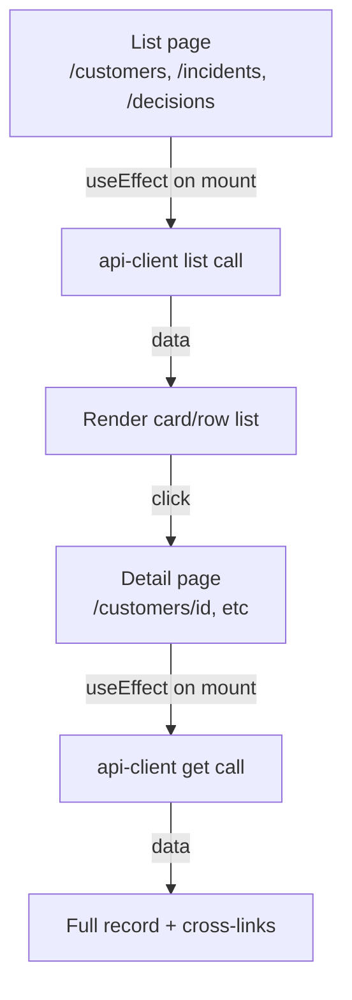
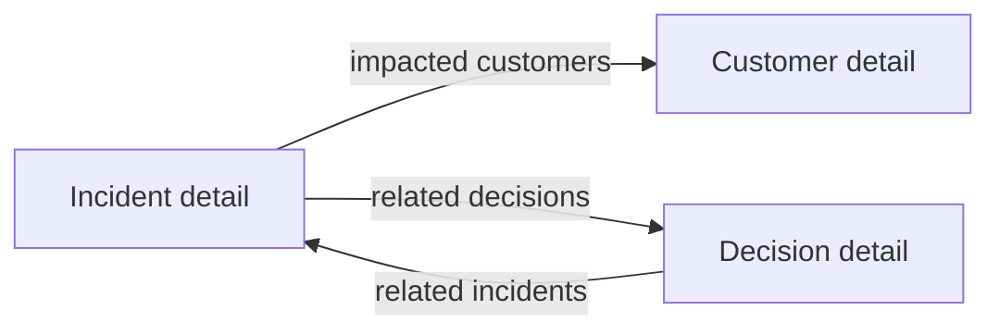

# Phase 13 — Project System Design Evolution: Console Shell

## Starting point: an API with no face

At the beginning of Phase 13 the backend was complete and tested. The system had a full REST API, a LangGraph research workflow, vector/graph/SQL retrieval, and 293 passing tests. But there was no user interface. All interaction required raw HTTP calls.



**Problem:** A recruiter, an analyst, or a demo audience cannot use a curl command. The platform needs a face.

---

## Step 1: Add a Next.js shell (P13-1)

The first task creates the application skeleton — the frame into which all pages will be added. At this point there are no pages yet, just the structural plumbing.

```mermaid
graph TD
    Browser[Browser :3001] -->|Next.js App Router| NS[App Shell]
    NS --> RootLayout[Root layout\napp/layout.tsx]
    NS --> GlobalCSS[Tailwind globals.css]
    NS --> RootPage[Root page\nRedirects to /login or /search]

    NS -->|rewrites via next.config.ts| Proxy[/api/v1/* → :8001]
    NS -->|rewrites| HealthProxy[/health/* → :8001]
```

**Key design decision:** Next.js rewrites proxy `/api/v1/*` to the FastAPI backend at `localhost:8001`. From the browser's perspective, it is talking to the same origin, which eliminates Cross-Origin Resource Sharing (CORS) complexity in the development environment.

**Navigation bar** is added as a shared component used by all authenticated pages. It reads the user's role from sessionStorage and shows/hides the Search link accordingly (viewers cannot start research).



---

## Step 2: Typed API client (P13-2)

Before any page can display data, the UI needs a disciplined way to call the backend. The typed API client in `frontend/lib/api-client.ts` is the single point through which all network calls flow.



**TypeScript types** in `frontend/lib/types.ts` mirror the schemas in `backend/app/schemas/` exactly. Any change to the backend contract immediately produces a TypeScript error in the frontend — the type system acts as a contract enforcer.

**Rate limit handling:** when the backend returns HTTP 429, the client records a `_rateLimitUntil` timestamp 60 seconds in the future. Any subsequent call before that time throws immediately with a human-readable message. This satisfies the FRONTEND_ASSUMPTIONS.md requirement without burdening each component with retry logic.

---

## Step 3: Login and role-aware layout (P13-3)

This step adds the authentication layer that guards all pages.

### Login flow



### Auth guard on every protected page

The `(app)/layout.tsx` wraps every page inside the authenticated section. It runs client-side on first render:



### Role-aware UI



The backend still enforces 403 — the UI restriction is a convenience, not a security boundary.

### Health banner



---

## Step 4: Browse pages (P13-4)

The browse pages form the "read-only window" into the enterprise data. They follow a consistent pattern:



### Cross-linking between entities

The incident detail page links out to both impacted customers and related decisions. The decision detail page links back to incidents. This creates a navigable web of related records.



This cross-linking is what makes the platform useful for root-cause analysis without having to run a research query. For deeper questions, the Search page (P13-1) passes control to the AI engine.

---

## Final architecture at the end of Phase 13

```mermaid
graph TD
    subgraph Browser [:3001]
        LP[/login\nLoginPage]
        SP[/search\nSearchPage analyst/admin]
        CP[/customers\nCustomersPage + detail]
        IP[/incidents\nIncidentsPage + detail]
        DP[/decisions\nDecisionsPage + detail]
        DocP[/documents\nDocumentsPage]
        KGP[/knowledge-graph\nPlaceholder]
        RP[/research/id\nResearchSessionPage\n2s poll]
        Nav[Nav + HealthBanner shared]
    end

    subgraph API Client [frontend/lib]
        AC[api-client.ts\nauthApi · customersApi\nincidentsApi · decisionsApi\nresearchApi · documentsApi]
        AT[auth.ts\nsaveToken · getToken\nclearToken · canStartResearch]
        TY[types.ts\nall TypeScript types]
    end

    Browser -->|all calls via| AC
    AC -->|JWT Bearer| Backend[FastAPI :8001]

    Backend --> DB[(SQLite / PostgreSQL)]
    Backend --> VS[(Vector Store)]
    Backend --> GS[(Graph Store)]
    Backend --> Redis[(Redis / fakeredis)]
    Backend --> LLM[(LLM provider)]
```

**What changed from Phase 12 to Phase 13:**
- Added the entire `frontend/` directory (19 files)
- Added `make frontend` target to the Makefile
- The backend is unchanged; Phase 13 only adds a consuming client

---

## Design principles applied in Phase 13

| Principle | How it is applied |
|-----------|------------------|
| Single typed API client | All 19 endpoints defined in one file; no ad-hoc fetch anywhere |
| Role enforcement at both layers | UI hides analyst features from viewers; backend still returns 403 |
| Degrade, don't crash | Health banner shows degraded state; pages still render |
| Token in sessionStorage | Clears on tab close; no localStorage persistence of credentials |
| 2-second poll stops on terminal state | Research session page stops polling on "completed" or "error" |
| Rewrites eliminate CORS | Backend URL never hardcoded in browser bundle for production |
