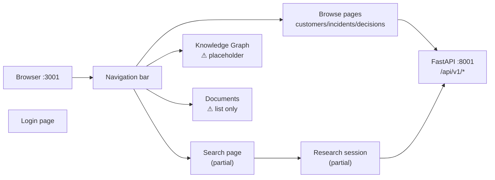
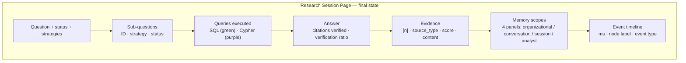
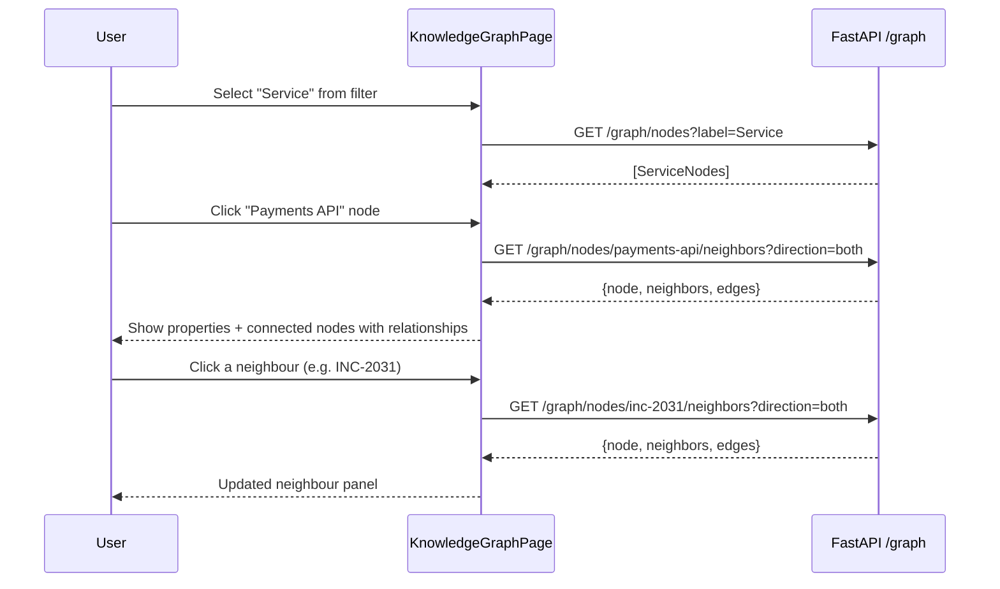
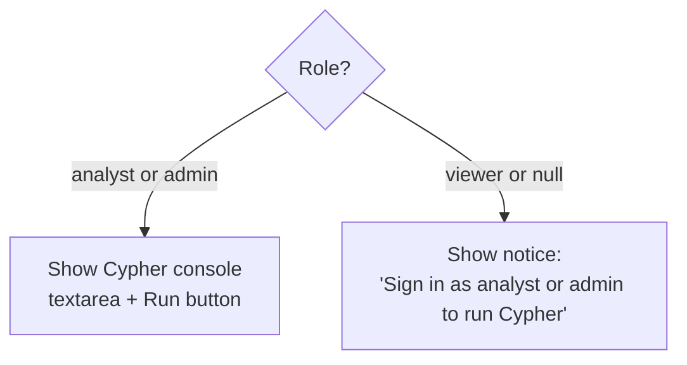
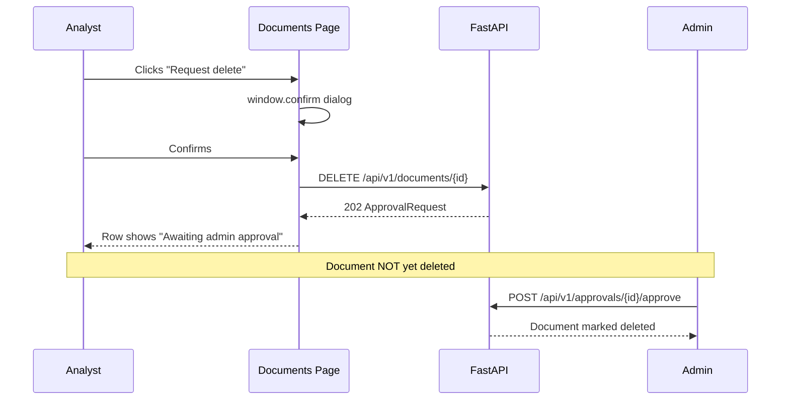
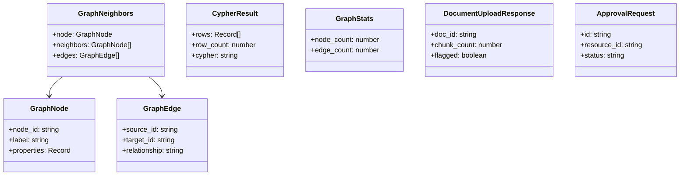
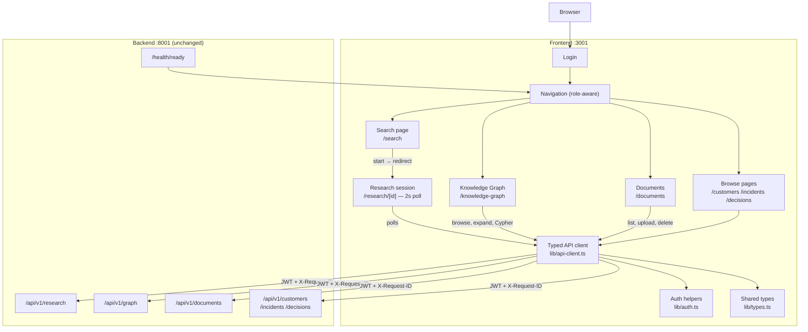

# Phase 14 — Project System Design Evolution

## Overview

Phase 14 completes the NovaEnterprise frontend, wiring the AI research engine and knowledge graph directly into the browser. The backend is unchanged; all evolution is in the Next.js client layer.

---

## Stage 1: Before Phase 14 — Console shell with placeholders

After Phase 13 the frontend had:
- Working browse pages (customers, incidents, decisions, documents list)
- A partially functional search page
- A research session page with basic sub-question and evidence rendering
- **Placeholder** knowledge-graph and documents pages



---

## Stage 2: Completing the Research Session Page

The first gap to fill was the research session page. It needed to show everything the API returns.

### What was added

| Section | Before | After |
|---------|--------|-------|
| Sub-questions | Showed ID, strategy, status, text | Unchanged (already correct) |
| Queries executed | Missing | SQL in green boxes + Cypher in purple boxes, derived from evidence |
| Answer | Showed text | Now shows verification ratio and citation count |
| Evidence | Showed source type + content | Same; now SQL/graph locators also shown in queries panel |
| Memory scopes | Missing | Organisational / Conversation / Session / Analyst scopes shown |
| Event timeline | Showed node name + event type | Now shows formatted timing per step |



**Key design insight**: the SQL queries and Cypher statements are derived from the `evidence` list already returned by the API — `evidence.locator` holds the query text, and `evidence.source_type` discriminates SQL from graph. No new API endpoint is needed.

---

## Stage 3: Knowledge Graph Explorer

This was the most complex new page. It needed to work without a visual canvas library (no D3 or Cytoscape added) while still being interactive.

### Design: text-based node browser

```mermaid
graph LR
    subgraph "Knowledge Graph Page"
        Stats["Stats bar\nnodes · edges"]
        Filter["Label filter\nService / Incident / Customer…"]
        NodeList["Node list\n(scrollable, clickable)"]
        NeighborPanel["Neighbour panel\nproperties + connected nodes"]
        Cypher["Cypher console\n(analyst+ only)"]
    end

    Filter -->|GET /graph/nodes?label=| NodeList
    NodeList -->|click| NeighborPanel
    NeighborPanel -->|GET /graph/nodes/{id}/neighbors| NeighborPanel
    NeighborPanel -->|click neighbour| NeighborPanel
    Cypher -->|POST /graph/cypher| Cypher
```

### Interaction flow



### Role enforcement on Cypher console



---

## Stage 4: Documents Page with Upload and Delete

```mermaid
graph TD
    subgraph "Documents Page"
        List["Document list\nfilename · chunks · size · status"]
        Upload["Upload form\nfile picker + Upload button\n(analyst+ only)"]
        DeleteBtn["Request delete button\n(analyst+ only, per row)"]
        PendingMsg["Awaiting admin approval\n(after request submitted)"]
    end

    Upload -->|POST /documents/upload| List
    DeleteBtn -->|confirm dialog| DeleteBtn
    DeleteBtn -->|DELETE /documents/{id}| PendingMsg
```

**Approval flow**:



---

## Stage 5: Types and API client extensions

The typed API client was extended to cover the new endpoints.



---

## Final Architecture: Phase 14



---

## Summary of design decisions in Phase 14

| Decision | Alternative considered | Why chosen |
|----------|----------------------|------------|
| SQL/Cypher extracted from evidence.locator | Separate API endpoint for query log | Avoids a new backend endpoint; locator already carries query text |
| Text-based graph explorer | D3 / vis.js canvas | Zero extra dependencies; works in any browser; accessible |
| Tailwind static class names (no dynamic strings) | Template-literal class strings | Dynamic strings are purged by Tailwind's content scanner |
| `window.confirm` for delete | Custom modal component | Simple; appropriate for a low-frequency admin action |
| `sessionStorage` for JWT | `localStorage` | Clears automatically on tab close; reduces window of token theft |
| Polling every 2 s | WebSocket | Simpler; backend already emits events via REST polling endpoint |
