# Phase 15 — Project System Design Evolution

## Overview

Phase 15 completes the NovaEnterprise platform by adding the outer ring of production readiness: evaluation, packaging, deployment, and an external integration surface. No core business logic changes — this phase proves the platform works and shows how to run it anywhere.

---

## Stage 1: Before Phase 15 — Working platform, no delivery layer

After Phase 14 the platform had all 14 phases of business logic running. What was missing:

- No automated quality gate on AI answer quality
- No packaging (Dockerfiles) — required a manual Python + Node.js setup
- No single-command deployment (Compose)
- No external integration surface (MCP)
- No automated hygiene checks

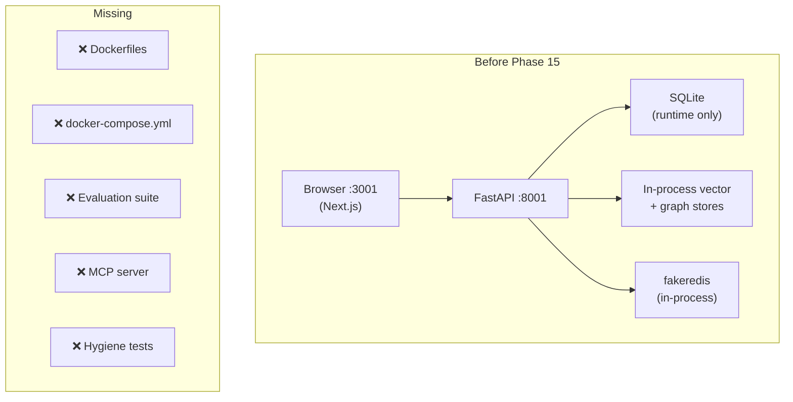

---

## Stage 2: Evaluation suite (P15-1)

The first addition is a closed feedback loop: does the AI actually give good answers?

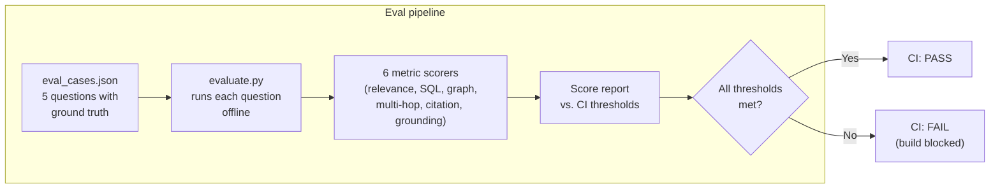

**CI thresholds (from CLAUDE.md §12):**

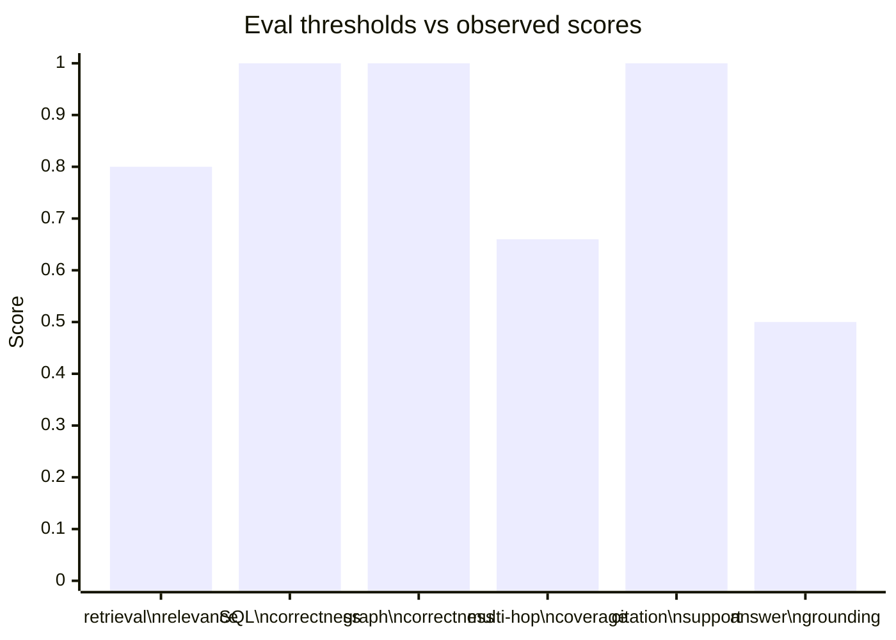

---

## Stage 3: Container packaging (P15-2)

Both the backend and frontend are packaged as multi-stage Docker images.

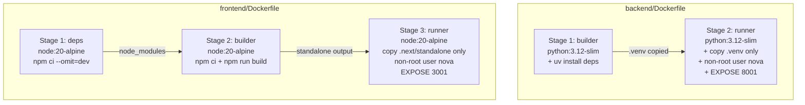

**Security invariants:**

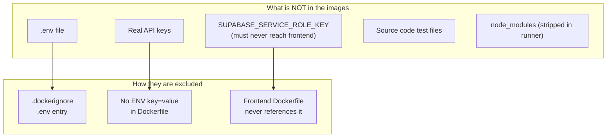

---

## Stage 4: Docker Compose stack (P15-3)

The Compose file wires all six services with correct dependency ordering and health checks.

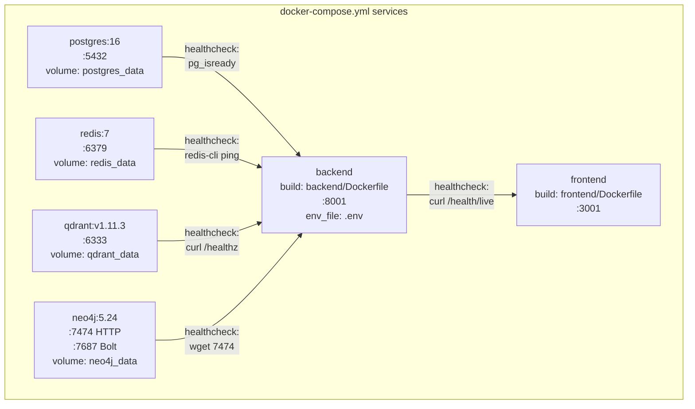

**Environment wiring for the backend in Compose:**

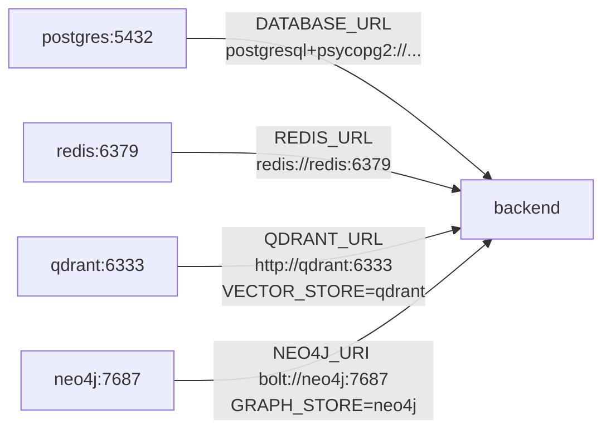

---

## Stage 5: CI pipeline (P15-4)

The CI workflow now runs four jobs in parallel after every push.

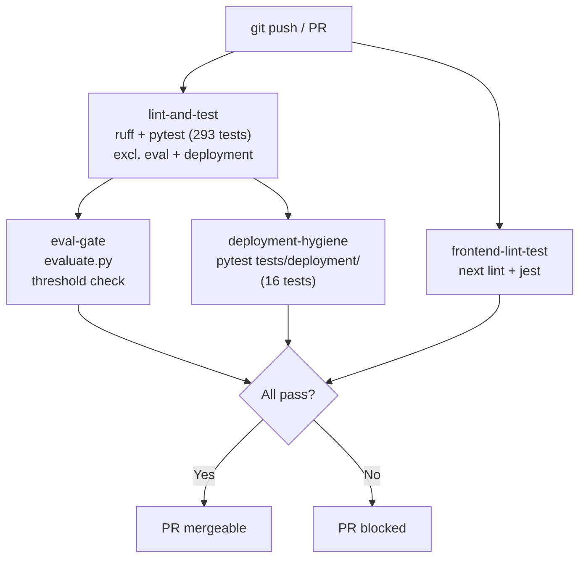

---

## Stage 6: MCP server (P15-5)

The MCP server adds an external integration surface — any MCP-compatible AI agent can now query the platform.

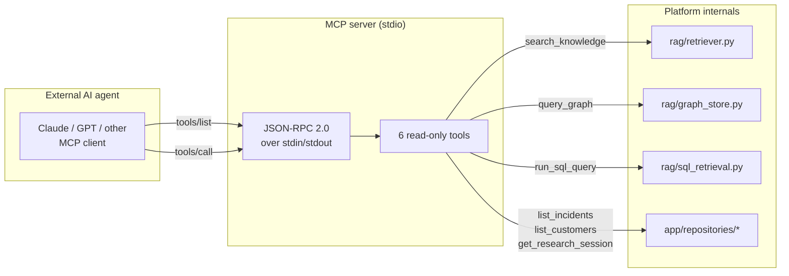

**Read-only guarantee:**

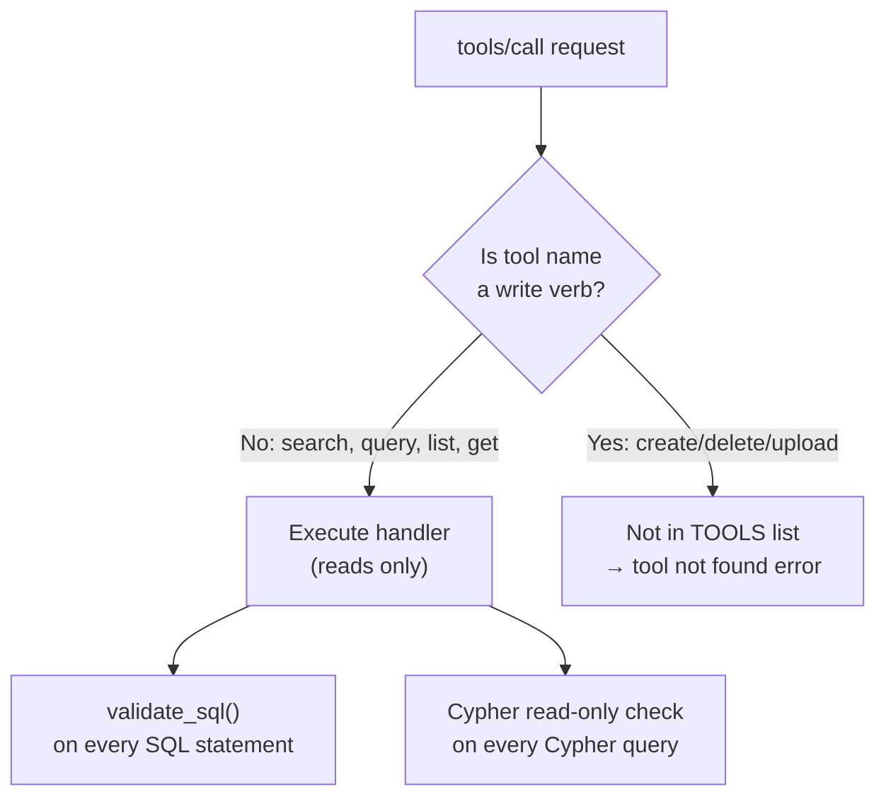

---

## Final Architecture: Phase 15

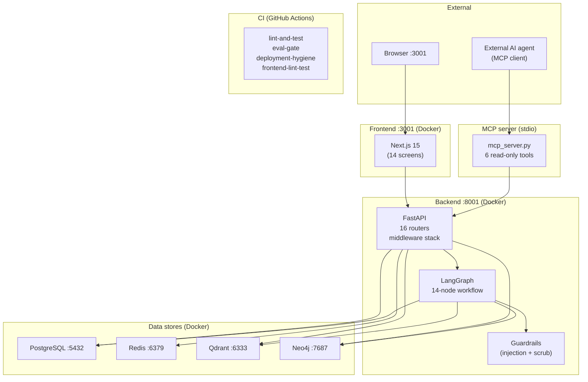

---

## Summary of design decisions in Phase 15

| Decision | Alternative | Why chosen |
|----------|-------------|------------|
| Offline eval with fake LLM | Eval against real LLM | Deterministic, no cost, runs in CI |
| Thresholds below observed scores | Exact observed scores | Catches regression without failing on noise |
| Multi-stage Dockerfiles | Single-stage | Runner image is smaller; build tools don't reach production |
| Non-root container user | Root user | Least-privilege; industry standard |
| Health checks on every store | No health checks | Compose respects start order; prevents race conditions |
| stdio MCP transport | HTTP/SSE | Simpler; no extra port; composable with pipe |
| Read-only MCP tools only | Full CRUD tools | External agents must not mutate enterprise data |
| Hygiene tests via pytest | Manual review | Automated; enforced on every PR |
