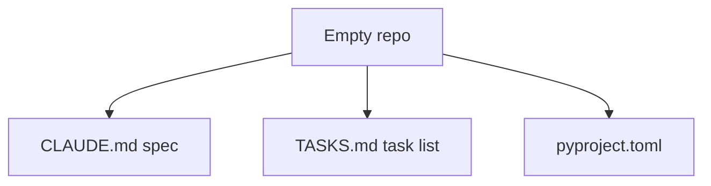
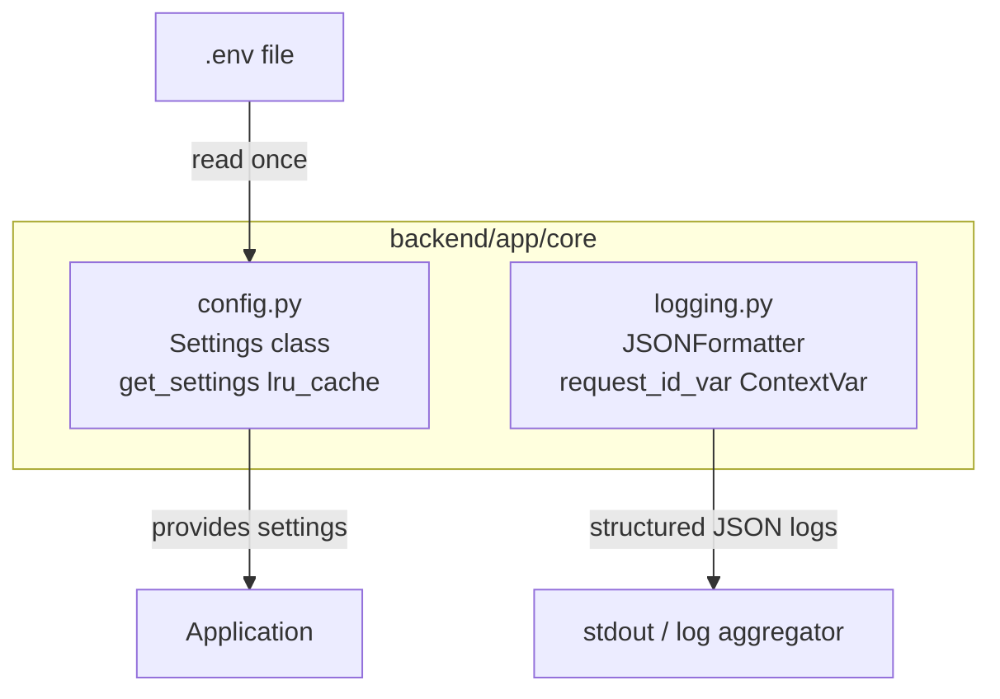
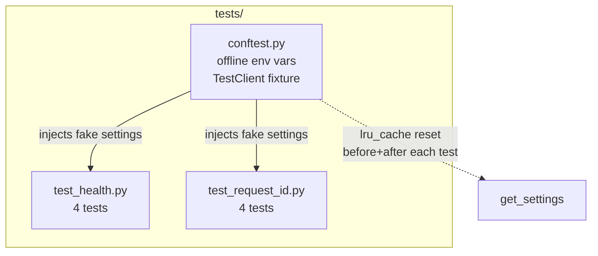
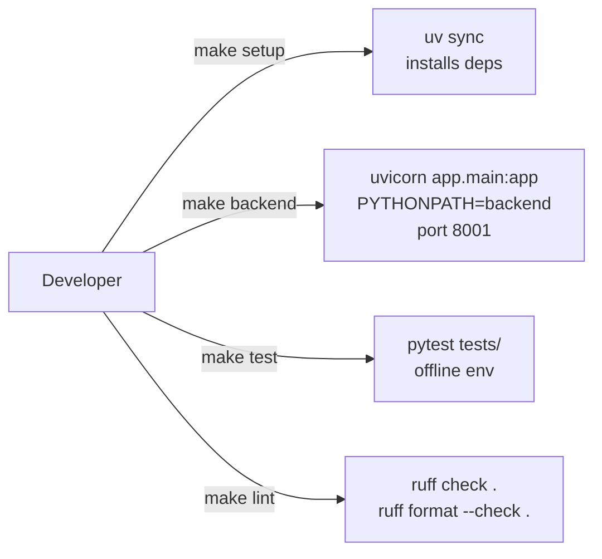
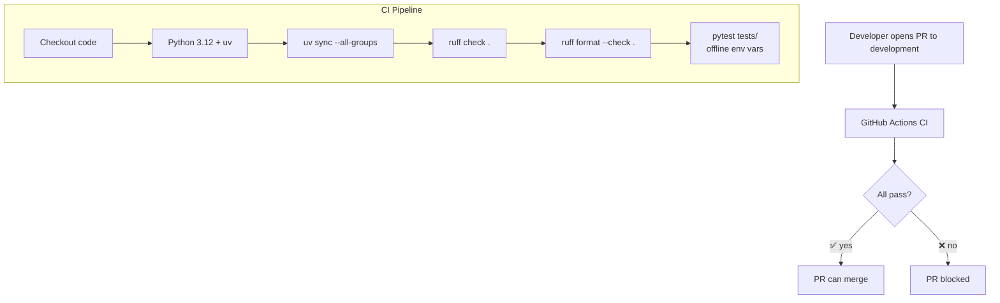
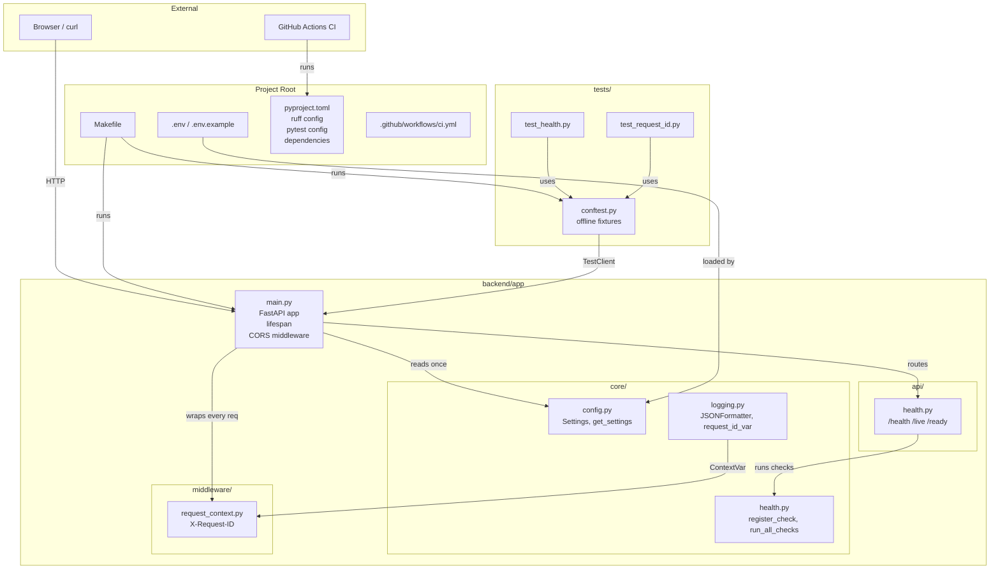

# Phase 1 — System Design Evolution

> This document tracks how the system design grew during Phase 1 — from a single file to a layered FastAPI skeleton.
> Each section shows the state at the end of the named sub-task.

---

## Starting point (before Phase 1)

The repository contained only specification and configuration files: `CLAUDE.md`, `TASKS.md`, `PLAN.md`, and a `pyproject.toml` from `uv init`. No application code existed.



---

## After P1-1 — Settings and JSON Logging

The first task introduced the concept of **application configuration as a typed object**. The key design decision: settings are read once at startup via `get_settings()`, which is `lru_cache`d. Tests can reset the cache to test different configurations.



**Key design choices made here:**
- `pydantic-settings` validates every env var at startup; a missing required value fails fast with a clear message
- `request_id_var` is a `ContextVar` — it is local to each async request handler automatically, with no threading bugs
- `configure_logging()` replaces all root handlers so third-party libraries also emit JSON

---

## After P1-2 — Health Routes and X-Request-ID Middleware

The second task introduced **middleware** (code that wraps every request) and the **check registry** pattern (a global dict that any later component can register a readiness check into).

```mermaid
graph LR
    CLIENT[Client Browser / curl] -->|HTTP request| MW[RequestContextMiddleware\nX-Request-ID]
    MW --> FASTAPI[FastAPI app]
    FASTAPI --> HR[/health router]
    HR --> HC[health_check_registry\nrun_all_checks]
    HC -->|app check| OK[status: ok]
    FASTAPI -->|every response| MW
    MW -->|adds X-Request-ID header| CLIENT
```

**Middleware order established here** (enforced by CLAUDE.md §4):
```
Request enters:   CORS → RequestContext → (rate-limit P3) → (audit P3) → route handler
Response leaves:  route handler → (audit P3) → (rate-limit P3) → RequestContext → CORS → Client
```

The `register_check()` / `run_all_checks()` pattern was chosen because later phases (database, Redis, vector store, graph store, LLM) each own their own check. Each phase calls `register_check("database", ...)` during lifespan, and `/health/ready` aggregates them all automatically.

---

## After P1-3 — Offline Test Harness

Adding tests did not change the application design, but it locked in the **test isolation strategy**:



**Isolation contract:** `conftest.py` forces all offline values before any application module is imported. The `_reset_settings` autouse fixture clears the cache before and after every single test, so no test can pollute the next one's settings.

---

## After P1-4 — Makefile, Ruff, .env.example

No new code was introduced; this task established **developer workflow conventions**:



---

## After P1-5 — CI Pipeline (final Phase 1 design)

The CI pipeline runs the same commands as the developer, but on a clean Ubuntu server on every push or pull request to `development`.



---

## Final Phase 1 Architecture — Complete Picture



---

## Design decisions locked in Phase 1

| Decision | Chosen approach | Why |
|----------|----------------|-----|
| Configuration | `pydantic-settings` with `lru_cache` | Validates all vars at startup; cheap to read; testable |
| Logging | JSON to stdout | Works with any log aggregator; `request_id` ties requests to logs |
| Request tracing | `ContextVar` + header | Thread-safe; works with async; zero overhead |
| Health checks | Registry pattern | Decoupled: each subsystem registers its own check |
| Offline testing | Fake provider, memory stores, SQLite | Zero external dependencies; CI runs on any machine |
| Code style | `ruff` with strict rules | Fast; covers both linting and formatting in one tool |
| Dependency management | `uv` with `pyproject.toml` | Modern Python packaging; reproducible with `uv.lock` |
