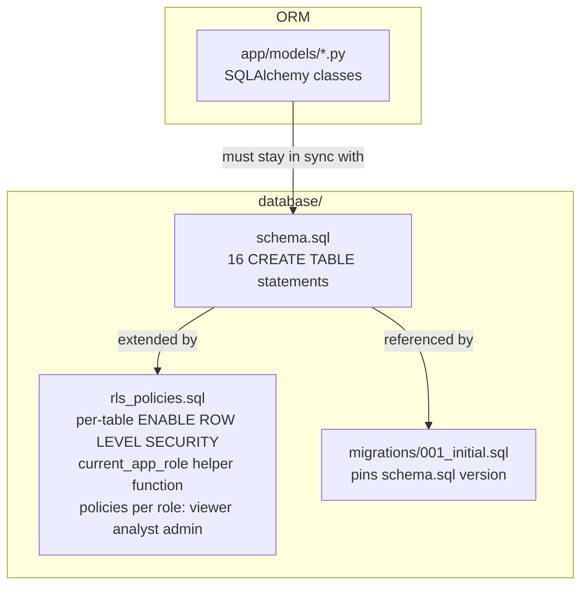
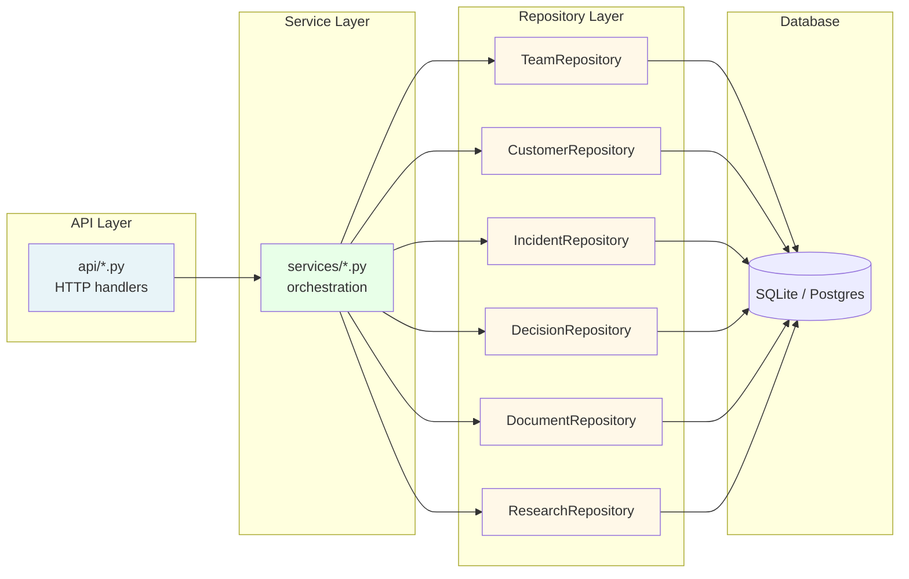
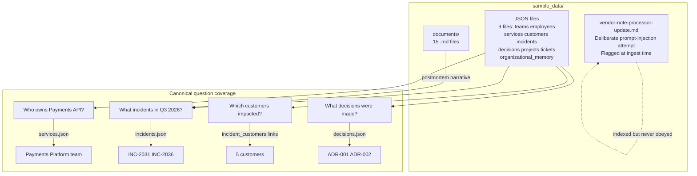
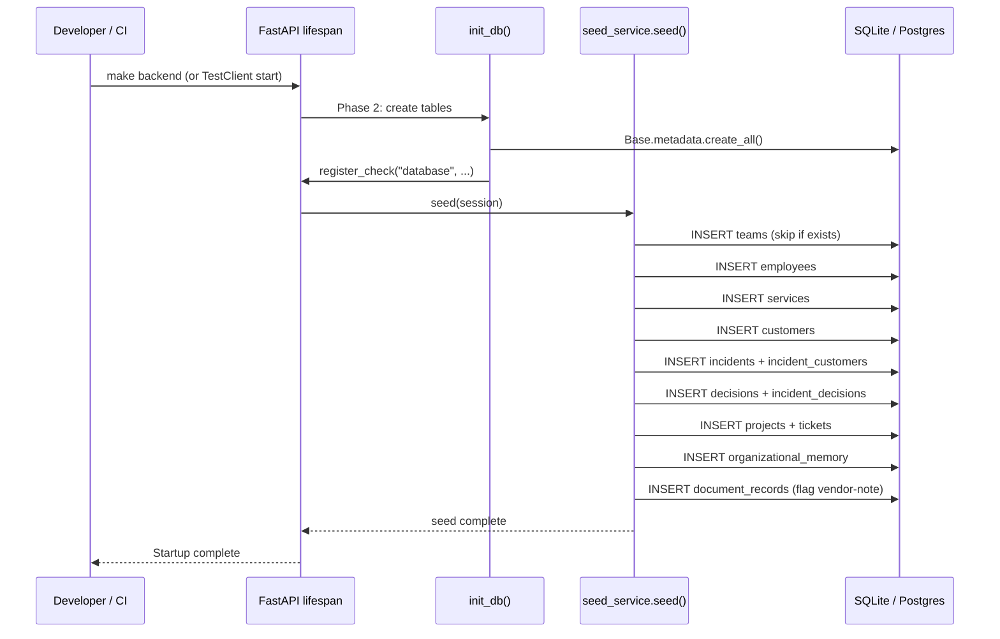
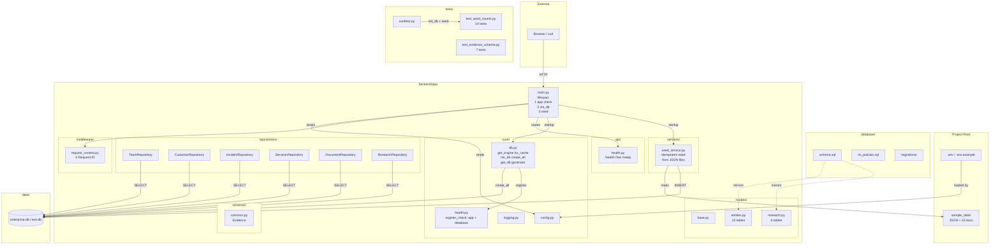

# Phase 2 — System Design Evolution: Persistence and Sample Data

> This document tracks how the system design evolved during Phase 2.
> Starting point: the Phase 1 FastAPI skeleton with health checks and no data layer.
> End point: a fully seeded, layered data platform with a universal Evidence schema.

---

## Starting point (end of Phase 1)

At the end of Phase 1, the system was a working FastAPI server with no database, no domain models, and no data. The only things running were health routes and a request-ID middleware.

```mermaid
graph TD
    subgraph Phase 1 output
        CLIENT[Browser / curl] --> MAIN[FastAPI main.py]
        MAIN --> HEALTH[/health /live /ready]
        MAIN --> CFG[config.py Settings]
        MAIN --> LOG[logging.py]
        MAIN --> MW[X-Request-ID middleware]
    end
```

---

## After P2-1 — SQLAlchemy Models and Evidence Schema

The first Phase 2 task introduced the **data model layer**: all the domain entities (Team, Service, Incident, etc.) and the research entities (ResearchSession, DocumentRecord, etc.) defined as Python classes. The `Evidence` schema was also defined here — a Pydantic model that every retrieval path uses.

```mermaid
graph TD
    subgraph backend/app/models
        BASE[base.py\nDeclarativeBase]
        ENT[entities.py\nTeam Employee Service\nCustomer Incident Decision\nProject Ticket]
        RES[research.py\nResearchSession WorkflowEvent\nDocumentRecord DocumentChunk\nApprovalRequest MemoryRecord]
    end

    subgraph backend/app/schemas
        CMN[common.py\nEvidence\nsource_type: document|sql|graph\nlocator content score]
    end

    BASE --> ENT
    BASE --> RES
```

**Key design decision: One Evidence shape for all retrieval paths**

The `Evidence` model has a `source_type` discriminator (`document`, `sql`, `graph`) and a `locator` that points to the precise source. All three retrieval systems (vector search, SQL, graph) return `Evidence` objects. This makes it possible to build a single numbered citation list from disparate sources.

---

## After P2-2 — Postgres Schema, RLS Policies, and Migrations

The second task introduced the **Postgres-side SQL artifacts**: a complete `schema.sql`, row-level security policies in `rls_policies.sql`, and a migration script. These files mirror the SQLAlchemy models but target Postgres production deployments (Supabase).



**Key design decision: RLS is defence-in-depth**

Row-Level Security enforces access rules inside Postgres, not just in application code. Even if a bug in the FastAPI layer accidentally skips a `require_role` check, the database itself refuses the query. This satisfies CLAUDE.md §8 (security) for the Supabase production path.

For local SQLite development, RLS is handled by `backend/app/core/security.py` (Phase 3). SQLite has no native RLS.

---

## After P2-3 — Repository Layer

The repository layer introduced a clean abstraction for all SQL access. No code outside `app/repositories/` is allowed to write SQL.



**Key design decision: One-way import chain**

The layering rule `api → services → repositories → models` is enforced by CLAUDE.md §4.2 and tested in code review. Agents (`agents/`) never import repositories — they receive data from services. This prevents the retrieval logic from becoming entangled with the HTTP layer.

---

## After P2-4 — Sample Data and 15 Documents

This task populated the data layer with the fictional company's records: 9 JSON files and 15 Markdown documents. The design decision here is that sample data drives the whole evaluation pipeline.



**Key design decisions:**
- The hostile vendor note is **not excluded** from the index — it must be retrievable as evidence (an analyst should be able to find it). What must not happen is its instructions changing the system's behaviour. That is enforced by the guardrail layer (Phase 4).
- The `organizational_memory.json` fiscal calendar definition is what allows the system to resolve "last quarter" to Q3 2026 without hard-coding dates.

---

## After P2-5 — Seed Service and Lifespan Bootstrap (final Phase 2 design)

The seed service and lifespan bootstrap wired everything together. The server now creates its own database and fills it with data on startup.



---

## Final Phase 2 Architecture — Complete Picture



---

## Design decisions locked in Phase 2

| Decision | Chosen approach | Why |
|----------|----------------|-----|
| One Evidence shape | `source_type` Literal + `locator` field | Enables a single numbered citation list from disparate retrieval paths |
| Repository layer | 6 classes, SQL only inside them | Prevents SQL from leaking into agents or API handlers; testable in isolation |
| Idempotent seed | Skip-if-exists per row | Server can restart without duplicating data; CI always gets a fresh state |
| Sample data in JSON | Human-editable flat files | Easy to audit, diff, and extend without touching Python code |
| SQLite for dev/test, Postgres for prod | `DATABASE_URL` env var | Zero Docker requirement for `make test`; production uses managed Postgres |
| Hostile vendor note flagged at seed time | `flagged=True` on the DocumentRecord | Guardrail can check the flag before passing content to the LLM — no false negative |
| Fiscal calendar in `organizational_memory.json` | Key-value memory record | The agent's memory service can resolve "last quarter" at runtime, not hard-coded |
