# Phase 3 — System Design Evolution: Identity and Request Guards

> This document traces how the system design grew during Phase 3 — from the unsealed skeleton at the start of the phase to the fully guarded API by the end.

---

## Where we started (end of Phase 2)

At the end of Phase 2 we had:

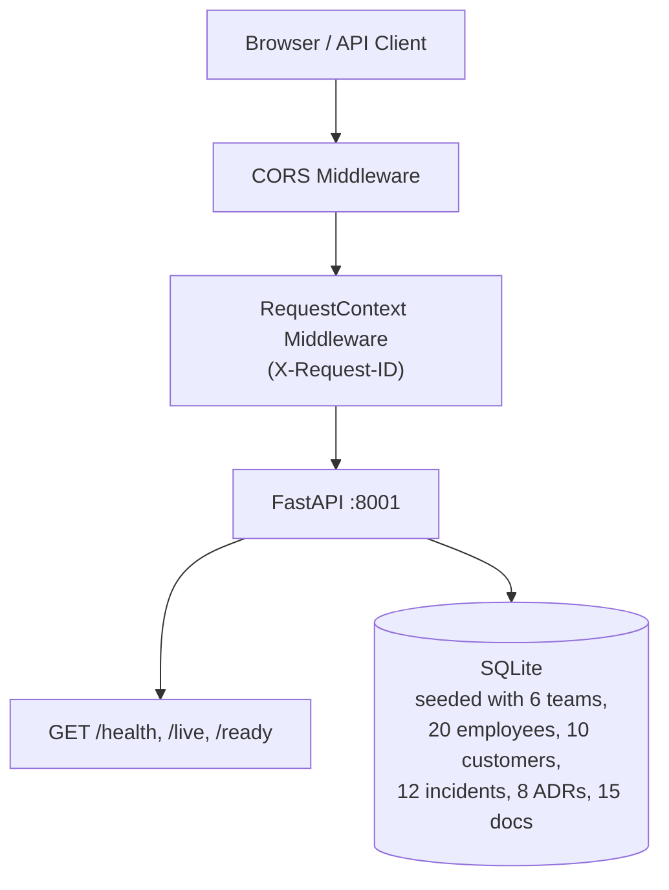

**Problem:** Any caller could reach any route. There was no concept of who you are, what you are allowed to do, or how many requests you can fire per minute.

---

## P3-1 — Adding JWT + Role Checks

The first step was to define the identity and permission model.

### Role model

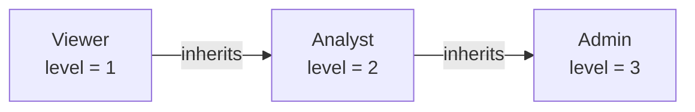

Role enforcement uses a simple integer comparison: a route that requires `Analyst (2)` accepts any caller with `role ≥ 2`. This means Admin automatically passes Analyst checks.

### JWT flow

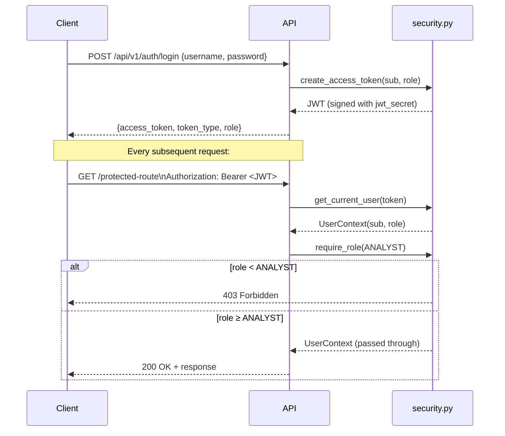

### Design after P3-1

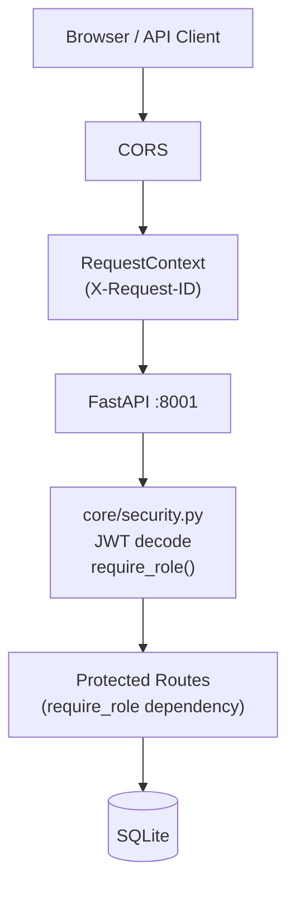

---

## P3-2 — Demo Login Routes

We added three demo user accounts and two convenience endpoints to the auth router:

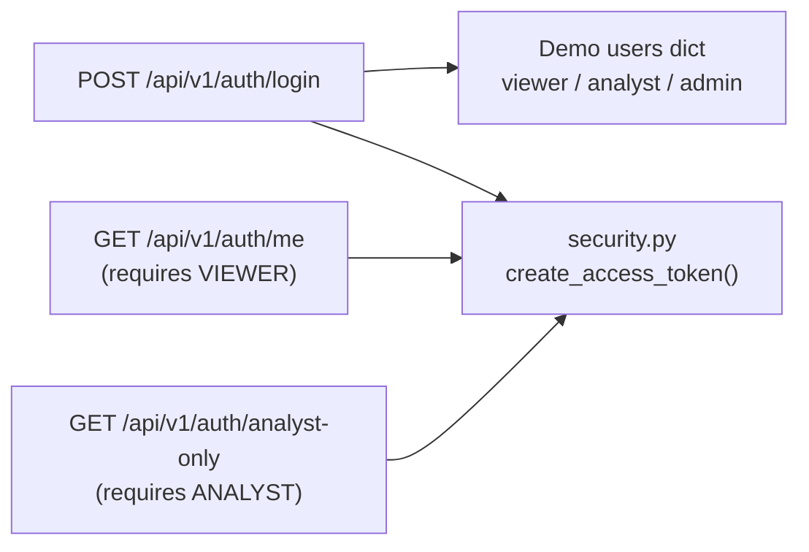

### Design after P3-2

The API now has an auth router alongside the health router:

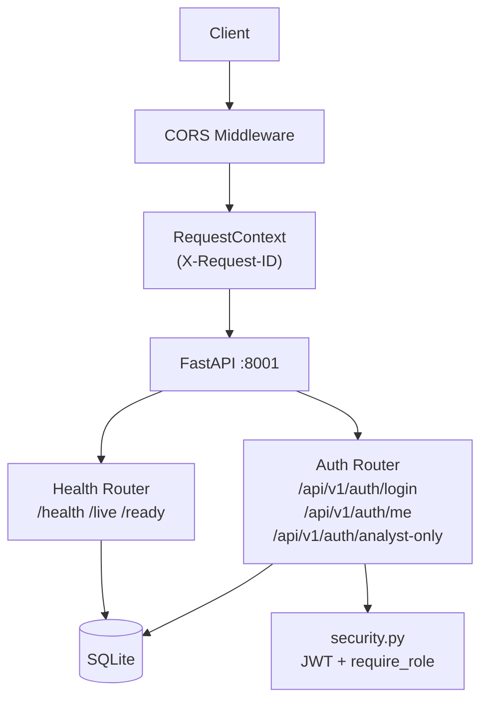

---

## P3-3 — Redis Client + Rate Limiter

A new middleware layer and a Redis (or fakeredis) backing store were introduced.

### Token-bucket rate limit design

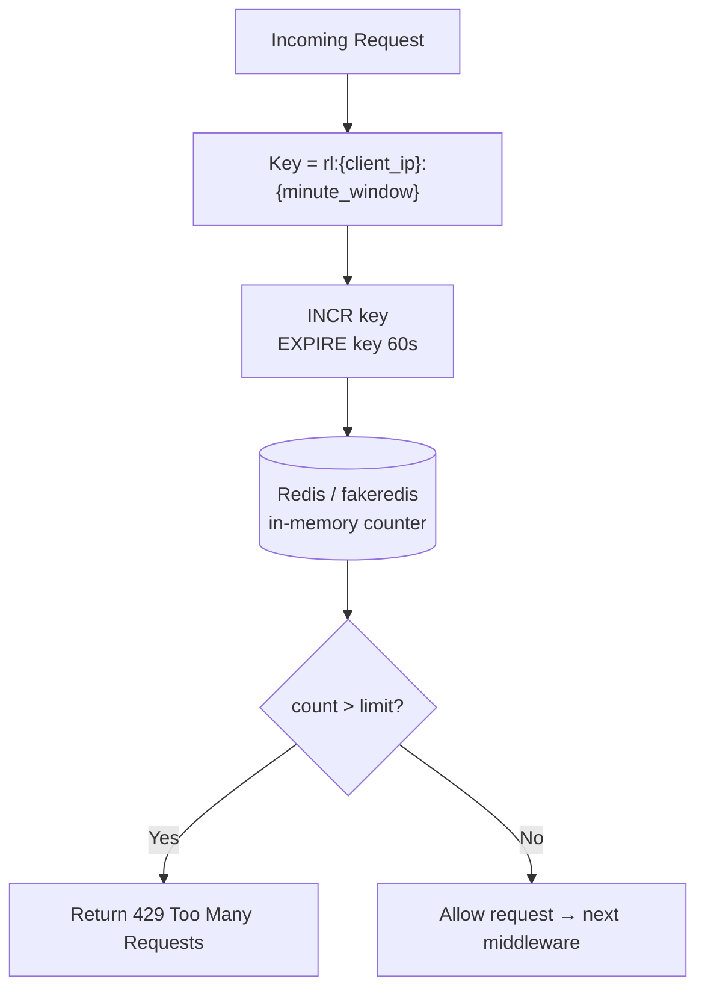

### Redis client bootstrap

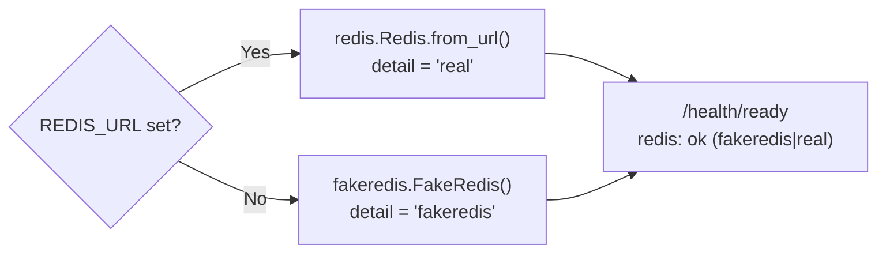

### Design after P3-3

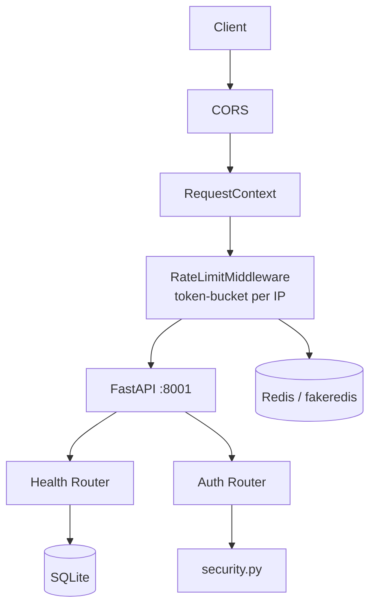

---

## P3-4 — Audit Middleware and Final Middleware Order

The final piece was an audit middleware that logs every state-changing request.

### Audit middleware design

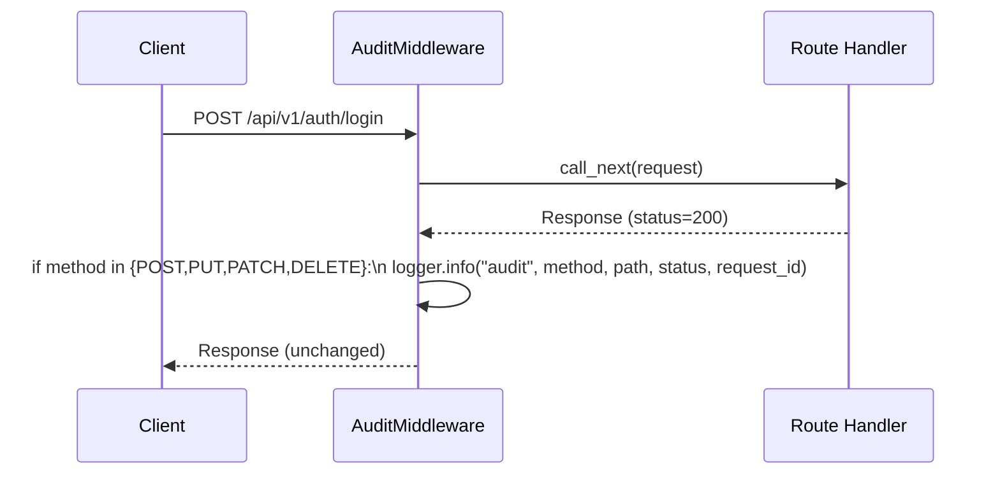

**Key design note:** The audit middleware reads `X-Request-ID` from the **response header** (not from a ContextVar). This is because Starlette's `BaseHTTPMiddleware` runs `call_next` in a separate asyncio task, which breaks ContextVar propagation. The RequestContextMiddleware stamps the ID onto the response before it bubbles back up, so reading from the header is reliable.

### Final middleware stack (Phase 3 complete)

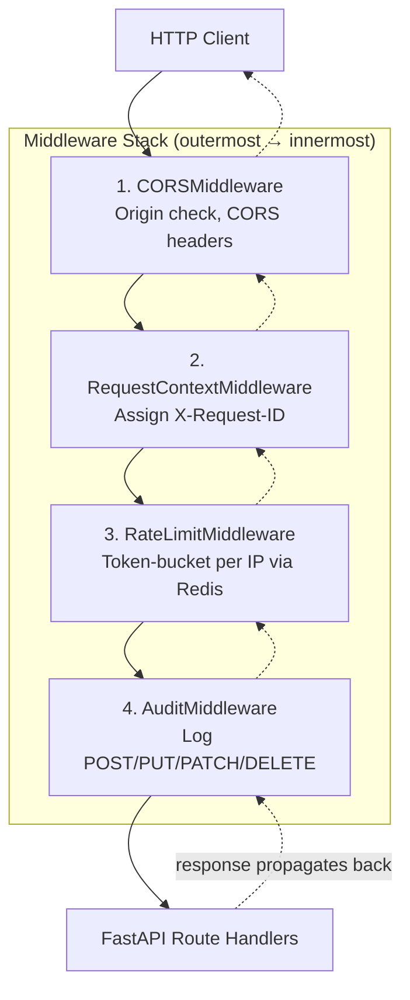

> **Starlette note:** With `add_middleware(A)` then `add_middleware(B)`, Starlette inserts at list position 0 and reverses the list when building the stack. Result: **first added = outermost = executes first** on the incoming request path.

---

## Full system design at end of Phase 3

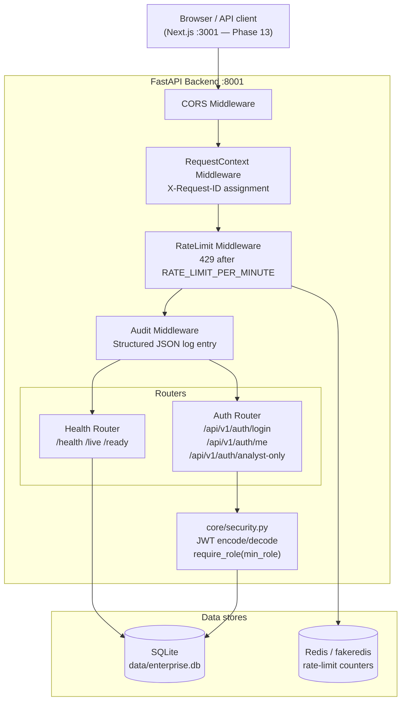

---

## What changes in future phases

| Phase | What it adds to this picture |
|-------|------------------------------|
| Phase 5 | Browse API routers (customers, incidents, decisions) — all protected by `require_role(VIEWER)` |
| Phase 9 | Documents API with upload — protected by `require_role(ANALYST)` |
| Phase 12 | Research API — protected by `require_role(ANALYST)`; this is where the full RBAC test (`viewer → 403`) runs |
| Phase 15 | Real Redis in Docker Compose; `/health/ready` reports `redis: ok (real)` |
