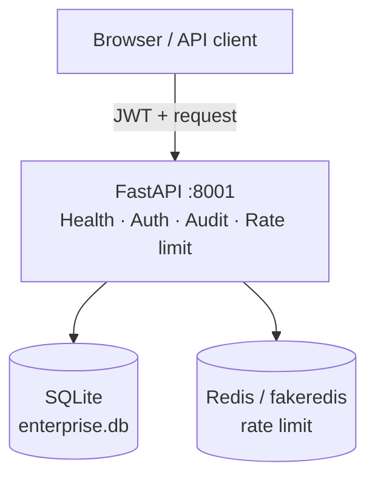
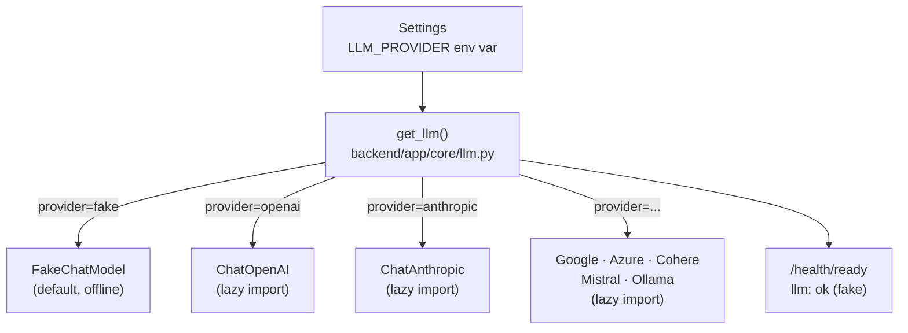
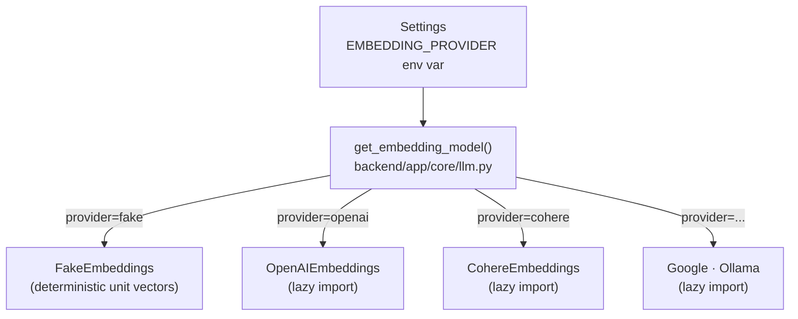
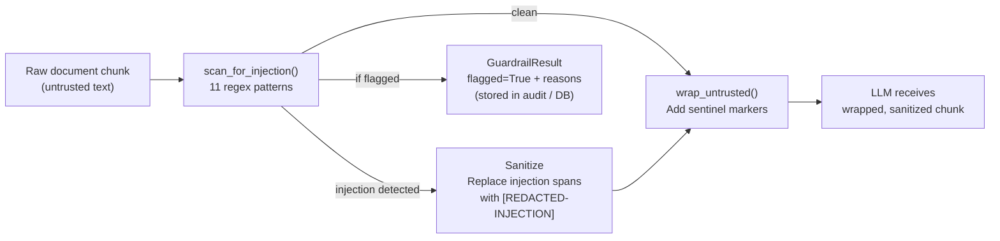
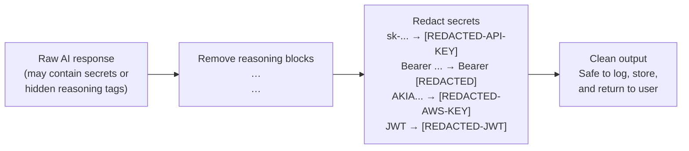
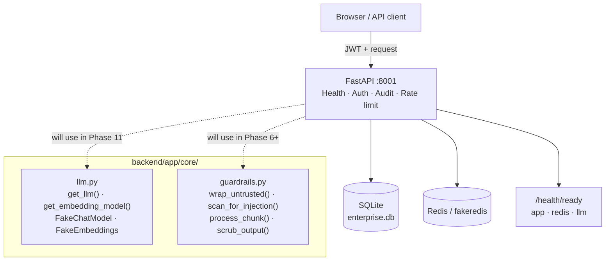

# Phase 4 — Project System Design Evolution

> How the system design grew during Phase 4: AI Providers and Guardrails.
> Each section shows the design as it stood at the start of the sub-task, then after.

---

## Starting point (end of Phase 3)

At the end of Phase 3, the system had a full HTTP layer with authentication, rate limiting, and an audit trail. But there was no AI — the backend was just a data server.

**What was missing:** No LLM, no embeddings, no guardrails. Any call to `get_llm()` would have failed with an ImportError.

---

## Sub-task P4-1 — LLM Provider Factory

The first addition was `backend/app/core/llm.py`. This module introduces the **provider factory** pattern: a single function `get_llm()` that reads `LLM_PROVIDER` from settings and returns the right chat model.

### Design at P4-1 start

The only "AI" that existed was the env variable setting — no code yet backed it.

### Design at P4-1 end

**Key design decisions:**
- **Lazy imports**: provider packages (langchain-openai, langchain-anthropic, etc.) are imported inside the `if` branch, not at module load. Missing packages surface as `ImportError` with an install hint at call time, not at startup.
- **Key validation at call time**: real providers require `LLM_API_KEY`, but the check happens when `get_llm()` is called, not when the module loads — so the server can start and serve health checks even without a key.
- **FakeChatModel is deterministic**: same input → same hash-based output. Zero randomness.

---

## Sub-task P4-2 — Embedding Model Factory

The same pattern was applied to embeddings. `get_embedding_model()` returns `FakeEmbeddings` by default.

**FakeEmbeddings design:**
- 1536-dimensional vectors (same as OpenAI text-embedding-3-small).
- Each vector is seeded from a deterministic hash of the input text.
- Vectors are **unit-normalised** (magnitude = 1.0), so cosine similarity works correctly.
- Same text → identical vector on every machine, every run.

---

## Sub-task P4-3 — Prompt-Injection Guardrail

A new module `backend/app/core/guardrails.py` was added. It introduces a pipeline that every document chunk must pass through before reaching the LLM.

### Why this matters architecturally

Before Phase 4, the AI would have received raw document text. That text could contain instructions. Architecturally, the guardrail is an **untrusted-data boundary** — the moment document content crosses from the retrieval layer into the AI layer, it is scanned, sanitised, and wrapped.

**process_chunk() is the entry point:** it calls both `scan_for_injection` and `wrap_untrusted` in sequence, returning a `GuardrailResult` with the sanitised, wrapped text and a flag for audit purposes.

---

## Sub-task P4-4 — Output Scrubber

The second half of `guardrails.py` adds `scrub_output()` — the exit-side mirror of P4-3.

### Where P4-3 guards the input, P4-4 guards the output

---

## Full system design at end of Phase 4

> The dashed arrows show future connections. The LLM and guardrail modules are ready now; the research agents and RAG layer that will call them are built in Phases 6–12.

---

## Design principles introduced in Phase 4

| Principle | Implementation |
|-----------|----------------|
| **Provider-agnostic AI** | Factory pattern — one function, N backends, zero hard-coding |
| **Offline-first** | FakeChatModel + FakeEmbeddings run with no network or API key |
| **Fail late, fail clearly** | Real provider key checks happen at call time, not import time |
| **Untrusted-by-default** | Every document chunk is wrapped before reaching the LLM |
| **Defence in depth** | Guardrails on both input (injection scan) and output (secret scrub) |
| **Deterministic testing** | Hash-based fake responses allow reproducible tests |

---

## What changes in later phases

| Phase | What uses these components |
|-------|---------------------------|
| Phase 6 — Vector RAG | `get_embedding_model()` powers semantic search |
| Phase 9 — Ingestion | `process_chunk()` guards every document on ingest |
| Phase 11 — Agents | `get_llm()` powers analysis, decomposition, synthesis nodes |
| Phase 12 — Research API | `scrub_output()` runs on every event and answer before DB write |
