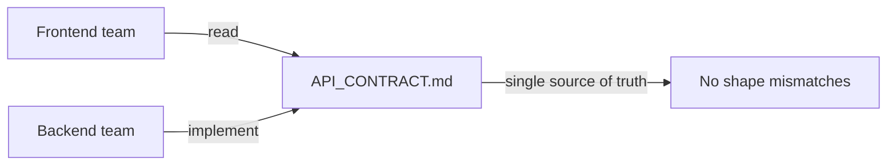
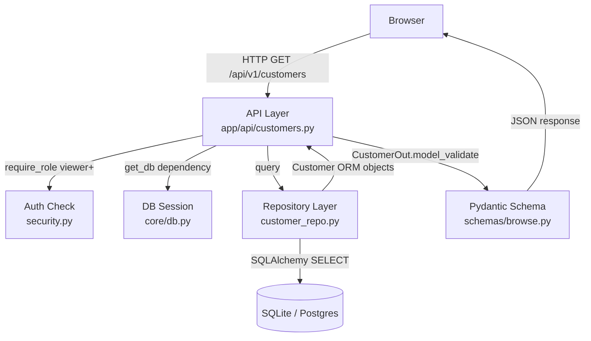
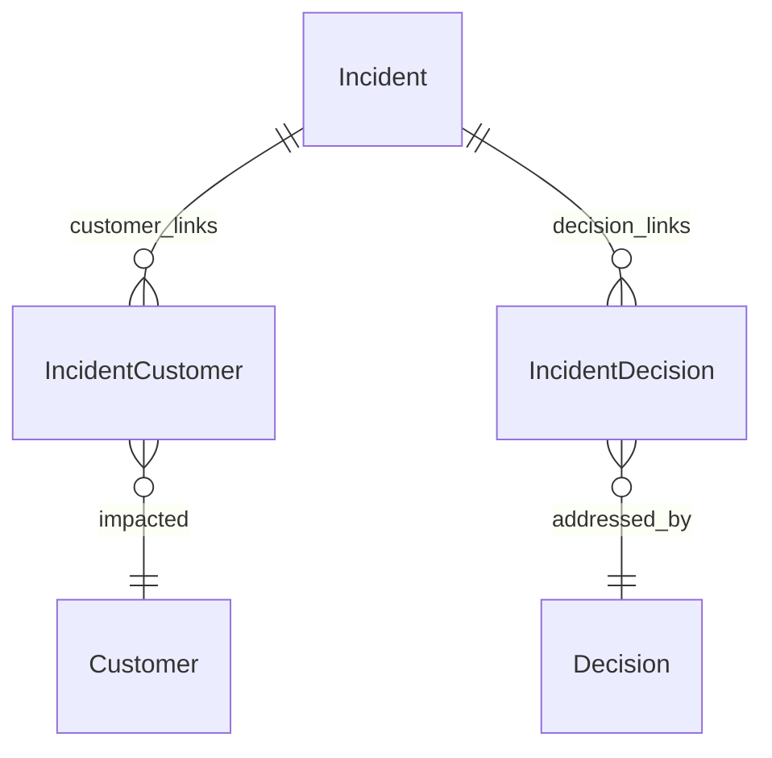
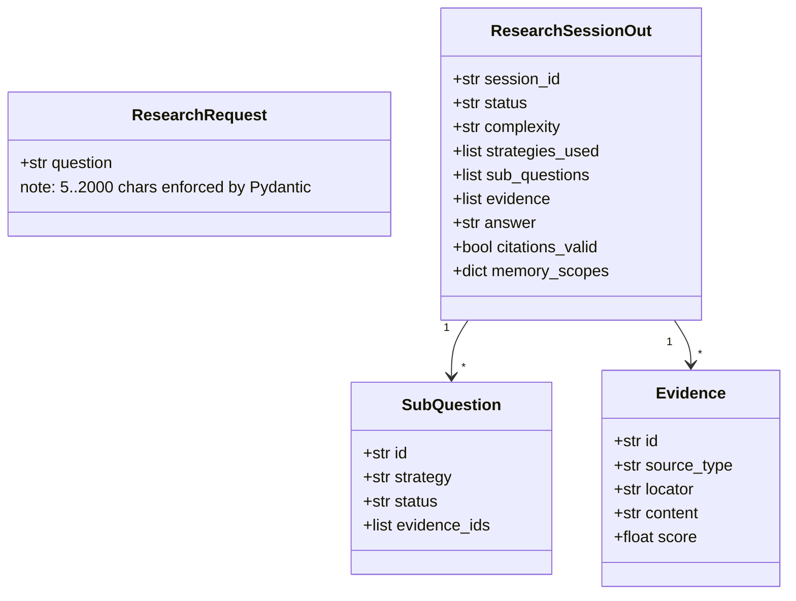

# Phase 5 — System Design Evolution: API Contract and Browse API

---

## Starting Point (entering Phase 5)

After Phases 1–4 we had a running FastAPI server with health, auth, rate limiting, audit logging,
a seeded database with all sample data, JWT + RBAC middleware, and an LLM provider factory with
guardrails. What was missing: any public-facing data API and an agreed-upon shape for requests and
responses between backend and frontend.

---

## Design Step 1 — The Contract-First Principle



Before writing a single endpoint we wrote the contract. This is the **contract-first** design
pattern: write down every URL, every request field, every response field, every status code, then
both teams implement against that contract independently.

`docs/API_CONTRACT.md` is that contract. `docs/FRONTEND_ASSUMPTIONS.md` extends it with
behavioural guarantees (polling cadence, node IDs, degraded mode behaviour).

---

## Design Step 2 — Layered Browse API

The browse endpoints follow the same layer cake established in Phase 2.



**Key design choices:**

| Choice | Alternative | Why |
|--------|------------|-----|
| Any authenticated role can browse | Restrict to analyst | Browse is read-only; viewers need to see data |
| `model_validate(orm_object)` in the router | Manual field mapping | Pydantic v2 `from_attributes=True` is safe and concise |
| Separate `IncidentDetail` and `IncidentOut` schemas | One schema with optional fields | Detail enriches the list shape with related entities |
| Repository layer handles all SQL | Inline queries in the router | Keeps the layering rules; repos are the only SQL path |

---

## Design Step 3 — Incident Detail: Cross-Entity Join



The `GET /api/v1/incidents/{id}` response bundles customers and decisions. This calls
`IncidentRepository.get_impacted_customers()` and `DecisionRepository.get_by_incident()`
separately and assembles the response in the router — repositories stay focused and independently
testable.

---

## Design Step 4 — Research Schemas: The Answer Template



The `ResearchRequest` enforces the 5–2000 character rule at the **boundary** — the moment the
HTTP request is parsed, before any business logic runs.

---

## End-of-Phase Design

```mermaid
flowchart TD
    subgraph Browser
        UI[Next.js :3001]
    end

    subgraph FastAPI :8001
        A1[/api/v1/auth] --> SEC[JWT + RBAC]
        A2[/api/v1/customers\n/incidents\n/decisions] --> SEC
        A3[Research schemas only] --> SEC
        H[/health/ready] --> CHK[Check Registry]
    end

    subgraph Core
        SEC --> DB[(SQLite)]
        DB --> SEED[10C 12I 8D 6T 20E 8S seeded]
        CHK --> DB & REDIS[fakeredis] & LLM[FakeLLM]
    end

    UI -->|JWT Bearer| FastAPI
    A2 --> REPO[Repositories]
    REPO --> DB
```

New in Phase 5: browse API routers, Pydantic schemas for browse and research, `API_CONTRACT.md`,
`FRONTEND_ASSUMPTIONS.md`. Still pending: research execution (Phases 6–12), graph API (Phase 9),
memory API (Phase 10), full Next.js frontend (Phases 13–14).
