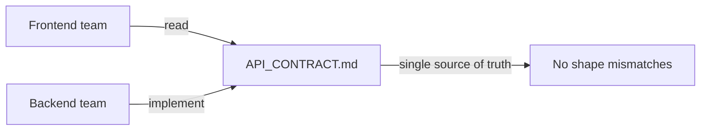
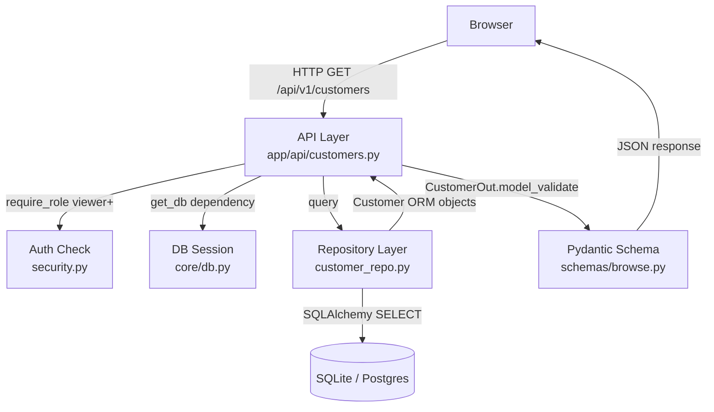
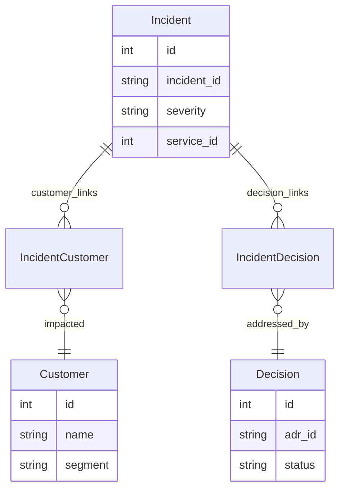
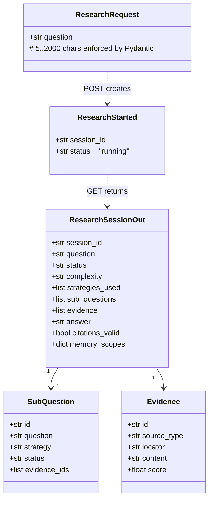

# Phase 5 — System Design Evolution: API Contract and Browse API

---

## Starting Point (entering Phase 5)

After Phases 1–4 we had:
- A running FastAPI server with health, auth, rate limiting, audit logging
- A seeded database with all sample data
- JWT + RBAC middleware
- LLM provider factory and guardrails

What we **didn't** have was any public-facing data API. The backend had repositories that could
query customers, incidents, and decisions — but no HTTP layer exposing them. The frontend had
no agreed-upon shape for requests or responses.

---

## Design Step 1 — The Contract-First Principle



Before writing a single line of endpoint code we wrote the contract. This is the
**contract-first** design pattern:

1. Write down every URL, every request field, every response field, every status code.
2. Both teams implement against that contract independently.
3. The contract is the test oracle: if the backend returns what the contract says and the
   frontend sends what the contract says, the system works.

`docs/API_CONTRACT.md` is that contract. `docs/FRONTEND_ASSUMPTIONS.md` extends it with
behavioural guarantees (polling cadence, node IDs, degraded mode behaviour).

---

## Design Step 2 — Layered Browse API

The browse endpoints follow the same layer cake established in Phase 2.



**Key design choices:**

| Choice | Alternative | Why |
|--------|------------|-----|
| Any authenticated role can browse | Restrict to analyst | Browse is read-only; viewers need to see the data to understand the system |
| `model_validate(orm_object)` in the router | Manual field mapping | Pydantic v2 `from_attributes=True` makes this safe and concise |
| Separate `IncidentDetail` and `IncidentOut` schemas | One schema with optional fields | `Detail` enriches the list shape with related entities; list stays lean for performance |
| Repository layer handles all SQL | Inline queries in the router | Keeps the layering rules; repos are the only SQL path |

---

## Design Step 3 — Incident Detail: Cross-Entity Join

The incident detail endpoint is the most interesting browse endpoint because it crosses
three tables.



The `GET /api/v1/incidents/{id}` response bundles all three. This is not a SQL join — it
calls `IncidentRepository.get_impacted_customers()` and `DecisionRepository.get_by_incident()`
separately and assembles the response in the router. This keeps the repositories focused
and testable in isolation.

---

## Design Step 4 — Research Schemas: The Answer Template



The `ResearchRequest` enforces the 5–2000 character rule at the **boundary** — the moment
the HTTP request is parsed. This is the right place: the validator runs before any business
logic, and the error shape (`422 Unprocessable Entity`) is consistent with all other
Pydantic validation errors.

---

## End-of-Phase Design

By the end of Phase 5 the system design looks like this:

```mermaid
flowchart TD
    subgraph Browser
        UI[Next.js :3001]
    end

    subgraph FastAPI :8001
        A1[/api/v1/auth] --> SEC[JWT + RBAC]
        A2[/api/v1/customers\n/incidents\n/decisions] --> SEC
        A3[/api/v1/research - schemas only] --> SEC
        H[/health/ready] --> CHK[Check Registry]
    end

    subgraph Core
        SEC --> DB[(SQLite)]
        DB --> SEED[Seeded: 10C 12I 8D 6T 20E 8S]
        CHK --> DB
        CHK --> REDIS[fakeredis]
        CHK --> LLM[FakeLLM]
    end

    UI -->|JWT Bearer| FastAPI
    A2 --> REPO[Repositories\ncustomer · incident · decision]
    REPO --> DB
```

**What is new in Phase 5 (shaded):** browse API routers, Pydantic schemas for browse and
research, `API_CONTRACT.md`, `FRONTEND_ASSUMPTIONS.md`.

**What is still pending:** the actual research execution (Phases 6–12), the knowledge graph
API (Phase 9), memory API (Phase 10), and the full Next.js frontend (Phases 13–14).
