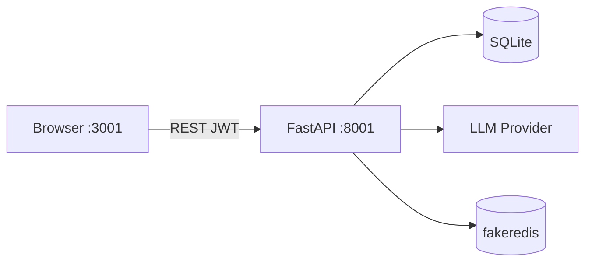
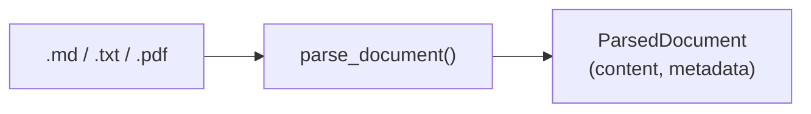
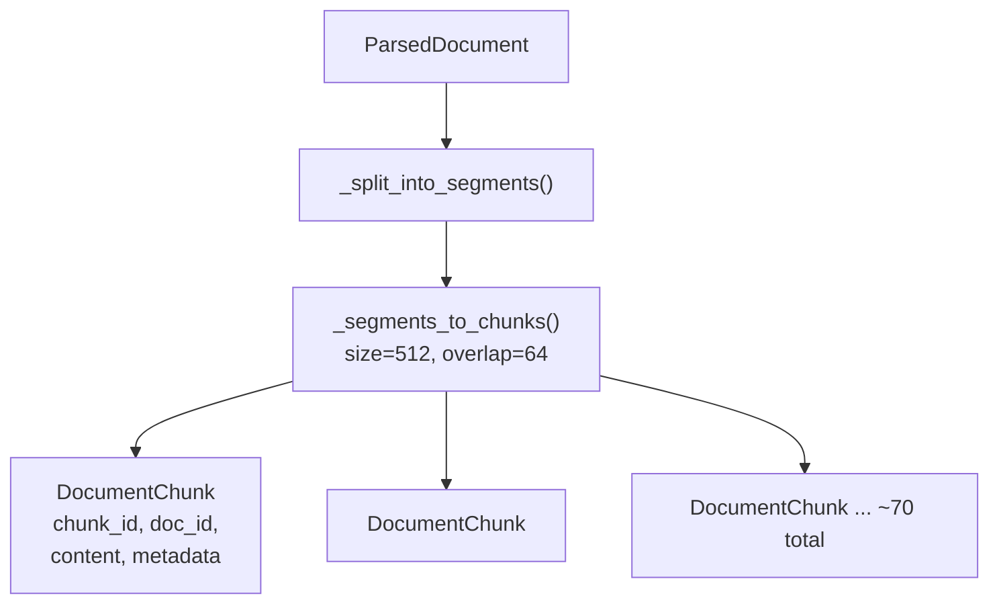
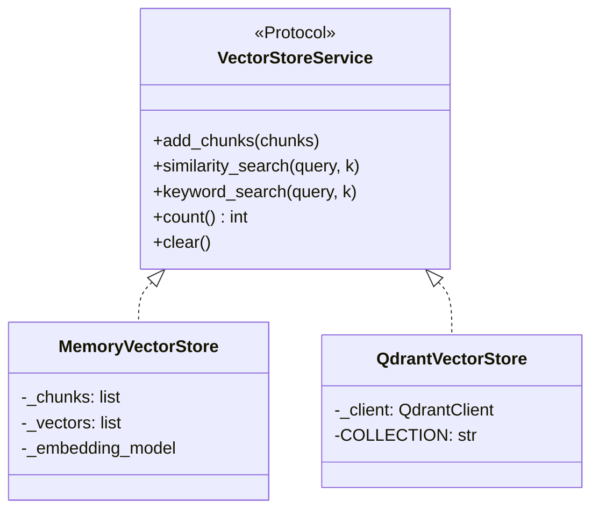
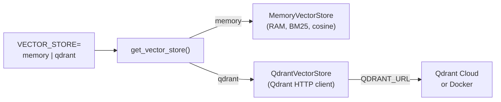
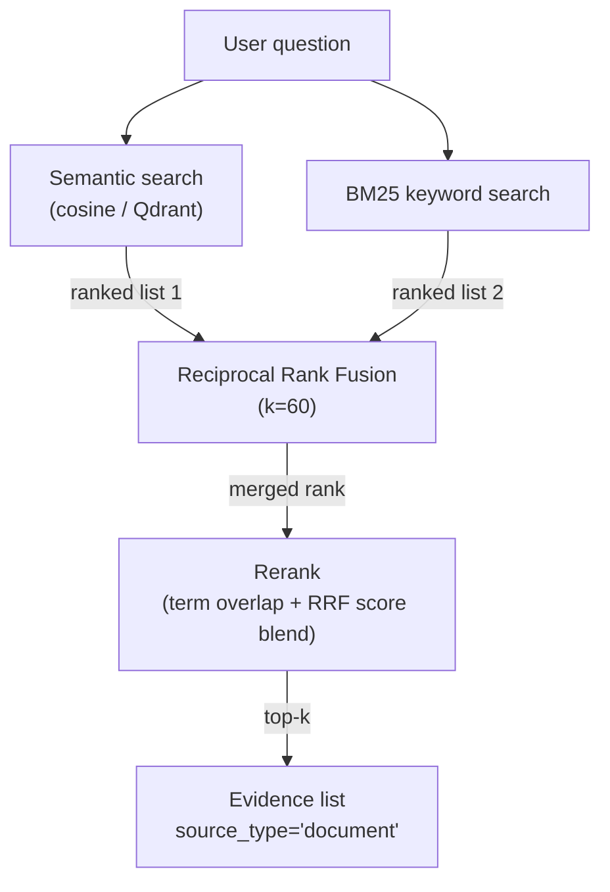
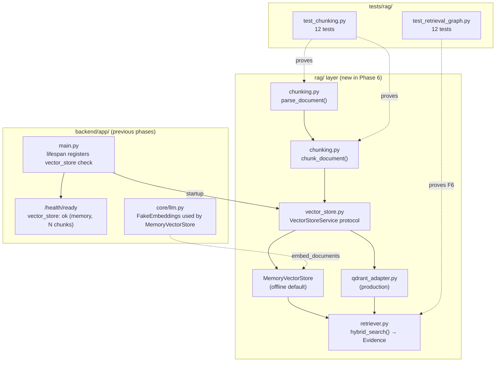

# Phase 6 — System Design Evolution: Vector RAG

> This document traces how the system design grew during Phase 6 — from a bare document-search idea to a production-ready hybrid retrieval pipeline.

---

## Starting point (end of Phase 5)

At the end of Phase 5 the platform could:
- Accept HTTP requests, authenticate users, and return seeded database records.
- Provide AI provider abstractions (fake, OpenAI, Anthropic, …).
- Expose a browse API for customers, incidents, and decisions.

But it had **no way to search documents**. The `rag/` folder did not exist.



---

## Step 1 — Document parsing (P6-1 start)

The first design question: how do we get text out of different file types?

We introduced `rag/chunking.py` with a `parse_document()` function. It handles `.md`, `.txt`, and `.pdf` using the `pypdf` library. The return type is `ParsedDocument` — a plain Python dataclass holding the raw text and metadata.



**Key design choice:** parsing returns a simple dataclass, not a framework object. This makes it easy to test and swap.

---

## Step 2 — Chunking (P6-1 complete)

A full document is too large to embed and compare directly. We split it into overlapping chunks.

Design decisions made here:
- **Chunk size: 512 characters** — small enough for a single embedding, large enough for context.
- **Overlap: 64 characters** — prevents cutting important context at boundaries.
- **Stable chunk IDs** — derived from `sha256(source_path)` + chunk index. Re-running produces the same IDs, making the system idempotent.
- **Split strategy** — markdown headers first, then blank lines, then sentence/word boundaries as fallbacks.



Target: **≈ 70 chunks** from the 15 sample documents. Measured at 162-test run time: confirmed in range.

---

## Step 3 — VectorStoreService protocol (P6-2)

Before writing any storage code, we defined the **protocol** (interface) that every store must satisfy:

```python
class VectorStoreService(Protocol):
    def add_chunks(chunks)   → None
    def similarity_search(query, k, filter) → list[(chunk, score)]
    def keyword_search(query, k, filter)    → list[(chunk, score)]
    def count()              → int
    def clear()              → None
```

This design decision — **protocol first, implementation second** — means the application never depends on a specific store. The router, agents, and tests only ever call these five methods.



The in-memory adapter uses:
- `FakeEmbeddings` (from Phase 4) for offline tests — deterministic, unit-normalised vectors.
- A pure-Python cosine similarity function.
- A pure-Python BM25 implementation (no external index library).

---

## Step 4 — Qdrant adapter (P6-3)

For production use, we added `rag/qdrant_adapter.py`. It:
- Defers the `qdrant_client` import so the app starts without it when `VECTOR_STORE=memory`.
- Creates the collection on first use if it does not exist.
- Falls back to in-process BM25 for keyword search (Qdrant does not support BM25 natively).



A health check is registered at startup:
```
/health/ready → { "vector_store": { "status": "ok", "detail": "memory (70 chunks)" } }
```

---

## Step 5 — Hybrid retriever (P6-4, complete)

The final design is a **four-stage pipeline** that combines semantic and keyword search:



**Why RRF?** It is a proven, parameter-free way to combine ranked lists from different sources without needing a learned model.

**Why rerank?** The post-RRF order is good, but a cheap term-overlap pass makes it better for the offline/fake path. In production this would be replaced by a cross-encoder model.

**Why return `Evidence`?** The same type is returned by SQL and Graph retrievers (Phases 7 and 8). One shape means one citation format, which is requirement F11.

---

## Final design at end of Phase 6



---

## Design decisions locked in Phase 6

| Decision | Rationale |
|----------|-----------|
| Protocol pattern for VectorStoreService | Nothing outside `rag/` depends on a specific store; swapping is a one-line config change |
| Memory adapter first, Qdrant second | Tests and demo run with zero infrastructure |
| Stable chunk IDs from sha256 | Re-runs are idempotent; citation locators remain valid |
| BM25 without an external library | Keeps offline tests dependency-free |
| RRF constant k=60 | Standard value from the original paper; no tuning needed |
| Evidence as the return type | One citation format for all retrieval paths (F11) |
