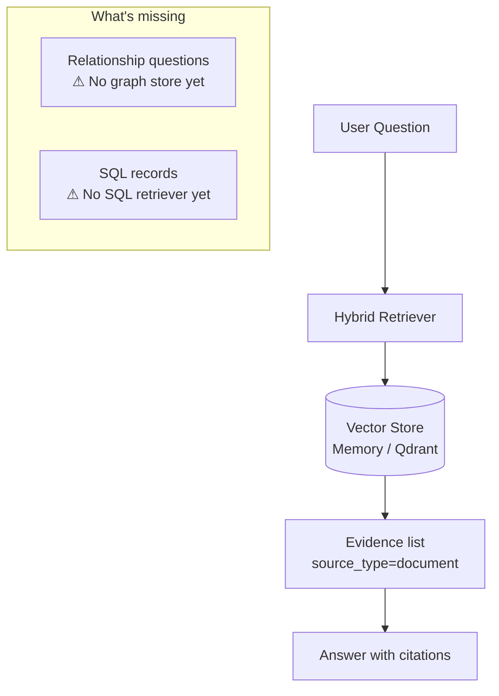
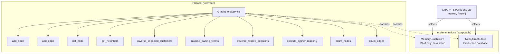
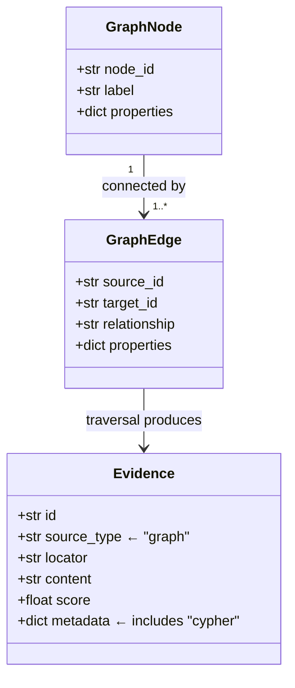
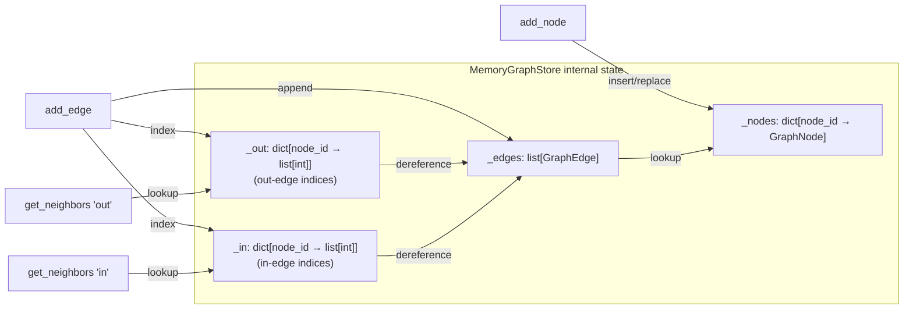
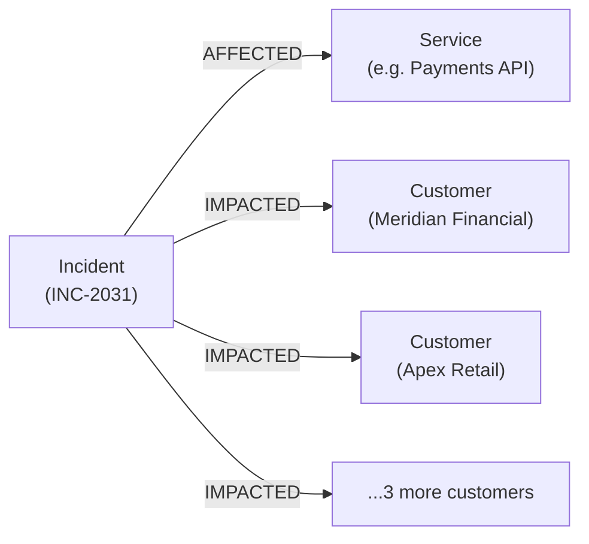
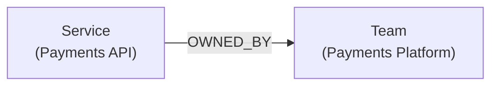
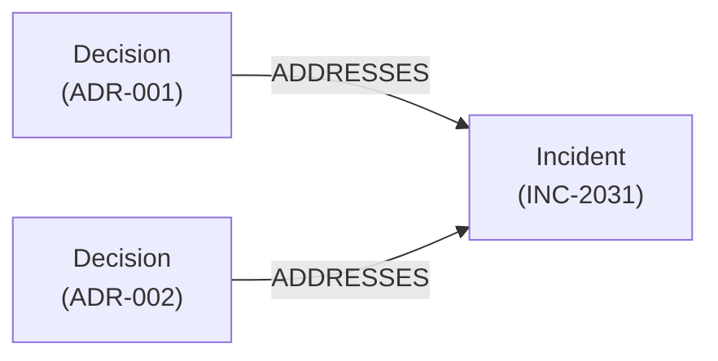

# Phase 7 — System Design Evolution: Graph RAG

> This document traces the design from the starting point (what we had after Phase 6) to the full Graph RAG implementation at the end of Phase 7. Each stage adds one layer of capability.

---

## Starting Point: After Phase 6

After Phase 6 the platform could retrieve evidence from documents using a hybrid vector + keyword search engine. The retrieval architecture looked like this:



**The gap:** Questions about relationships between entities — "who was impacted?", "which team owns this?" — could not be answered. The vector store finds relevant text, but it cannot traverse connections.

---

## Stage 1: GraphStoreService Protocol (P7-1)

The first design decision is **not to hard-code a graph database**. Instead, we define a protocol (interface) that any graph-store implementation must satisfy.



**Key design decision:** nothing outside `rag/` ever imports `MemoryGraphStore` or `Neo4jGraphStore` by name. All callers work through `GraphStoreService` and the factory `get_graph_store()`. This is the same pattern used for the vector store.

---

## Stage 2: Domain Types (P7-1)

Two lightweight data classes capture the graph's vocabulary:



**One Evidence shape for all stores.** The `metadata["cypher"]` field is new in Phase 7 — it carries the Cypher string that represents the traversal, so users can see the exact query the system executed.

---

## Stage 3: In-Memory Graph Store (P7-1)

The in-memory adapter uses three internal data structures for efficiency:



**Why both indices?** Most graph traversals go in one direction (follow out-edges). But the AFFECTED relationship is traversed *backwards*: given a service, find which incidents affected it. The in-edge index makes that equally fast without scanning all edges.

---

## Stage 4: Typed Traversals with Cypher (P7-2)

The three traversals implement the relationship patterns from CLAUDE.md. Each traversal is a multi-hop graph walk:

### Traversal 1 — Impacted Customers



**Cypher returned:** `MATCH (svc:Service {name: 'Payments API'})<-[:AFFECTED]-(inc:Incident)-[:IMPACTED]->(c:Customer) WHERE inc.started_at >= '2026-07-01' RETURN svc, inc, c`

### Traversal 2 — Owning Teams



**Cypher returned:** `MATCH (svc:Service {name: 'Payments API'})-[:OWNED_BY]->(t:Team) RETURN svc, t`

### Traversal 3 — Related Decisions



**Cypher returned:** `MATCH (d:Decision)-[:ADDRESSES]->(inc:Incident {incident_id: 'INC-2031'}) RETURN d, inc`

---

## Stage 5: Neo4j Adapter and Read-Only Guard (P7-3)

```mermaid
graph TD
    subgraph "User Cypher path"
        UC[User submits Cypher] --> RO[is_readonly_cypher check]
        RO -->|contains CREATE/MERGE/DELETE/SET/REMOVE/DROP| ERR[ValueError raised<br/>403 to analyst]
        RO -->|only MATCH/RETURN/WHERE| EXEC[execute on store]
    end

    subgraph "Neo4j Adapter"
        NA[Neo4jGraphStore] --> CONN[Lazy connection<br/>opened on first use]
        CONN -->|ping fails| DEG[health check → degraded]
        CONN -->|ping ok| SESS[Neo4j session]
        SESS -->|run typed traversal| RESULT[Evidence list]
        SESS -->|run user Cypher| RESULT2[raw rows]
    end

    subgraph "Degraded readiness"
        DEG --> HR[/health/ready → degraded]
        HR -->|workflow continues| SKIP[graph sub-question<br/>records error, skips]
    end
```

**The degraded pattern** is critical: the graph store is a non-critical enrichment layer. If Neo4j is down during a research run, the platform answers from documents and SQL — it does not block or crash.

---

## Stage 6: Graph Seeder (P7-4)

The seeder builds the full NovaEnterprise knowledge graph from JSON sample data files:

```mermaid
graph TD
    subgraph "Input (JSON files)"
        TJ[teams.json<br/>6 teams]
        SJ[services.json<br/>8 services]
        CJ[customers.json<br/>10 customers]
        IJ[incidents.json<br/>12 incidents]
        DJ[decisions.json<br/>8 decisions]
        EJ[employees.json<br/>20 employees]
        PJ[projects.json<br/>6 projects]
        TKJ[tickets.json<br/>15 tickets]
    end

    subgraph "Nodes (85 total)"
        TJ --> NTeam[6 Team nodes]
        SJ --> NSvc[8 Service nodes]
        CJ --> NCust[10 Customer nodes]
        IJ --> NInc[12 Incident nodes]
        DJ --> NDec[8 Decision nodes]
        EJ --> NEmp[20 Employee nodes]
        PJ --> NProj[6 Project nodes]
        TKJ --> NTick[15 Ticket nodes]
    end

    subgraph "Edges (~260 total)"
        REL1["Employee → MEMBER_OF → Team (20)"]
        REL2["Service → OWNED_BY → Team (8)"]
        REL3["Incident → AFFECTED → Service (12)"]
        REL4["Incident → IMPACTED → Customer (46)"]
        REL5["Decision → ADDRESSES → Incident (11)"]
        REL6["Project → OWNED_BY → Team (6)"]
        REL7["Ticket → PART_OF → Project (15)"]
        REL8["Ticket → ASSIGNED_TO → Employee (15)"]
        REL9["Customer → USES → Service (~49)"]
        REL10["Service → DEPENDS_ON → Service (4)"]
        REL11["Project → ADDRESSES → Decision (7)"]
        REL12["Incident → INVESTIGATED_BY → Team (12)"]
        REL13["Decision → APPLIES_TO → Service (~10)"]
        REL14["Employee → WORKS_ON → Project (15)"]
        REL15["Team → COORDINATES_WITH → Team (4)"]
    end

    NTeam & NSvc & NCust & NInc & NDec & NEmp & NProj & NTick --> GS[(GraphStore)]
    REL1 & REL2 & REL3 & REL4 & REL5 --> GS
    REL6 & REL7 & REL8 & REL9 & REL10 --> GS
    REL11 & REL12 & REL13 & REL14 & REL15 --> GS
```



---

## Final Architecture After Phase 7

```mermaid
graph TD
    Q[User Question] --> ROUTER{Routing decision}

    ROUTER -->|document question| HR[Hybrid Retriever<br/>Phase 6]
    ROUTER -->|relationship question| GT[Graph Traversals<br/>Phase 7]
    ROUTER -->|record question| SQL[SQL Retriever<br/>Phase 8 — coming]
    ROUTER -->|multi-hop| HYB[Hybrid: all three]

    HR --> VS[(Vector Store<br/>Memory / Qdrant)]
    GT --> GS[(Graph Store<br/>Memory / Neo4j)]
    SQL --> DB[(SQLite / PostgreSQL)]

    VS --> EV1[Evidence<br/>source_type=document]
    GS --> EV2[Evidence<br/>source_type=graph<br/>+ Cypher shown]
    DB --> EV3[Evidence<br/>source_type=sql<br/>Phase 8]

    EV1 & EV2 --> MERGE[Merge & deduplicate]
    MERGE --> VERIFY[Verify evidence]
    VERIFY --> SYNTH[Synthesise answer<br/>with [1][2][3] citations]
```

**What Phase 7 adds to this picture:**
- The graph store as a third evidence source
- Typed traversals that expose their Cypher
- Read-only guard on user-submitted queries
- Degraded gracefully when Neo4j is unavailable
- 85 nodes / 260 edges seeded from sample data

---

## Design Principles Applied in Phase 7

| Principle | How it appears |
|---|---|
| Protocol pattern (N3) | `GraphStoreService` protocol; nothing imports the concrete adapter |
| Offline first (N1) | `MemoryGraphStore` works with zero external services |
| Degrade, don't crash | Neo4j failure → degraded health, not crash |
| Read-only retrieval | `assert_readonly_cypher()` on every user query |
| One Evidence shape | `source_type="graph"` fits the same schema as document and SQL evidence |
| Rules first | Typed traversals are deterministic; no LLM decides which path to follow |
