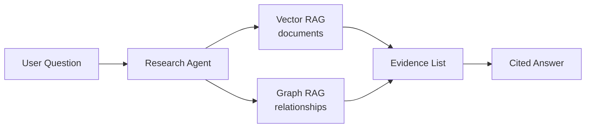
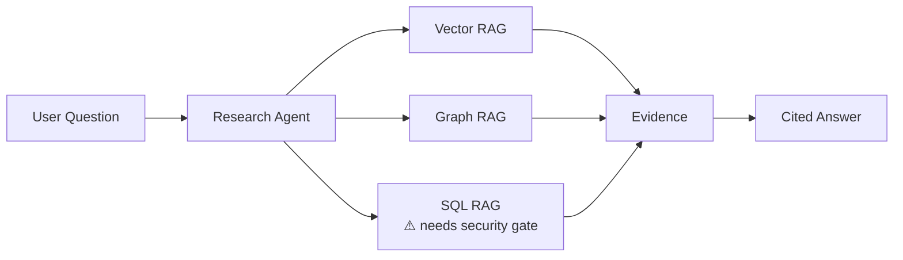
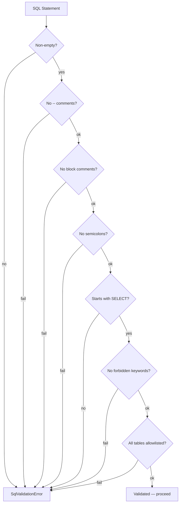
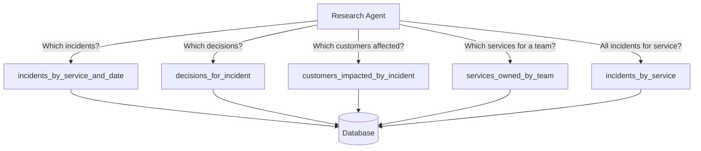
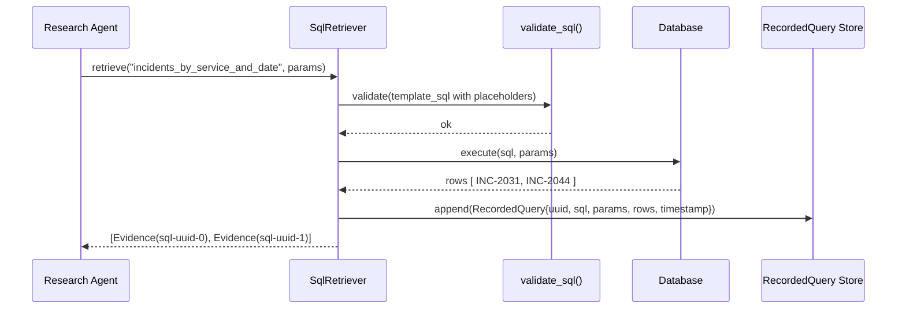
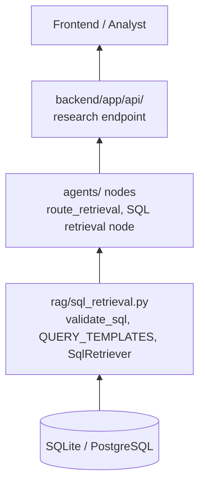

# Phase 8 — Project System Design Evolution: SQL Retrieval

> How the NovaEnterprise system design evolved through Phase 8.
> Each stage shows what was added and why the design grew the way it did.

---

## Where we started (end of Phase 7)

After Phase 7, the platform had two retrieval paths:



The agent could search through written documents and follow graph relationships. But it had no way to answer questions that require **exact structured records** — like "show me every SEV1 incident between July and September."

---

## Stage 1: Identifying the gap (start of Phase 8)

The canonical question includes: *"what incidents occurred?"*

That sub-question is best answered by a SQL query against the `incidents` table, not by searching through documents or traversing a graph. Documents may reference incidents, but they are unstructured and may be incomplete. The database has the authoritative, structured record.

**Design decision:** Add a third retrieval path — SQL — that runs against the relational database (SQLite in development, PostgreSQL in production). Like vector and graph retrieval, it must return the same `Evidence` shape so all three paths can be merged into one citation list.

**Risk identified:** Letting the AI write arbitrary SQL is dangerous. A flawed prompt or a prompt-injection attempt could produce a query that deletes or modifies data. The design must include a strict security layer.



---

## Stage 2: The SQL validator (P8-1)

The first design question: **where does the security gate live?**

Option A: validate at the API layer (the HTTP server checks queries before they reach the agent).
Option B: validate inside `rag/sql_retrieval.py` — the retrieval module itself.

We chose **Option B**. The validator lives as close to the database as possible. Even if the agent bypasses the API, the validator still runs. This is "defence in depth."

The validator applies seven rules in sequence:



**Key design choice:** The allowlist covers both table names AND column names (via dot-qualified references like `incidents.title`). This prevents access to tables or columns that are not part of the research schema.

---

## Stage 3: Query templates (P8-2)

**Problem:** Even a valid SELECT can be semantically wrong. If the AI generates SQL from scratch it may reference wrong columns, use wrong join conditions, or produce queries that work but return misleading results.

**Solution:** Pre-written, human-verified query templates. The AI picks *which template* to use and fills in the *parameter values*. The SQL structure itself is fixed.

Five templates cover the Phase 8 requirements:



**Template validation at import time:** Every template is validated by `validate_sql()` when the Python module is loaded. If a developer accidentally introduced a dangerous keyword into a template, the application would refuse to start — the bug is caught immediately, not at run time.

---

## Stage 4: The SQL retriever and query recording (P8-3)

The retriever ties the validator and templates together and adds the third essential piece: **query recording**.



**Why record queries?**

1. **Transparency (F16):** The agent exposes every query that ran, including the SQL text and the parameters. Analysts can inspect exactly what the system asked the database.
2. **Citations (F11):** Each Evidence item carries the `query_id` as its `locator`. The citation `[2]` in the answer resolves to that specific query run.
3. **Audit trail:** In production, recorded queries can be persisted to the database alongside the research session.

---

## Final Phase 8 architecture

After Phase 8, the retrieval layer has all three paths complete:

```mermaid
graph TD
    subgraph Research Workflow
        RQ[Research Question]
        AN[Analyze + Decompose]
        RT[Route sub-questions]
    end

    subgraph Retrieval Layer
        VR[Vector RAG\nsemantic + BM25 + RRF + rerank]
        GR[Graph RAG\ntyped traversals + Cypher]
        SR[SQL RAG\ntemplates + validate_sql + recorder]
    end

    subgraph Data Stores
        VS[(Vector Store\nchunk embeddings)]
        GS[(Graph Store\nnodes + edges)]
        DB[(Relational DB\nteams / services / incidents / decisions)]
    end

    subgraph Evidence Layer
        EV[Evidence\nsource_type: document | graph | sql]
        CA[Cited Answer with [n] markers]
    end

    RQ --> AN --> RT
    RT --> VR & GR & SR
    VR --> VS
    GR --> GS
    SR --> DB
    VR --> EV
    GR --> EV
    SR --> EV
    EV --> CA
```

**What is the same across all three paths:**
- Each returns `Evidence(source_type=..., locator=..., content=..., score=...)`.
- Each is behind a protocol / interface so it can be swapped (e.g. in-memory for tests, real service for production).
- Each degrades gracefully — a failed SQL query records an error on its sub-question and the workflow continues.

---

## Layering view



Layering rule: `rag/` knows nothing about FastAPI. The agent calls the retriever; the retriever calls the database. The API layer only knows about the agent, not about SQL.

---

## What Phase 8 adds to the overall system

| Capability | Before Phase 8 | After Phase 8 |
|---|---|---|
| Exact record lookup | Not possible | ✅ via SQL templates |
| Date-range incident queries | Not possible | ✅ `incidents_by_service_and_date` |
| SQL safety | Not applicable | ✅ 7-rule validator, allowlist |
| Query audit trail | Not applicable | ✅ RecordedQuery with UUID |
| All three Evidence sources unified | Only 2 (document + graph) | ✅ All 3 (document + graph + sql) |
| Test count | 202 | 210 (8 new SQL validator tests) |
