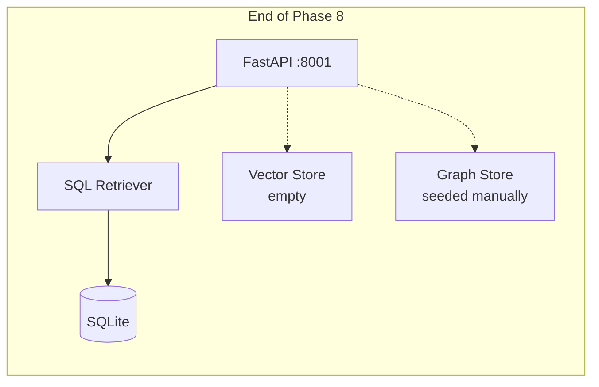
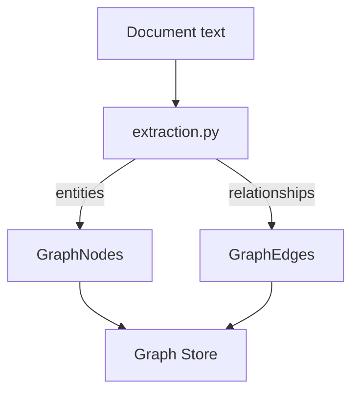
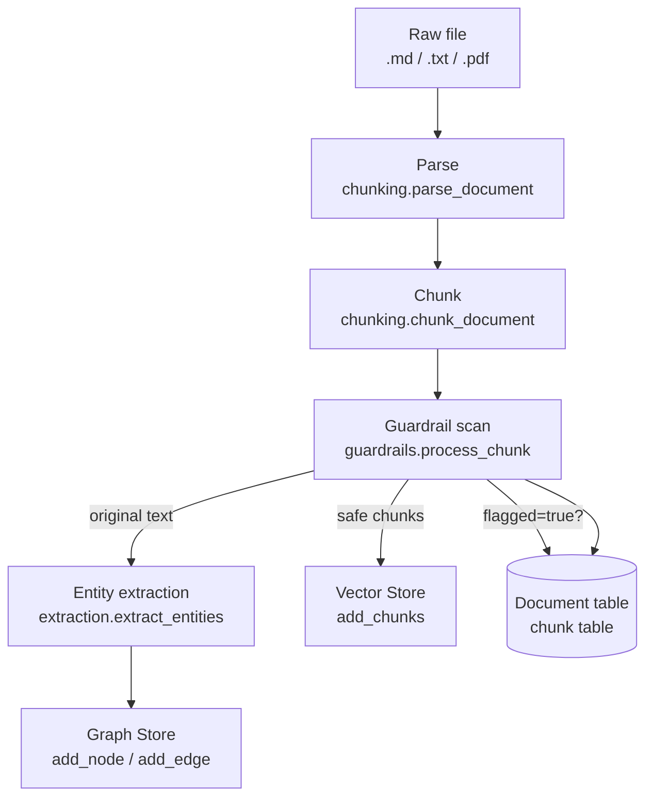
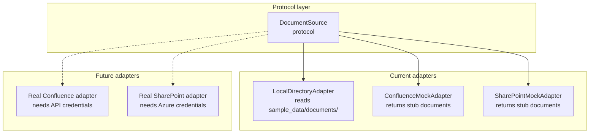
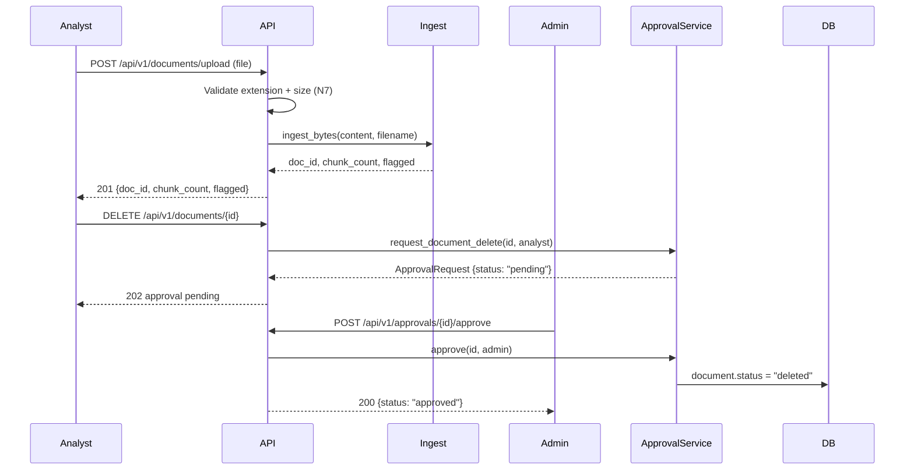
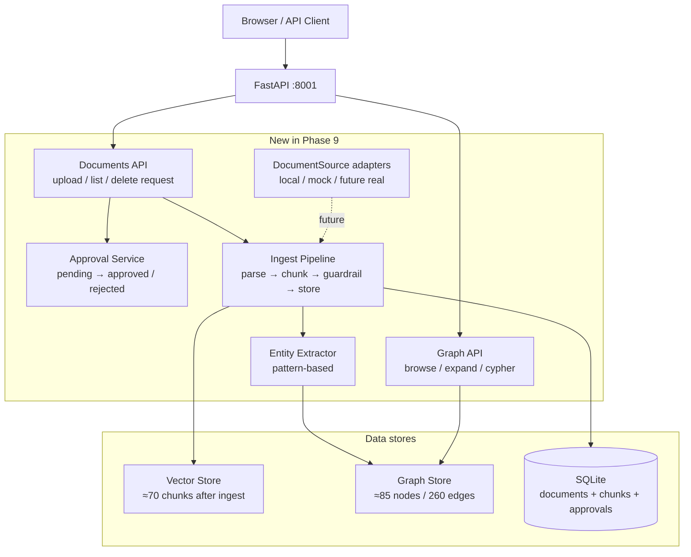

# Phase 9 — System Design Evolution: Ingestion and Document Management

## Starting point (end of Phase 8)

After Phase 8, the system could retrieve information from three stores using read-only SQL queries. But the vector store and graph store contained no real document data — there was no pipeline to get documents *into* the system. The system was query-ready but had no content to query.



The vector store was empty. The graph store could only be populated by running `make seed-graph` manually.

---

## Step 1 — Entity extraction layer (P9-1)

The first addition is a pattern-based extractor that reads document text and finds references to known entities: incident IDs like `INC-2031`, service names like `Payments API`, team names like `Payments Platform Team`, and ADR IDs like `ADR-001`.



The extractor uses regular expressions, not an LLM, so it works offline with `LLM_PROVIDER=fake`. It is intentionally conservative: a missed entity is safer than a wrong relationship.

---

## Step 2 — Ingest pipeline (P9-2)

The ingest pipeline is the core of Phase 9. It orchestrates all the steps needed to take a raw file and make it searchable.



Each step has a specific responsibility and can fail independently:
- If the guardrail flags a chunk, the redacted version is stored (not the original)
- If the vector store fails, the error is logged but the pipeline continues
- If a graph edge is a duplicate, the error is silently ignored

---

## Step 3 — Integration protocol layer (P9-3)

The system is designed to eventually pull documents from external tools. We define a `DocumentSource` protocol that any adapter must implement, and ship three mock adapters for testing.



The demo never requires the real adapters. All tests pass with the mock adapters.

---

## Step 4 — Documents HTTP API and approval service (P9-4, P9-5)

The documents API exposes the ingest pipeline over HTTP and enforces role-based access.



The document is never deleted immediately. The two-step approval gate (F17) means no data can be lost without a human review.

---

## Step 5 — Knowledge graph API (P9-6)

The final addition is the API that lets users browse the knowledge graph directly.

```mermaid
graph LR
    subgraph "HTTP routes"
        STATS[GET /graph/stats]
        NODES[GET /graph/nodes]
        NODE[GET /graph/nodes/{id}]
        EXPAND[GET /graph/nodes/{id}/neighbors]
        CYPHER[POST /graph/cypher]
    end
    subgraph "Graph store"
        GS[MemoryGraphStore\nor Neo4j]
    end
    STATS --> GS
    NODES --> GS
    NODE --> GS
    EXPAND --> GS
    CYPHER -->|read-only check| GS
```

The Cypher endpoint validates that the query contains no write operations before executing it. If you try `CREATE`, `MERGE`, `DELETE`, or `SET`, you get a 422 error immediately.

---

## Final architecture (end of Phase 9)



The system now has a complete content pipeline. Documents can be uploaded, ingested, and retrieved. The knowledge graph is enriched from document text in addition to the seed data. All destructive operations are gated behind admin approval.
